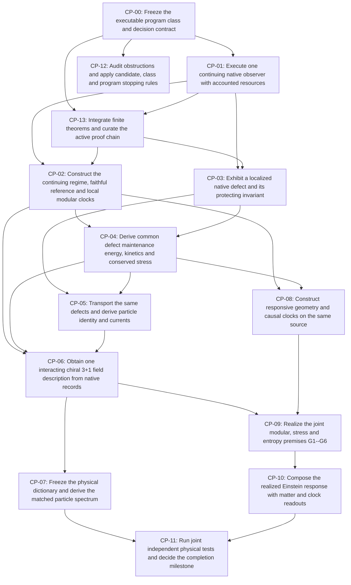

# Executable OPH completion program

Generated by `tools/build_completion_program.py` from [`claims/completion_program.json`](../claims/completion_program.json).

Coordination: [#1134](https://github.com/FloatingPragma/observer-patch-holography/issues/1134). Physical target: [the executable hypothesis](OPH_EXECUTABLE_HYPOTHESIS.md).

**One native repair/memory process must supply the observer clocks, defect/maintenance-energy mechanism, interacting field/particle description and realized Einstein premises together.** Component benchmarks retain their own contracts; they cannot be pooled into that realization.

Program: `OPH-EXECUTABLE-COMPLETION-2026-10-28`. Boundary: `NOT_FROZEN`. Decision: `NOT_DECIDED`. No integrated gate is accepted by opening an issue.

## Existing foundations to extend

The integrated gates remain open, but the program starts from retained positive constructions. The rows below link to existing canonical claims; they are reuse/navigation bindings, not new proof-discharge assertions. Preserve these capabilities while constructing the missing joins.

| Foundation | Achieved component | Remaining join | Builds into |
| --- | --- | --- | --- |
| Native rank-three slow response and intrinsic carrier geometry | The uniform native repair mean selects a normalized rank-three Gram band; exact quotient, proper-action and completion results connect it to the carrier response and signed records. | This is a response/metric result, not a physical position or a complete 3+1 field theory. Finite nonconstant modes remain; the limiting normalization and calibration schedule matter. | CP-03, CP-08, CP-13 |
| Candidate observer clocks with an implemented modular-flow relation | Finite faithful-reference preparation and active modular histories provide continuing clock/readout constructions. On the declared Gibbs product branch, modular flow equals the rescaled Hamiltonian flow and clocked field measurements share that reference. | Reference/access choice, compiled controls and branch-specific clock conversion remain explicit. Passive repair, every regional modular flow and a physical laboratory duration are not thereby identified. | CP-02, CP-04, CP-09 |
| Common native field generator and conditional 3+1 Lorentzian field readout | The refining native screen has a common positive continuum operator. A declared radial product builds on that response structure and supports one smooth static 1+3 scalar description of finite admissible joint clock, field and response menus at any positive tolerance. | The native screen has spectral dimension two. Rank three of the local slow band alone does not derive three spatial field dimensions; radial interval/filter, encoded fields, action, active controls and units retain their stated inputs. The claim is conditional and does not supply the Standard Model continuum. | CP-06, CP-08, CP-13 |
| Interacting field projections and same-reference modular measurement histories | A finite coupled matter/link/scalar source and a separate same-product quartic projection execute complete quantum records and feedback, with occupation bounds and declared Gibbs/modular readout histories. | The supplied actions, projected spatial modes, coupling, temperature and access services keep their own contracts. These constructions are reusable interaction and observation machinery, not a single source-derived chiral Standard Model. | CP-01, CP-04, CP-06 |
| Finite conditional Einstein tensor-completion kernel | The finite theorem chain composes the stated null-balance and conservation premises into the Einstein tensor relation up to the metric term; source-direction tomography supplies a finite completeness witness on its stated carrier. | One source tower realizing the geometric modular/stress/entropy and scale hypotheses remains required. Proving this implication does not establish physical gravity or a quantum graviton. | CP-09, CP-10, CP-13 |

In particular, retain the modular-clock candidate and the conditional 3+1 field construction based on the native response structure. The slow band's rank three and the native screen's spectral dimension two are distinct facts; the supplied radial extension remains part of that field construction's contract.

## Next work and dependencies

Start with CP-00. It must identify the law/resource/interpretation class whose complete exclusion would stop this program. Component investigations can continue provisionally; their results cannot discharge a dependent gate without the predecessor mappings. CP-12 audits every stage in parallel once the program boundary is fixed.

| Gate | Research task | Dependency readiness | Issue |
| --- | --- | --- | --- |
| CP-00 | Freeze the executable program class and decision contract | Ready to start | [#1135](https://github.com/FloatingPragma/observer-patch-holography/issues/1135) |
| CP-01 | Execute one continuing native observer with accounted resources | Awaiting CP-00 | [#1136](https://github.com/FloatingPragma/observer-patch-holography/issues/1136) |
| CP-13 | Integrate finite theorems and curate the active proof chain | Awaiting CP-00, CP-01 | [#1137](https://github.com/FloatingPragma/observer-patch-holography/issues/1137) |
| CP-02 | Construct the continuing regime, faithful reference and local modular clocks | Awaiting CP-01, CP-13 | [#1138](https://github.com/FloatingPragma/observer-patch-holography/issues/1138) |
| CP-03 | Exhibit a localized native defect and its protecting invariant | Awaiting CP-01, CP-13 | [#1139](https://github.com/FloatingPragma/observer-patch-holography/issues/1139) |
| CP-04 | Derive common defect maintenance energy, kinetics and conserved stress | Awaiting CP-02, CP-03 | [#1140](https://github.com/FloatingPragma/observer-patch-holography/issues/1140) |
| CP-05 | Transport the same defects and derive particle identity and currents | Awaiting CP-03, CP-04 | [#1141](https://github.com/FloatingPragma/observer-patch-holography/issues/1141) |
| CP-06 | Obtain one interacting chiral 3+1 field description from native records | Awaiting CP-02, CP-04, CP-05 | [#1142](https://github.com/FloatingPragma/observer-patch-holography/issues/1142) |
| CP-07 | Freeze the physical dictionary and derive the matched particle spectrum | Awaiting CP-06 | [#1143](https://github.com/FloatingPragma/observer-patch-holography/issues/1143) |
| CP-08 | Construct responsive geometry and causal clocks on the same source | Awaiting CP-02, CP-04 | [#1144](https://github.com/FloatingPragma/observer-patch-holography/issues/1144) |
| CP-09 | Realize the joint modular, stress and entropy premises G1--G6 | Awaiting CP-06, CP-08 | [#1145](https://github.com/FloatingPragma/observer-patch-holography/issues/1145) |
| CP-10 | Compose the realized Einstein response with matter and clock readouts | Awaiting CP-09 | [#1146](https://github.com/FloatingPragma/observer-patch-holography/issues/1146) |
| CP-11 | Run joint independent physical tests and decide the completion milestone | Awaiting CP-07, CP-10 | [#1147](https://github.com/FloatingPragma/observer-patch-holography/issues/1147) |
| CP-12 | Audit obstructions and apply candidate, class and program stopping rules | Awaiting CP-00 | [#1148](https://github.com/FloatingPragma/observer-patch-holography/issues/1148) |

The arrows are research acceptance dependencies, not a new theorem entailment graph. The existing [claim graph](../claims/dependency_graph.json) continues to record theorem/claim dependencies.

## Decisions and stopping

| Verdict | Evidence needed | Consequence |
| --- | --- | --- |
| Candidate rejection | A replayable failure of the specified law/state/access/readout contract | Stop that candidate and retain its result |
| Class obstruction | A proof covering every realization in an explicitly quantified subclass | Stop that class; list remaining admitted classes |
| Whole-program falsification | Verified contradiction in indispensable premises, exclusion of every frozen realization of a required join, or an unavoidable independently excluded prediction | Stop the frozen program; any premise/class change starts a new version |
| Inconclusive | Open maps, incomplete coverage or an unsuccessful finite search | No confirmation and no impossibility claim |
| Resource/value stop | A declared budget or return threshold is reached | A research stop, not scientific falsification |

The boundary is **not frozen**, so no whole-program exclusion is claimed. Broad closure alone does not guarantee this specific C/E candidate, and an indefinitely enlarged escape class cannot be declared exhausted. Freezing CP-00 makes the tested formulation and its possible rejection explicit. Changing it never erases an earlier verdict.

Every obstruction records target revision, mandatory premises, quantified class, evidence and independent check, coverage, surviving escape routes and the exact consequence. Issue closure alone is not scientific acceptance. The registry validator checks structure and artifact custody, not the truth of a mathematical proof or a physical interpretation.

## Gate contracts

### CP-00: Freeze the executable program class and decision contract

Owner: [#1135](https://github.com/FloatingPragma/observer-patch-holography/issues/1135). Status: `OPEN`. Requires: none. Hypothesis obligations: EMH-1, EMH-2, EMH-3, EMH-4, EMH-5.

A versioned, content-bound class of admissible carrier/refinement, repair and memory laws, record instruments, resources, preparations, clocks and interpretation maps; one target and exposure record fixed before validation.

Acceptance:

- Distinguish fixed C/E law, permitted quantum record implementations and any explicitly bounded alternative-law family; enumerate what may vary and why.
- Declare observable domains, Standard Model/neutrino and gravity targets, allowed calibrations, P/N ancestry, uncertainty, prediction rules, computational budgets and success/stop thresholds.
- Provide the actual source interface and resource boundary; separate the first field/particle/gravity milestone from unfulfilled full-Universe and internal-closure obligations.
- Bind all retained failures and prior empirical exposure. Record a new program version for any later change of mandatory premises or admissible class.

Obstruction/stopping test: If the declared class is empty or jointly inconsistent, prove that exclusion. An unbounded unspecified escape class makes a whole-program no-go unarmed; an unfinished freeze is not confirmation or falsification.

Retained starting evidence:

- [CANDIDATES.md](../model/CANDIDATES.md)
- [CONSTRUCTION.md](../model/CONSTRUCTION.md)
- [INTERPRETATION_AND_TERMS.md](../docs/INTERPRETATION_AND_TERMS.md)

Earlier related work: [#1076](https://github.com/FloatingPragma/observer-patch-holography/issues/1076), [#1078](https://github.com/FloatingPragma/observer-patch-holography/issues/1078), [#1026](https://github.com/FloatingPragma/observer-patch-holography/issues/1026).

### CP-01: Execute one continuing native observer with accounted resources

Owner: [#1136](https://github.com/FloatingPragma/observer-patch-holography/issues/1136). Status: `OPEN`. Requires: CP-00. Hypothesis obligations: EMH-1, EMH-2.

One replayable native repair/memory process that prepares, acts, reads, retains records and continues on overlapping accessible regions, with every service and failure branch accounted.

Acceptance:

- Use the frozen carrier, complete record instruments and law; specify state, controls, scheduler and memory update before testing.
- Construct or explicitly count coherent resources, ancillas, initialization, read/write, retention, feedback, timeout and recovery services; do not hide supplied fields or clocks.
- Verify complete classical/quantum outputs including untouched references, interventions, failures and continuation; give the declared growth/refinement and resource bounds.
- Prove every theorem premise assigned to this gate on the actual model and retained domain; bind the state, algebra, operations, clock and refinement maps in the existing premise ledger before invoking the conclusion.
- Retain the original #1077 q=3 common-code scalar preparation/history as unexecuted, with its mathematical/resource bounds. Complete it if adopted, or explicitly retire it from the active program through CP-00/CP-13 without relabeling it executed or obstructed.

Obstruction/stopping test: A source-access, coherence, retention or resource impossibility rejects the tested implementation class. Escalate to the whole frozen program only if CP-12 proves that every admitted implementation is covered.

Retained starting evidence:

- [README.md](../model/observer/README.md)
- [DERIVATION.md](../model/common_source/DERIVATION.md)
- [README.md](../model/native_interface/README.md)

Earlier related work: [#1077](https://github.com/FloatingPragma/observer-patch-holography/issues/1077), [#1076](https://github.com/FloatingPragma/observer-patch-holography/issues/1076), [#1026](https://github.com/FloatingPragma/observer-patch-holography/issues/1026).

### CP-13: Integrate finite theorems and curate the active proof chain

Owner: [#1137](https://github.com/FloatingPragma/observer-patch-holography/issues/1137). Status: `OPEN`. Requires: CP-00, CP-01. Hypothesis obligations: EMH-1, EMH-2, EMH-3, EMH-4.

A theorem-to-model integration and relevance review in the existing premise map: each result needed by the completion chain has an owning gate and an explicit model-premise proof obligation; irrelevant branches leave the active path.

Acceptance:

- Start from the existing theorem guides, claim registry and model premise map; inspect actual statements, domains, quantifiers and proof dependencies rather than matching names or abstract dimensions.
- For each required theorem specify its native state/algebra/operation/clock/refinement interface and which gate must prove every premise on the same process. Compatibility must be specified independently of the update; distinguish runtime/source checks from mathematical entailment.
- Classify results as realized on the claimed domain, required but conditional, alternative-branch, redundant, irrelevant to this completion target, or needing correction. Preserve a model counterexample or verified witness for exclusions and claimed instantiations.
- Remove redundant/irrelevant results from active derivation and headline routes. Archive/deprecate with provenance when appropriate; delete only after caller/import, claim, receipt and publication checks. Correct false statements openly and preserve frozen evidence.
- Gate acceptance here establishes the reviewed map and cleanup, not discharge of future physical premises. The owning construction gates must later prove and bind their assigned premises before invoking each theorem.

Obstruction/stopping test: A required premise combination with no admissible common realization routes to CP-12. An unused theorem is not a no-go; a false theorem refutes its statement, and becomes a whole-program obstruction only if indispensable premises or every allowed realization are thereby excluded.

Retained starting evidence:

- [PREMISES.md](../model/PREMISES.md)
- [premise_register.json](../tracking/premise_register.json)
- [claim_registry.yaml](../claims/claim_registry.yaml)
- [README.md](../Lean/README.md)

Earlier related work: [#1033](https://github.com/FloatingPragma/observer-patch-holography/issues/1033), [#1026](https://github.com/FloatingPragma/observer-patch-holography/issues/1026), [#1078](https://github.com/FloatingPragma/observer-patch-holography/issues/1078).

### CP-02: Construct the continuing regime, faithful reference and local modular clocks

Owner: [#1138](https://github.com/FloatingPragma/observer-patch-holography/issues/1138). Status: `OPEN`. Requires: CP-01, CP-13. Hypothesis obligations: EMH-1.

A same-process reference/state regime, observer algebras and implemented modular histories with compatible local clock and energy normalization maps.

Acceptance:

- Exhibit reference preparation, support/faithfulness, continuing regime, accessible algebras and regional compatibility.
- Distinguish passive repair, dimensionless modular flow, event counts and physical duration; retain tracial-reference and compressed-algebra controls.
- Derive local clock comparisons and the common normalization used by energy and propagation; preserve full records, disturbance and resource errors.
- Prove every theorem premise assigned to this gate on the actual model and retained domain; bind the state, algebra, operations, clock and refinement maps in the existing premise ledger before invoking the conclusion.

Obstruction/stopping test: Prove whether the frozen preparation/access grammar forces trivial modular action, incompatible regional flows or no admissible physical clock map. A failed chosen reference alone is a candidate obstruction.

Retained starting evidence:

- [README.md](../model/native_modular_reference/README.md)
- [THERMAL_CLOCK.md](../model/common_source/THERMAL_CLOCK.md)
- [modular_covariance.py](../model/common_source/modular_covariance.py)

Earlier related work: [#1077](https://github.com/FloatingPragma/observer-patch-holography/issues/1077), [#1026](https://github.com/FloatingPragma/observer-patch-holography/issues/1026).

### CP-03: Exhibit a localized native defect and its protecting invariant

Owner: [#1139](https://github.com/FloatingPragma/observer-patch-holography/issues/1139). Status: `OPEN`. Requires: CP-01, CP-13. Hypothesis obligations: EMH-3.

An actual native state/observable sector with a localized core, reference-like exterior and a boundary charge invariant under the full admitted repair law.

Acceptance:

- Define the configuration or quantum/history sector, boundary transport, deformation class and invariant independently of a target mass.
- Prove autonomous protection or a controlled lifetime with all seams and branches retained; disclose active recovery and finite-size assumptions.
- Retain the exact transient-collision and irreducible classical-shell controls. Check quantum and record sectors separately before making a universal exclusion.
- Prove every theorem premise assigned to this gate on the actual model and retained domain; bind the state, algebra, operations, clock and refinement maps in the existing premise ledger before invoking the conclusion.

Obstruction/stopping test: An exhaustive invariant/localization no-go over every sector and allowed refinement in the frozen defect class stops that mechanism. The existing classical and collision-subspace exclusions do not exhaust arbitrary quantum/history sectors.

Retained starting evidence:

- [native_defect_decision.py](../model/common_source/native_defect_decision.py)
- [native_defect_decision_results.json](../model/common_source/native_defect_decision_results.json)
- [OPH_FIELD_RECONSTRUCTION.md](../docs/research/OPH_FIELD_RECONSTRUCTION.md)

Earlier related work: [#1026](https://github.com/FloatingPragma/observer-patch-holography/issues/1026), [#1078](https://github.com/FloatingPragma/observer-patch-holography/issues/1078).

### CP-04: Derive common defect maintenance energy, kinetics and conserved stress

Owner: [#1140](https://github.com/FloatingPragma/observer-patch-holography/issues/1140). Status: `OPEN`. Requires: CP-02, CP-03. Hypothesis obligations: EMH-1, EMH-3, EMH-4.

One intrinsic action/energy and kinetic response for the same defect, with reference subtraction, clock normalization and an independently justified stress/Ward identity.

Acceptance:

- Derive rather than fit how defect maintenance changes rest energy; distinguish action, energy, entropy production, event counts and host work.
- Extract energy and kinetic terms from one process; test moving/rest responses with a common signal speed and no species-dependent conversion.
- Supply interaction energy accounting, reference/cutoff dependence and the stress/conservation map that gravity will consume.
- Prove every theorem premise assigned to this gate on the actual model and retained domain; bind the state, algebra, operations, clock and refinement maps in the existing premise ledger before invoking the conclusion.

Obstruction/stopping test: A proved inability to define a common positive physical energy/kinetic/stress dictionary in the frozen class, or a mandatory incompatibility between maintenance and propagation, is an obstruction; a scalar code cost or failed ansatz is narrower.

Retained starting evidence:

- [kinetic_response.py](../model/common_source/particle_identification/kinetic_response.py)
- [native_defect_decision.py](../model/common_source/native_defect_decision.py)
- [OPH_FIELD_RECONSTRUCTION.md](../docs/research/OPH_FIELD_RECONSTRUCTION.md)

Earlier related work: [#1026](https://github.com/FloatingPragma/observer-patch-holography/issues/1026), [#1078](https://github.com/FloatingPragma/observer-patch-holography/issues/1078).

### CP-05: Transport the same defects and derive particle identity and currents

Owner: [#1141](https://github.com/FloatingPragma/observer-patch-holography/issues/1141). Status: `OPEN`. Requires: CP-03, CP-04. Hypothesis obligations: EMH-3, EMH-2.

The same native excitations carry charges, spin/statistics, family structure, gauge-current couplings and allowed creation, fusion, annihilation and decay.

Acceptance:

- Construct actual transport and charge conservation on the native state/process, with leakage and recovery bounds.
- Show the physical accessible current content and matter lift, including extra modes and chirality; do not identify equivalent internal and spatial representations by name alone.
- Distinguish stable defects, metastable/internal excitations and massless collective/transport modes; derive their observable and interaction maps on one law.
- Prove every theorem premise assigned to this gate on the actual model and retained domain; bind the state, algebra, operations, clock and refinement maps in the existing premise ledger before invoking the conclusion.

Obstruction/stopping test: Incompatible required charge/spin/statistics/current/transport structures exclude the covered defect realization. A 17-versus-12 response mismatch excludes its grammar, not every admissible current law.

Retained starting evidence:

- [native_gauge_object.py](../model/common_source/native_gauge_object.py)
- [native_sm_current.py](../model/common_source/native_sm_current.py)
- [native_matter_attachment.py](../model/common_source/native_matter_attachment.py)
- [DERIVATION.md](../model/observer_particles/DERIVATION.md)

Earlier related work: [#1026](https://github.com/FloatingPragma/observer-patch-holography/issues/1026), [#1078](https://github.com/FloatingPragma/observer-patch-holography/issues/1078).

### CP-06: Obtain one interacting chiral 3+1 field description from native records

Owner: [#1142](https://github.com/FloatingPragma/observer-patch-holography/issues/1142). Status: `OPEN`. Requires: CP-02, CP-04, CP-05. Hypothesis obligations: EMH-2, EMH-3.

A refining same-process observation law with a nontrivial interacting chiral 3+1-dimensional effective field description and controlled detector/intervention correspondence.

Acceptance:

- Prove the declared continuum or effective-domain comparison for complete observable laws, with locality, quantum correlations, positivity/unitarity and controlled errors.
- Retain every taste, chirality, dark mode and residue until a derived decoupling/removal map is supplied; obtain kinetic, Higgs and current responses jointly.
- Keep the full photon-containing theory gapless; state separate massive thresholds, confinement observables, infrared and resonance conventions, and any pure Yang--Mills gap domain.
- Prove every theorem premise assigned to this gate on the actual model and retained domain; bind the state, algebra, operations, clock and refinement maps in the existing premise ledger before invoking the conclusion.

Obstruction/stopping test: A covered chirality, locality, positivity, continuum or interaction no-go stops the frozen realization class. A supplied scalar product, finite free symbol or pole list alone does not pass this gate.

Retained starting evidence:

- [record_two_point.py](../model/common_source/chiral_candidate/record_two_point.py)
- [spectral_response.py](../model/observer_particles/spectral_response.py)
- [CONSTRUCTION.md](../model/CONSTRUCTION.md)

Earlier related work: [#1026](https://github.com/FloatingPragma/observer-patch-holography/issues/1026), [#1078](https://github.com/FloatingPragma/observer-patch-holography/issues/1078).

### CP-07: Freeze the physical dictionary and derive the matched particle spectrum

Owner: [#1143](https://github.com/FloatingPragma/observer-patch-holography/issues/1143). Status: `OPEN`. Requires: CP-06. Hypothesis obligations: EMH-3, EMH-5.

A source-selected spectrum, mixing and interaction packet in compatible physical conventions, using the same defects, energy, kinetics and observer clocks.

Acceptance:

- Bind source/law/decoder revisions, empirical ancestry, matching scheme and scale, all inputs, covariance, theory uncertainty and trial count before the eligible comparison.
- Derive the charged benchmark of nine running Yukawas and four CKM parameters together; specify neutrino and unstable/confined-sector obligations without calling charged-sector closure complete.
- Test reference, regulator and volume dependence and common physical units; retain calibration controls and all failed mechanisms without assembling a spectrum from separate benchmarks.
- Prove every theorem premise assigned to this gate on the actual model and retained domain; bind the state, algebra, operations, clock and refinement maps in the existing premise ledger before invoking the conclusion.

Obstruction/stopping test: A wrong unavoidable matched spectrum with an independently justified error budget rejects the fixed candidate, and the whole class only if all permitted nuisance/source choices are excluded. Known-data calibration alone is not independent validation.

Retained starting evidence:

- [OPH_PARTICLE_MASS_RESPONSE.md](../docs/research/OPH_PARTICLE_MASS_RESPONSE.md)
- [ledger.yaml](../code/particles/ledger.yaml)
- [POSTDICTION_LEDGER.md](../docs/POSTDICTION_LEDGER.md)

Earlier related work: [#1026](https://github.com/FloatingPragma/observer-patch-holography/issues/1026), [#1025](https://github.com/FloatingPragma/observer-patch-holography/issues/1025).

### CP-08: Construct responsive geometry and causal clocks on the same source

Owner: [#1144](https://github.com/FloatingPragma/observer-patch-holography/issues/1144). Status: `OPEN`. Requires: CP-02, CP-04. Hypothesis obligations: EMH-4.

A common source-derived effective event, causal and geometry dictionary that responds to the same matter/energy perturbations and admits the required refinement.

Acceptance:

- Construct the effective Lorentzian domain, compatible observer directions, local clock comparisons and count/volume/length maps with controlled errors.
- Derive geometry response to admitted matter changes rather than supplying a static metric or an independent fitted gravitational source.
- Retain the static radial-product null-balance failure and distinguish finite rank-three carrier geometry from physical 3+1 event geometry.
- Prove every theorem premise assigned to this gate on the actual model and retained domain; bind the state, algebra, operations, clock and refinement maps in the existing premise ledger before invoking the conclusion.

Obstruction/stopping test: A mandatory incompatibility between source geometry, clocks and nonzero matter stress excludes the covered common realization. Failure of the static radial product is a scoped control, not a universal gravity no-go.

Retained starting evidence:

- [PHYSICAL_AUDIT.md](../model/PHYSICAL_AUDIT.md)
- [README.md](../model/physical_space_time/README.md)
- [COMMON_MATTER_METRIC_AND_RESPONSE.tex](../paper/tex_fragments/COMMON_MATTER_METRIC_AND_RESPONSE.tex)

Earlier related work: [#1026](https://github.com/FloatingPragma/observer-patch-holography/issues/1026), [#1078](https://github.com/FloatingPragma/observer-patch-holography/issues/1078).

### CP-09: Realize the joint modular, stress and entropy premises G1--G6

Owner: [#1145](https://github.com/FloatingPragma/observer-patch-holography/issues/1145). Status: `OPEN`. Requires: CP-06, CP-08. Hypothesis obligations: EMH-4.

A premise-by-premise same-tower witness for geometric modular flow, common conserved stress, entropy/area normalization and fixed-proper-volume generalized-entropy stationarity.

Acceptance:

- Bind G1--G6 to the actual common state, law, algebras, geometry, matter stress, observer clocks and refinement maps.
- Derive the edge-center entropy split, modular first law, positive Newton normalization and geometric/state variation with controlled small-ball remainders and enough directions.
- Show the relevant joint stationarity, beyond a stationary Markov law, Gibbs reference or conditional Shannon entropy; retain native entropy and bare-area negative controls.
- Prove every theorem premise assigned to this gate on the actual model and retained domain; bind the state, algebra, operations, clock and refinement maps in the existing premise ledger before invoking the conclusion.

Obstruction/stopping test: Prove that a necessary entropy sign, modular/stress normalization or stationarity variation is incompatible across all allowed same-process realizations before promoting a no-go. An unmet theorem premise is an open gate, not a theorem failure.

Retained starting evidence:

- [recovering_observer_spacetime_and_einstein_dynamics_from_overlap_consistency.tex](../paper/recovering_observer_spacetime_and_einstein_dynamics_from_overlap_consistency.tex)
- [from_observer_consensus_to_standard_physics.tex](../flagship/from_observer_consensus_to_standard_physics.tex)
- [PHYSICAL_AUDIT.md](../model/PHYSICAL_AUDIT.md)

Earlier related work: [#1026](https://github.com/FloatingPragma/observer-patch-holography/issues/1026), [#1078](https://github.com/FloatingPragma/observer-patch-holography/issues/1078).

### CP-10: Compose the realized Einstein response with matter and clock readouts

Owner: [#1146](https://github.com/FloatingPragma/observer-patch-holography/issues/1146). Status: `OPEN`. Requires: CP-09. Hypothesis obligations: EMH-4.

A common matter/geometry model that actually instantiates null balance and tensor completion and predicts its coupled coarse-scale gravitational response.

Acceptance:

- Apply the existing conditional Einstein theorem with a checked map for every premise; do not replace the missing realization by reproving the tensor identity.
- Obtain the Einstein equation up to its cosmological term, one positive Newton constant and universal coupling of the same defect maintenance energy/stress.
- Propagate finite/refinement errors into gravitational observations. Keep a possible quantum spin-two graviton separate from the classical theorem and Standard Model content.
- Prove every theorem premise assigned to this gate on the actual model and retained domain; bind the state, algebra, operations, clock and refinement maps in the existing premise ledger before invoking the conclusion.

Obstruction/stopping test: A genuine counterexample satisfying every theorem premise refutes the affected implication. A necessary failure of joint gravitational response can exclude the frozen program only with CP-12 coverage of the admissible class.

Retained starting evidence:

- [recovering_observer_spacetime_and_einstein_dynamics_from_overlap_consistency.tex](../paper/recovering_observer_spacetime_and_einstein_dynamics_from_overlap_consistency.tex)
- [from_observer_consensus_to_standard_physics.tex](../flagship/from_observer_consensus_to_standard_physics.tex)

Earlier related work: [#1026](https://github.com/FloatingPragma/observer-patch-holography/issues/1026), [#1078](https://github.com/FloatingPragma/observer-patch-holography/issues/1078).

### CP-11: Run joint independent physical tests and decide the completion milestone

Owner: [#1147](https://github.com/FloatingPragma/observer-patch-holography/issues/1147). Status: `OPEN`. Requires: CP-07, CP-10. Hypothesis obligations: EMH-5.

One frozen physical dictionary survives independent field, particle and gravity observations over its declared regime, or receives a scoped rejection.

Acceptance:

- Compare complete joint/conditional laws and intervention responses, not an aggregate of separate fitted observables; preserve all calibration and exposure ancestry.
- Use predeclared rejection rules, eligible data, nuisance ranges, covariance and physical theory errors; report discrepancies and distinguishing alternatives.
- State exactly which completion obligations are met and which broader cosmological, quantum-gravity or internal-closure obligations remain. No simulated output counts as a new physical confirmation.
- Prove every theorem premise assigned to this gate on the actual model and retained domain; bind the state, algebra, operations, clock and refinement maps in the existing premise ledger before invoking the conclusion.

Obstruction/stopping test: Reject the fixed formulation when its unavoidable prediction fails a valid frozen comparison. A whole-class empirical exclusion requires every admitted realization/nuisance choice to fail; a resource stop is a separate research decision.

Retained starting evidence:

- [OPH_FALSIFICATION_PROGRAM.md](../docs/OPH_FALSIFICATION_PROGRAM.md)
- [PUBLIC_DATA_PREDICTION_AUDIT.md](../docs/research/PUBLIC_DATA_PREDICTION_AUDIT.md)
- [FROZEN_PREDICTION_LADDER.md](../docs/FROZEN_PREDICTION_LADDER.md)

Earlier related work: [#1025](https://github.com/FloatingPragma/observer-patch-holography/issues/1025), [#1078](https://github.com/FloatingPragma/observer-patch-holography/issues/1078).

### CP-12: Audit obstructions and apply candidate, class and program stopping rules

Owner: [#1148](https://github.com/FloatingPragma/observer-patch-holography/issues/1148). Status: `OPEN`. Requires: CP-00. Hypothesis obligations: EMH-1, EMH-2, EMH-3, EMH-4, EMH-5.

A continuing obstruction review across every gate, with exact scope, class coverage, independent checks and an explicit stop/continue verdict. The broad obstruction search #1078 remains open and owns that continuing research; this gate applies its scoped evidence to the new program decisions.

Acceptance:

- For every exclusion record target version, mandatory premises, quantified class, evidence, independently checked coverage, surviving escape routes and consequence.
- Promote to whole-program falsification only for a verified contradiction in indispensable premises, a proof excluding every frozen realization of a required join, or an unavoidable independently excluded prediction.
- Keep mathematical theorem error, candidate failure, class no-go, empirical rejection, inconclusive search and budget/value stop distinct. Changing the class starts a new program version and retains the original verdict.
- Run in parallel once CP-00 is fixed; reject circular mappings, hidden supplied services and combinations of incompatible benchmark branches throughout the DAG.

Obstruction/stopping test: The current program has no universal falsification verdict. No-go coverage must quantify over the frozen class; a finite unsuccessful search, open map or exhausted budget supplies no impossibility proof.

Retained starting evidence:

- [OPH_FALSIFICATION_PROGRAM.md](../docs/OPH_FALSIFICATION_PROGRAM.md)
- [OPH_EXECUTABLE_HYPOTHESIS.md](../docs/OPH_EXECUTABLE_HYPOTHESIS.md)
- [native_defect_decision_results.json](../model/common_source/native_defect_decision_results.json)

Earlier related work: [#1078](https://github.com/FloatingPragma/observer-patch-holography/issues/1078), [#1033](https://github.com/FloatingPragma/observer-patch-holography/issues/1033).

## Working organization

Issues #1025, #1026, #1076 and #1077 are superseded by the new completion owners and closed as not planned, not as scientifically completed. Their evidence and unfinished contracts remain linked. The ongoing audit #1033 and broad obstruction search #1078 stay open. Live observer code, tests and retained results stay in `model/`; the existing particle code and theorem library keep their scientific ownership. Do not move or rewrite frozen packets to make the navigation look simpler.

New work identifies its CP gate, fixed contract, nearest existing result, actual model/theorem map, falsifier and preservation checks. Prefer the smallest exact counterexample or native witness before larger runs. A supplied benchmark is evidence only for its stated conditional task. Each accepted gate needs a retained, source-bound result and the explicit join to its accepted predecessors.

The generated [postdiction ledger](POSTDICTION_LEDGER.md) carries the hypothesis and program custody without adding a physical comparison. The [falsification program](OPH_FALSIFICATION_PROGRAM.md) retains its claim/branch-specific rejection rules and the stronger scope required for whole-program decisions.
