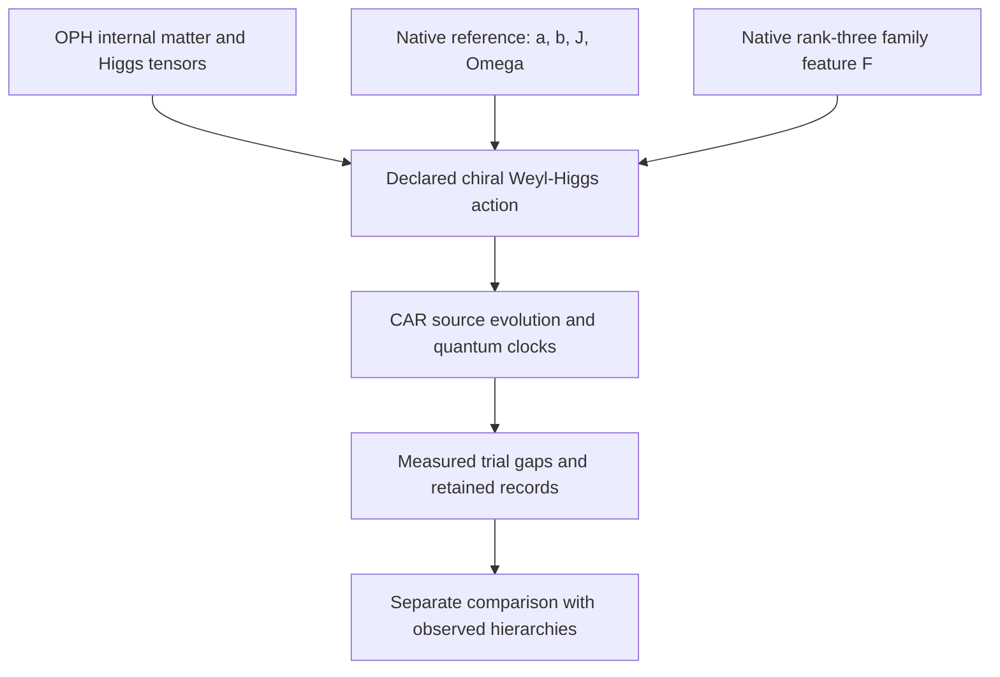

# OPH chiral Weyl–Higgs candidate: derivation, clocked response and hierarchy tests

**Research note — 26 October 2026. Unreleased candidate construction.**

This note describes a concrete OPH-compatible chiral matter architecture and
what its executable tests establish. It combines the existing internal
matter representation, verified Higgs interaction tensors and a native
family-dependent operator. Its fixed-Higgs-background fermion sector is
executed as a 90-mode CAR system, with a continuing source-clock experiment
that reads three charged rest gaps.

The candidate has the minimal Standard Model's chiral fermion representation
types and the expected Weyl–Higgs dispersion. **Its chosen mass prescription
does not reproduce measured particle hierarchies.** Three fixed nonlinear
comparison prescriptions also fail the joint charged-lepton hierarchy test.
No observed particle spectrum, complete interacting Standard Model, or
theory of gravity is claimed as derived by this construction.

The implementation and retained evidence are in
[the candidate package](../../model/common_source/chiral_candidate/README.md),
[its receipt](../../model/common_source/chiral_candidate/results.json) and
[its quantum-state artifact](../../model/common_source/chiral_candidate/results.npz).
The equations below explain their construction independently of the code.

## 1. The question being tested

An earlier [continuing response experiment](../../model/common_source/mass_response/README.md)
joined a finite charged gap, interactions, neighboring-site response and
quantum-clock measurements in one history. A subsequent
[operator-response audit](../../model/common_source/particle_identification/README.md)
showed that this gap has nonzero CAR spectral residue and can be read by an
even, charge-conserving transfer instrument. It also classified the separate
eight-component free continuum extension as two degenerate Dirac copies.

That establishes a charged fermionic response in the tested model. It does
not give the Standard Model's chiral charge assignments. The next question
was whether the existing OPH matter and Higgs results could supply those
assignments to an explicit propagating field, with masses measured against
the same clock convention.

This candidate answers the representation and finite execution parts of
that question. It also supplies a direct mass test that rejects the simplest
trial coupling map.

## 2. Source inputs and construction choices

The calculation has three independent inputs: an internal representation,
a prepared native reference and a native spatial response band. Their
combination into a coherent action is a declared architecture choice.



### 2.1 Internal matter and Higgs channels

The existing
[representation decoder](../../model/observer_particles/representation_identification.py)
recovers the nonvacuum even exterior module

\[
\mathcal M_{15}=\Lambda^2(\mathbb C^5)\oplus\Lambda^4(\mathbb C^5)
               =\mathbf{10}\oplus\bar{\mathbf5},
\]

under its stated source-linked lift. Its five joint charge/Casimir blocks
are the following, in **all-left Weyl notation**:

| Internal field type | \((SU(3),SU(2),Y)\) | Internal dimension |
| --- | --- | ---: |
| \(Q\) | \((3,2,1/6)\) | 6 |
| \(u^c\) | \((\bar3,1,-2/3)\) | 3 |
| \(d^c\) | \((\bar3,1,1/3)\) | 3 |
| \(L\) | \((1,2,-1/2)\) | 2 |
| \(e^c\) | \((1,1,1)\) | 1 |

Here \(Q_{\rm electric}=T_3+Y\). The superscript \(c\) denotes the
left-handed charge conjugate of a right-handed singlet. Those signs matter
when forming both masses and currents. The minimal module contains a left
neutrino and no independent right-neutrino singlet.

The existing
[one-Higgs construction](../../model/observer_particles/unified_yukawa_action.py)
supplies a single \(H=(1,2,1/2)\), its conjugate, and exact invariant tensors
for the channels

\[
Q u^c H,\qquad Q d^c H^*,\qquad L e^c H^*.
\]

The new action uses these tensors directly and rechecks their current
covariance and anomaly traces. The internal representation is conditional
on the stated lift; its existence does not force a unique field action or
choose Yukawa coefficients. The
[Standard Model comparison map](../../model/common_source/particle_identification/SM_MATCH.md)
records the precise existing theorem and ledger dependencies. For physical
conventions, see the [PDG electroweak review](https://pdg.lbl.gov/2025/reviews/rpp2025-rev-standard-model.pdf);
its hypercharge variable is twice the \(Y\) used here.

### 2.2 Exact native reference coefficients

The [public reference producer](../../model/native_modular_reference/local_preparation.py)
defines an ideal faithful distribution on 66 binary configurations with
total native load two. A distinguished two-port core has occupation
\(q=0,1,2\), multiplicities \(45,20,1\), and respective weights **per
configuration**

\[
(w_0,w_1,w_2)=\left(\frac{2}{225},\frac1{36},\frac2{45}\right).
\]

The logarithmic source statistics used in the candidate are

\[
\begin{aligned}
a&=\log(w_1/w_0)=\log(25/8),\\
b&=\log(w_2/w_1)=\log(8/5),\\
J&=\log\frac{w_1^2}{w_0w_2}=\log(125/64)=a-b,\\
\Omega&=\log(w_2/w_0)=\log5=a+b.
\end{aligned}
\]

For the two core occupations, the modular generator \(K=-\log\sigma\) can
be written as a constant plus \(-a(n_0+n_1)+J n_0n_1\). These coefficients do not
themselves create a propagating Weyl Hamiltonian. Assigning them to the
coherent channels below is part of the architecture being tested.

This calculation consumes the **exact ideal reference target**. It does
not execute a finite native warmup or propagate its preparation error.
The protected core, coherent controls, blank states and clock calibration
are declared operational inputs.

### 2.3 A native family symmetry breaker

The prepared reference is not invariant under the full carrier rotation
group. Its one-body occupation means are

\[
\mathbb E[n_i]=
\begin{cases}
29/90,&i\text{ in the two-port core},\\
61/450,&i\text{ outside it}.
\end{cases}
\]

Let \(B\) span the actual selected rank-three native slow band and
\(G=B^T B\). Compressing the occupation matrix gives

\[
F=G^{-1}B^T\operatorname{diag}(\mathbb E[n_i])B.
\]

The [exact producer](../../model/common_source/particle_identification/family_attachment.py)
obtains three distinct positive eigenvalues:

\[
\lambda_1=\frac{61}{450},\qquad
\lambda_{2,3}=\frac{41}{225}\mp\frac{7\sqrt5}{750}.
\]

They are approximately \(0.135556,0.161352,0.203092\). The calculation
checks all 60 rotation-covariance identities, explicitly transports the
different native and retained-family port charts, and obtains the exact
group average \(I_3/6\).

This supplies a concrete nonscalar native family operator. The earlier
unbroken-family theorem, whose invariant commutant is scalar, remains
correct: its full-invariance hypothesis is absent for this prepared
reference. Physical family interpretation and a coupling to masses remain
additional attachments. The protected-core preparation has not thereby
selected the electron, muon and tau basis.

## 3. The declared Weyl–Higgs action

The candidate uses two left spin components, 15 internal components and
three native family axes: **90 complex CAR modes** in one momentum block.
The trial family matrices and neutral background are

\[
Y_u=aF,\qquad Y_d=bF,\qquad Y_e=JF,\qquad
H=(0,v),\quad v=\Omega.
\]

The kinetic coordinate speed is chosen as \(c=\Omega/2\). The value \(v\)
is the neutral component norm in this convention, not an independently
derived electroweak scale in GeV.

Using the verified Higgs tensors produces a symmetric 45-dimensional
all-left internal mass kernel \(K\). With
\(\epsilon=i\sigma_2\), the real-background creation pairing is

\[
\Delta=\epsilon\otimes K,\qquad \Delta^T=-\Delta.
\]

The transpose antisymmetry is required by CAR. In particular, a Dirac mass
is formed through the appropriate Higgs line and charge-conjugated singlet;
it is not inserted directly between unrelated gauge representations.
The neutral background preserves the assigned electric charge.

For left fields \(\chi\), the kinetic symbol is

\[
h(p)=-c\,\sigma\cdot p\otimes I_{45}.
\]

The opposite-momentum Nambu operator is

\[
\mathcal B(p)=
\begin{pmatrix}
h(p)&\Delta\\
\Delta^\dagger&-h(-p)^T
\end{pmatrix}.
\]

For a general complex action kernel the creation coefficient uses the
corresponding conjugation; the implemented default is real. Spin conjugation
of the hole block gives the standard massive chiral form, with

\[
E_j(p)^2=c^2|p|^2+s_j(K)^2.
\]

Negative Nambu energies are conjugate partners, not extra mirror families.
Counting color and family, the massive channels form **21 charged Dirac
fields**, and the minimal module leaves **three massless left-Weyl neutrinos**.
The latter does not reproduce observed neutrino masses. At zero momentum
the 12 Nambu zero eigenvalues represent six complex CAR zero modes, not
twelve neutrino species.

The [action proof](../../model/common_source/chiral_candidate/ACTION.md) and
[kinetic proof](../../model/common_source/chiral_candidate/KINETIC.md) give
the matrix ordering, signs, count and dispersion checks.

## 4. What establishes chirality in this candidate

All-left notation alone is insufficient to establish a weak-current
discriminator. The implementation reconstructs a weak raising operator
from the actual source current generators and checks its action on the
decoded lepton projectors.

In the massless limit, its total charged-current coupling strength on the
physical charge-minus-one energy branches is one for negative helicity and
zero for positive helicity. With a nonzero trial mass, the weights follow

\[
w_{\mp}=\frac12\left(1\pm\frac{c|p|}{E}\right).
\]

The check uses the complete \(J^\dagger J\) final-state sum; it does not
mistake a same-momentum final-neutrino spin selection for chirality. These
are matrix vertex weights of the declared action, not measured scattering
cross sections. No dynamical \(W\) field is executed. A charged current
drive would need its compensating charged apparatus or gauge field.

## 5. Source execution and the observer clock

### 5.1 Finite CAR computation without a huge Fock vector

The source backend executes native two-mode hopping, pairing and onsite
words on **all four local Fock input columns**. Their completed action on
Majorana operators determines the full finite Gaussian transformation.
Nonadjacent modes use fermionic SWAP routing, including the minus sign on
double occupation. Every routing pulse is counted.

At rest the chosen background separates into 42 charged pair blocks and
six neutral zero modes. All are retained. An initial fermionic wire layout
places the three probed lepton blocks first. Their six-mode Fock factor and
two clocks are also executed literally, with both clock purification
references retained. This independent calculation checks the Gaussian
reduction rather than replacing a missing large-state simulation with an
unsupported assumption.

The finite Gaussian identity concerns completed logical blocks. Individual
processor pulses or intermediate routes need not preserve the physical
charge interpretation. No polar projection, covariance repair, clipping of
probabilities, or selection of successful detector outcomes is applied.
Floating residuals remain diagnostics rather than physical precision bounds.

### 5.2 Continuing measurement protocol

The two clock references have populations \((1/6,5/6)\), contrast
\(r=-2/3\), and modular gap \(\Omega=\log5\). Their parameter is programmed
modular flow; it is not calibrated laboratory seconds.

One history prepares the field and clocks once, advances them for
\(\tau=1/4\), and records three lepton-mode occupations. A committed result
can trigger a neutral phase on another block. The same field and clocks
continue for another \(\tau\), after which a further occupation and two
clock quadratures are read. No field reset occurs. All 64 six-bit terminal
records and the 16 full-field Gaussian conditionals are retained.

For the initial empty-pair apparatus state,

\[
P_i(\text{empty at }\tau)-P_i(\text{occupied at }\tau)
=\cos(2m_i\tau).
\]

The final clock quadratures recover

\[
\theta=\operatorname{atan2}\!\left(
\frac{\langle Y\rangle}{r},\frac{\langle X\rangle}{r}\right)
=2\Omega\tau.
\]

Consequently the observer decoder uses only records, calibration and the
admitted phase branch:

\[
\frac{m_i}{\Omega}
=\frac{\arccos\langle(-1)^{n_i(\tau)}\rangle}{\theta}.
\]

The prior branch condition matters: cosine data cannot exclude arbitrary
frequency aliases. For this trial, exact elementary bounds give
\(J<1\), \(\Omega<2\), \(\max\lambda(F)<1/4\), hence
\(2m_i\tau<1/4<\pi\). The decoder does not consult the hidden Hamiltonian
or simulator duration to obtain the displayed ratios.

The recovered ratios, in **native family-axis order**, are

| Native axis | Measured trial \(m_i/\Omega\) |
| --- | ---: |
| 0 | 0.1080141452 |
| 1 | 0.1359561376 |
| 2 | 0.0907450442 |

The source and independent continuous probe outputs agree at numerical
residuals of order \(10^{-14}\); full-field and probe probability marginals
agree at order \(10^{-15}\). An independent state-level reduction also
compares all conditional six-mode covariances and clock references.
These are numerical checks, not outward roundoff or physical-service
certificates. Finite-shot confidence and finite native preparation errors
are not included in the point inverse.

The preparation is an apparatus state. It does not show that native repair
prepares the physical interacting vacuum. The measured frequencies agree
with the trial's charged quasiparticle gaps under its stated quadratic and
particle–hole interpretation.

## 6. Relation to observers' effective 3+1D spacetime

There are two distinct levels of attachment.

**At the declared field-description level**, the action is a 3+1D
Lorentzian Weyl–Higgs candidate with the dispersion and chiral representation
above. The prior OPH metric construction also supplies an exact pointwise
comparison: for spatial principal tensor \(A=L L^T\), use coordinate
principal momentum \(q=L^T p\). For the retained metric with lapse \(N\),
proper orthonormal spatial momentum is \(\hat p=q/N\). The Weyl principal
symbol then shares the scalar characteristic cone. The native four-component
Clifford matrices can be put into chiral form by

\[
W=\frac1{\sqrt2}\begin{pmatrix}I&-I\\I&I\end{pmatrix},\qquad
W\alpha_jW^\dagger=\operatorname{diag}(-\sigma_j,+\sigma_j),\qquad
W\beta W^\dagger=\begin{pmatrix}0&I\\I&0\end{pmatrix}.
\]

A proper mass carries the coordinate lapse factor
\(K_{\rm coordinate}=N K_{\rm proper}\). Clock regraduation must transform
the kinetic, mass and clock rates together.

**At the same reconstructed-history level**, the global attachment is not
complete. The previous source spatial CAR construction uses an incidence
operator with 720 node and 2,850 edge modes, including 2,130 persistent
edge-cycle zero modes. It cannot be identified by a unitary basis change
with a minimal two-component Weyl field on those 720 sites. Discarding the
cycles would discard retained outputs.

There is also a terminology distinction: the earlier scalar effective
description's **Weyl operators are bosonic CCR displacement operators**.
That theorem is not already a theorem about left-Weyl fermions. Its scalar
smoothing controls do not supply the missing chiral spin-connection or
field-state intertwiner.

The old radial domain check gives another concrete requirement: imposing
scalar Dirichlet conditions on every component does not make the first-order
Weyl operator self-adjoint. A spin-compatible domain, boundary conditions,
connection and reference must be supplied and checked. On curved space,
the Dirac square also contains spin-connection and curvature contributions;
it is not simply the scalar spatial operator acting on each component.
The frozen comparison coefficient is not asserted to equal the limiting
native tensor. A common modular reference also needs its state/clock map:
under a time regraduation, \(\beta H\) must remain fixed. One cannot hold
both reference conventions fixed and freely rescale only the field rates.

Thus a shared characteristic cone is available as an exact local
compatibility result. A complete chiral field history on the observers'
recovered spacetime has not been established. The
[existing geometric construction](../../model/observer_particles/geometric_matter_join.py)
and [new attachment check](../../model/common_source/chiral_candidate/spacetime_attachment.py)
state that boundary explicitly.

A finite spectral menu is also not a completed local chiral gauge
regulator. The naive lattice control has eight Weyl nodes with balanced
handedness. Relevant published regulator routes and their hypotheses are
collected in [REGULATOR_ROUTES.md](../../model/common_source/chiral_candidate/REGULATOR_ROUTES.md).

## 7. The hierarchy tests and their outcome

### 7.1 Linear native family map

The three trial Yukawa matrices are proportional to the same \(F\).
Therefore all three charged channels have the same family ratios. The
family spread is strictly below \(3/2\); the spread across **all** charged
tree masses is strictly below \(15/4\). The canonical tree quark mixing is
identity, up to basis ordering and rephasings, with no generated CP phase.

Those are exact exclusions of this trial prescription as an observed
spectrum. A common Higgs scale or a permutation of the modes cannot change
the ratios. This conclusion does not depend on a costly QCD calculation.

### 7.2 Fixed nonlinear controls

To test whether a nonperturbative numerical dependence could amplify the
small native anisotropy, three further prescriptions were fixed without
fitting observed masses. They evaluate the half-filled one-dimensional
Hubbard charge-threshold function with \(t=\Omega/2\) and
\(U=a\lambda_i(F),b\lambda_i(F),J\lambda_i(F)\).

The underlying [Lieb–Wu theorem](https://arxiv.org/html/cond-mat/0207529)
and [positive threshold representation](https://arxiv.org/html/cond-mat/9911281)
support a quadrature-free rational enclosure. Here that function is only a
**declared nonlinear texture prescription**. Its use does not turn a
one-dimensional gap theorem into a three-dimensional dynamical mass theorem.
The very small thresholds are not claimed as resolved measurements in the
finite clock history.

| Prescription | Ascending ratios, lightest normalized to one |
| --- | --- |
| Linear \(F\) | \(1:1.1903:1.4982\) |
| Hubbard function, \(U=a\lambda_i\) | \(1:204.97:65{,}743.94\) |
| Hubbard function, \(U=b\lambda_i\) | \(1:353{,}640.05:3.5494\times10^{11}\) |
| Hubbard function, \(U=J\lambda_i\) | \(1:8{,}075.31:1.3683\times10^8\) |

The source predictions are computed before a separate comparison with the
[PDG lepton summary](https://pdg.lbl.gov/2025/download/db2024.pdf). The charged
leptons require approximately \(1:206.77:3477.23\). The benchmark uses broad
windows \([206,207]\) and \([3470,3485]\), so the rejection is not an argument
about the last measured digit.

**All four fixed prescriptions fail the joint two-ratio test.** The nearby
middle ratio in the first nonlinear control cannot compensate for its much
larger heaviest ratio. No continuous parameter search or empirical mass fit
was performed. Other nonlinear couplings and interacting repair actions are
not excluded by these tests.

## 8. What is established, and what remains

| Item | Result in this candidate |
| --- | --- |
| Internal chiral matter types and Higgs channels | Explicit operators inherited and rechecked under their stated lift |
| Native family-dependent operator | Exact, covariant, nonscalar, with three distinct eigenvalues |
| Weyl/Higgs Spin, charge and dispersion | Checked on the same declared action and Nambu conventions |
| Weak-chirality discriminator | Correct operator vertex weights; no dynamical weak scattering calculation |
| Continuing source readout | Full 90-mode Gaussian field, literal Fock/clock factor, all outcomes retained |
| Charged rest-gap ratios | Read from source records and quantum-clock quadratures |
| Observed mass hierarchy | Fails for every fixed prescription tested here |
| Quantum gauge/Higgs dynamics | Not executed by this fixed-background quadratic trial |
| Local nonperturbative chiral regulator | Not constructed here |
| Same recovered-spacetime field history | Local principal-symbol compatibility; full domain/history attachment open |
| Physical units and observed particle identification | Not established |
| GR entropy stationarity and responsive geometry | No new closure claim from this calculation |

The specific remaining mass problem is to determine and test the
mass-generating coupling of available native family data to the Higgs
channels, their kinetic forms and the physical vacuum. The current example
shows that getting the chiral representation right and computing every
number from a chosen source prescription does not guarantee the measured
hierarchy. A new prescription must earn that agreement through its actual
charged response, including its extra modes and error accounting.

## 9. Reproduction and evidence

From the public repository root, using Python 3.12 and the root
[pinned requirements](../../requirements.txt):

```sh
OPENBLAS_NUM_THREADS=1 OMP_NUM_THREADS=1 .venv/bin/python -m pytest -q model/common_source/chiral_candidate
OPENBLAS_NUM_THREADS=1 OMP_NUM_THREADS=1 .venv/bin/python -u -m model.common_source.chiral_candidate.run --output /tmp/chiral-candidate.json
.venv/bin/python -m model.common_source.chiral_candidate.run --verify model/common_source/chiral_candidate/results.json
```

The replay requires fresh JSON and companion NPZ paths and refuses to
overwrite them. The NPZ retains all literal source work/reference outputs
and the complete Gaussian conditional descriptors with their separate branch
weights. Verification checks source custody and retained state/weight
consistency; it does not rerun the dynamics.

The retained calculation binds the source code, native reference, exact
representation and interaction artifacts, and prior response evidence.
Exact algebra, rational interval certificates and floating execution checks
remain distinct forms of support. All existing r2053 source and artifact
bytes are preserved; this research note and candidate are additions.
