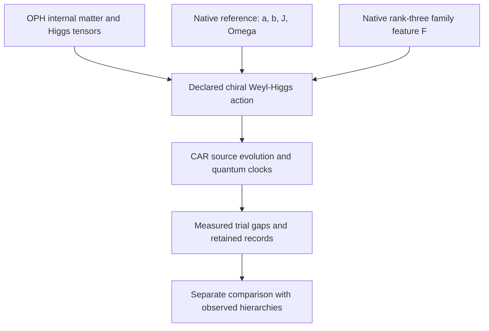

# OPH particle mass response and hierarchy audit

**Current research report.** This single report collects the declared chiral
Weyl–Higgs candidate, the hierarchy diagnosis, and the full repair response
audit. Its calculations and retained outputs are in the linked model packages.
The measured Standard Model mass hierarchy has **not** been recovered. The
physical charged field and its dynamics have not yet been derived from a
native continuing repair history.

- [Candidate construction](#candidate-construction)
- [Hierarchy diagnosis](#hierarchy-diagnosis)
- [Full repair response](#full-repair-response)

## Candidate construction

This section describes a concrete OPH-compatible chiral matter architecture and
what its executable tests establish. It combines the existing internal
matter representation, verified Higgs interaction tensors and a native
family-dependent operator. Its fixed-Higgs-background fermion sector is
executed as a 90-mode CAR system, with a continuing source-clock experiment
that reads three charged rest gaps.

The candidate has the minimal Standard Model's chiral fermion representation
types and the expected Weyl–Higgs dispersion. **Its chosen mass prescription
does not reproduce measured particle hierarchies.** Three fixed nonlinear
comparison prescriptions also fail the joint charged-lepton hierarchy test.
No observed particle spectrum, complete interacting Standard Model, or
theory of gravity is claimed as derived by this construction.

The implementation and retained evidence are in
[the candidate package](../../model/common_source/chiral_candidate/README.md),
[its receipt](../../model/common_source/chiral_candidate/results.json) and
[its quantum-state artifact](../../model/common_source/chiral_candidate/results.npz).
The equations below explain their construction independently of the code.

### 1. The question being tested

An earlier [continuing response experiment](../../model/common_source/mass_response/README.md)
joined a finite charged gap, interactions, neighboring-site response and
quantum-clock measurements in one history. A subsequent
[operator-response audit](../../model/common_source/particle_identification/README.md)
showed that this gap has nonzero CAR spectral residue and can be read by an
even, charge-conserving transfer instrument. It also classified the separate
eight-component free continuum extension as two degenerate Dirac copies.

That establishes a charged fermionic response in the tested model. It does
not give the Standard Model's chiral charge assignments. The next question
was whether the existing OPH matter and Higgs results could supply those
assignments to an explicit propagating field, with masses measured against
the same clock convention.

This candidate answers the representation and finite execution parts of
that question. It also supplies a direct mass test that rejects the simplest
trial coupling map.

### 2. Source inputs and construction choices

The calculation has three independent inputs: an internal representation,
a prepared native reference and a native spatial response band. Their
combination into a coherent action is a declared architecture choice.



#### 2.1 Internal matter and Higgs channels

The existing
[representation decoder](../../model/observer_particles/representation_identification.py)
recovers the nonvacuum even exterior module

```math
\mathcal M_{15}=\Lambda^2(\mathbb C^5)\oplus\Lambda^4(\mathbb C^5)
               =\mathbf{10}\oplus\bar{\mathbf5},
```

under its stated source-linked lift. Its five joint charge/Casimir blocks
are the following, in **all-left Weyl notation**:

| Internal field type | $(SU(3),SU(2),Y)$ | Internal dimension |
| --- | --- | ---: |
| $Q$ | $(3,2,1/6)$ | 6 |
| $u^c$ | $(\bar3,1,-2/3)$ | 3 |
| $d^c$ | $(\bar3,1,1/3)$ | 3 |
| $L$ | $(1,2,-1/2)$ | 2 |
| $e^c$ | $(1,1,1)$ | 1 |

Here $Q_{\rm electric}=T_3+Y$. The superscript $c$ denotes the
left-handed charge conjugate of a right-handed singlet. Those signs matter
when forming both masses and currents. The minimal module contains a left
neutrino and no independent right-neutrino singlet.

The existing
[one-Higgs construction](../../model/observer_particles/unified_yukawa_action.py)
supplies a single $H=(1,2,1/2)$, its conjugate, and exact invariant tensors
for the channels

```math
Q u^c H,\qquad Q d^c H^*,\qquad L e^c H^*.
```

The new action uses these tensors directly and rechecks their current
covariance and anomaly traces. The internal representation is conditional
on the stated lift; its existence does not force a unique field action or
choose Yukawa coefficients. The
[Standard Model comparison map](../../model/common_source/particle_identification/SM_MATCH.md)
records the precise existing theorem and ledger dependencies. For physical
conventions, see the [PDG electroweak review](https://pdg.lbl.gov/2025/reviews/rpp2025-rev-standard-model.pdf);
its hypercharge variable is twice the $Y$ used here.

#### 2.2 Exact native reference coefficients

The [public reference producer](../../model/native_modular_reference/local_preparation.py)
defines an ideal faithful distribution on 66 binary configurations with
total native load two. A distinguished two-port core has occupation
$q=0,1,2$, multiplicities $45,20,1$, and respective weights **per
configuration**

```math
(w_0,w_1,w_2)=\left(\frac{2}{225},\frac1{36},\frac2{45}\right).
```

The logarithmic source statistics used in the candidate are

```math
\begin{aligned}
a&=\log(w_1/w_0)=\log(25/8),\\
b&=\log(w_2/w_1)=\log(8/5),\\
J&=\log\frac{w_1^2}{w_0w_2}=\log(125/64)=a-b,\\
\Omega&=\log(w_2/w_0)=\log5=a+b.
\end{aligned}
```

For the two core occupations, the modular generator $K=-\log\sigma$ can
be written as a constant plus $-a(n_0+n_1)+J n_0n_1$. These coefficients do not
themselves create a propagating Weyl Hamiltonian. Assigning them to the
coherent channels below is part of the architecture being tested.

This calculation consumes the **exact ideal reference target**. It does
not execute a finite native warmup or propagate its preparation error.
The protected core, coherent controls, blank states and clock calibration
are declared operational inputs.

#### 2.3 A native family symmetry breaker

The prepared reference is not invariant under the full carrier rotation
group. Its one-body occupation means are

```math
\mathbb E[n_i]=
\begin{cases}
29/90,&i\text{ in the two-port core},\\
61/450,&i\text{ outside it}.
\end{cases}
```

Let $B$ span the actual selected rank-three native slow band and
$G=B^T B$. Compressing the occupation matrix gives

```math
F=G^{-1}B^T\operatorname{diag}(\mathbb E[n_i])B.
```

The [exact producer](../../model/common_source/particle_identification/family_attachment.py)
obtains three distinct positive eigenvalues:

```math
\lambda_1=\frac{61}{450},\qquad
\lambda_{2,3}=\frac{41}{225}\mp\frac{7\sqrt5}{750}.
```

They are approximately $0.135556,0.161352,0.203092$. The calculation
checks all 60 rotation-covariance identities, explicitly transports the
different native and retained-family port charts, and obtains the exact
group average $I_3/6$.

This supplies a concrete nonscalar native family operator. The earlier
unbroken-family theorem, whose invariant commutant is scalar, remains
correct: its full-invariance hypothesis is absent for this prepared
reference. Physical family interpretation and a coupling to masses remain
additional attachments. The protected-core preparation has not thereby
selected the electron, muon and tau basis.

### 3. The declared Weyl–Higgs action

The candidate uses two left spin components, 15 internal components and
three native family axes: **90 complex CAR modes** in one momentum block.
The trial family matrices and neutral background are

```math
Y_u=aF,\qquad Y_d=bF,\qquad Y_e=JF,\qquad
H=(0,v),\quad v=\Omega.
```

The kinetic coordinate speed is chosen as $c=\Omega/2$. The value $v$
is the neutral component norm in this convention, not an independently
derived electroweak scale in GeV.

Using the verified Higgs tensors produces a symmetric 45-dimensional
all-left internal mass kernel $K$. With
$\epsilon=i\sigma_2$, the real-background creation pairing is

```math
\Delta=\epsilon\otimes K,\qquad \Delta^T=-\Delta.
```

The transpose antisymmetry is required by CAR. In particular, a Dirac mass
is formed through the appropriate Higgs line and charge-conjugated singlet;
it is not inserted directly between unrelated gauge representations.
The neutral background preserves the assigned electric charge.

For left fields $\chi$, the kinetic symbol is

```math
h(p)=-c\,\sigma\cdot p\otimes I_{45}.
```

The opposite-momentum Nambu operator is

```math
\mathcal B(p)=
\begin{pmatrix}
h(p)&\Delta\\
\Delta^\dagger&-h(-p)^T
\end{pmatrix}.
```

For a general complex action kernel the creation coefficient uses the
corresponding conjugation; the implemented default is real. Spin conjugation
of the hole block gives the standard massive chiral form, with

```math
E_j(p)^2=c^2|p|^2+s_j(K)^2.
```

Negative Nambu energies are conjugate partners, not extra mirror families.
Counting color and family, the massive channels form **21 charged Dirac
fields**, and the minimal module leaves **three massless left-Weyl neutrinos**.
The latter does not reproduce observed neutrino masses. At zero momentum
the 12 Nambu zero eigenvalues represent six complex CAR zero modes, not
twelve neutrino species.

The [action proof](../../model/common_source/chiral_candidate/ACTION.md) and
[kinetic proof](../../model/common_source/chiral_candidate/KINETIC.md) give
the matrix ordering, signs, count and dispersion checks.

### 4. What establishes chirality in this candidate

All-left notation alone is insufficient to establish a weak-current
discriminator. The implementation reconstructs a weak raising operator
from the actual source current generators and checks its action on the
decoded lepton projectors.

In the massless limit, its total charged-current coupling strength on the
physical charge-minus-one energy branches is one for negative helicity and
zero for positive helicity. With a nonzero trial mass, the weights follow

```math
w_{\mp}=\frac12\left(1\pm\frac{c|p|}{E}\right).
```

The check uses the complete $J^\dagger J$ final-state sum; it does not
mistake a same-momentum final-neutrino spin selection for chirality. These
are matrix vertex weights of the declared action, not measured scattering
cross sections. No dynamical $W$ field is executed. A charged current
drive would need its compensating charged apparatus or gauge field.

### 5. Source execution and the observer clock

#### 5.1 Finite CAR computation without a huge Fock vector

The source backend executes native two-mode hopping, pairing and onsite
words on **all four local Fock input columns**. Their completed action on
Majorana operators determines the full finite Gaussian transformation.
Nonadjacent modes use fermionic SWAP routing, including the minus sign on
double occupation. Every routing pulse is counted.

At rest the chosen background separates into 42 charged pair blocks and
six neutral zero modes. All are retained. An initial fermionic wire layout
places the three probed lepton blocks first. Their six-mode Fock factor and
two clocks are also executed literally, with both clock purification
references retained. This independent calculation checks the Gaussian
reduction rather than replacing a missing large-state simulation with an
unsupported assumption.

The finite Gaussian identity concerns completed logical blocks. Individual
processor pulses or intermediate routes need not preserve the physical
charge interpretation. No polar projection, covariance repair, clipping of
probabilities, or selection of successful detector outcomes is applied.
Floating residuals remain diagnostics rather than physical precision bounds.

#### 5.2 Continuing measurement protocol

The two clock references have populations $(1/6,5/6)$, contrast
$r=-2/3$, and modular gap $\Omega=\log5$. Their parameter is programmed
modular flow; it is not calibrated laboratory seconds.

One history prepares the field and clocks once, advances them for
$\tau=1/4$, and records three lepton-mode occupations. A committed result
can trigger a neutral phase on another block. The same field and clocks
continue for another $\tau$, after which a further occupation and two
clock quadratures are read. No field reset occurs. All 64 six-bit terminal
records and the 16 full-field Gaussian conditionals are retained.

For the initial empty-pair apparatus state,

```math
P_i(\text{empty at }\tau)-P_i(\text{occupied at }\tau)
=\cos(2m_i\tau).
```

The final clock quadratures recover

```math
\theta=\operatorname{atan2}\!\left(
\frac{\langle Y\rangle}{r},\frac{\langle X\rangle}{r}\right)
=2\Omega\tau.
```

Consequently the observer decoder uses only records, calibration and the
admitted phase branch:

```math
\frac{m_i}{\Omega}
=\frac{\arccos\langle(-1)^{n_i(\tau)}\rangle}{\theta}.
```

The prior branch condition matters: cosine data cannot exclude arbitrary
frequency aliases. For this trial, exact elementary bounds give
$J<1$, $\Omega<2$, $\max\lambda(F)<1/4$, hence
$2m_i\tau<1/4<\pi$. The decoder does not consult the hidden Hamiltonian
or simulator duration to obtain the displayed ratios.

The recovered ratios, in **native family-axis order**, are

| Native axis | Measured trial $m_i/\Omega$ |
| --- | ---: |
| 0 | 0.1080141452 |
| 1 | 0.1359561376 |
| 2 | 0.0907450442 |

The source and independent continuous probe outputs agree at numerical
residuals of order $10^{-14}$; full-field and probe probability marginals
agree at order $10^{-15}$. An independent state-level reduction also
compares all conditional six-mode covariances and clock references.
These are numerical checks, not outward roundoff or physical-service
certificates. Finite-shot confidence and finite native preparation errors
are not included in the point inverse.

The preparation is an apparatus state. It does not show that native repair
prepares the physical interacting vacuum. The measured frequencies agree
with the trial's charged quasiparticle gaps under its stated quadratic and
particle–hole interpretation.

### 6. Relation to observers' effective 3+1D spacetime

There are two distinct levels of attachment.

**At the declared field-description level**, the action is a 3+1D
Lorentzian Weyl–Higgs candidate with the dispersion and chiral representation
above. The prior OPH metric construction also supplies an exact pointwise
comparison: for spatial principal tensor $A=L L^T$, use coordinate
principal momentum $q=L^T p$. For the retained metric with lapse $N$,
proper orthonormal spatial momentum is $\hat p=q/N$. The Weyl principal
symbol then shares the scalar characteristic cone. The native four-component
Clifford matrices can be put into chiral form by

```math
W=\frac1{\sqrt2}\begin{pmatrix}I&-I\\I&I\end{pmatrix},\qquad
W\alpha_jW^\dagger=\operatorname{diag}(-\sigma_j,+\sigma_j),\qquad
W\beta W^\dagger=\begin{pmatrix}0&I\\I&0\end{pmatrix}.
```

A proper mass carries the coordinate lapse factor
$K_{\rm coordinate}=N K_{\rm proper}$. Clock regraduation must transform
the kinetic, mass and clock rates together.

**At the same reconstructed-history level**, the global attachment is not
complete. The previous source spatial CAR construction uses an incidence
operator with 720 node and 2,850 edge modes, including 2,130 persistent
edge-cycle zero modes. It cannot be identified by a unitary basis change
with a minimal two-component Weyl field on those 720 sites. Discarding the
cycles would discard retained outputs.

There is also a terminology distinction: the earlier scalar effective
description's **Weyl operators are bosonic CCR displacement operators**.
That theorem is not already a theorem about left-Weyl fermions. Its scalar
smoothing controls do not supply the missing chiral spin-connection or
field-state intertwiner.

The old radial domain check gives another concrete requirement: imposing
scalar Dirichlet conditions on every component does not make the first-order
Weyl operator self-adjoint. A spin-compatible domain, boundary conditions,
connection and reference must be supplied and checked. On curved space,
the Dirac square also contains spin-connection and curvature contributions;
it is not simply the scalar spatial operator acting on each component.
The frozen comparison coefficient is not asserted to equal the limiting
native tensor. A common modular reference also needs its state/clock map:
under a time regraduation, $\beta H$ must remain fixed. One cannot hold
both reference conventions fixed and freely rescale only the field rates.

Thus a shared characteristic cone is available as an exact local
compatibility result. A complete chiral field history on the observers'
recovered spacetime has not been established. The
[existing geometric construction](../../model/observer_particles/geometric_matter_join.py)
and [new attachment check](../../model/common_source/chiral_candidate/spacetime_attachment.py)
state that boundary explicitly.

A finite spectral menu is also not a completed local chiral gauge
regulator. The naive lattice control has eight Weyl nodes with balanced
handedness. Relevant published regulator routes and their hypotheses are
collected in [REGULATOR_ROUTES.md](../../model/common_source/chiral_candidate/REGULATOR_ROUTES.md).

### 7. The hierarchy tests and their outcome

#### 7.1 Linear native family map

The three trial Yukawa matrices are proportional to the same $F$.
Therefore all three charged channels have the same family ratios. The
family spread is strictly below $3/2$; the spread across **all** charged
tree masses is strictly below $15/4$. The canonical tree quark mixing is
identity, up to basis ordering and rephasings, with no generated CP phase.

Those are exact exclusions of this trial prescription as an observed
spectrum. A common Higgs scale or a permutation of the modes cannot change
the ratios. This conclusion does not depend on a costly QCD calculation.

#### 7.2 Fixed nonlinear controls

To test whether a nonperturbative numerical dependence could amplify the
small native anisotropy, three further prescriptions were fixed without
fitting observed masses. They evaluate the half-filled one-dimensional
Hubbard charge-threshold function with $t=\Omega/2$ and
$U=a\lambda_i(F),b\lambda_i(F),J\lambda_i(F)$.

The underlying [Lieb–Wu theorem](https://arxiv.org/html/cond-mat/0207529)
and [positive threshold representation](https://arxiv.org/html/cond-mat/9911281)
support a quadrature-free rational enclosure. Here that function is only a
**declared nonlinear texture prescription**. Its use does not turn a
one-dimensional gap theorem into a three-dimensional dynamical mass theorem.
The very small thresholds are not claimed as resolved measurements in the
finite clock history.

| Prescription | Ascending ratios, lightest normalized to one |
| --- | --- |
| Linear $F$ | $1:1.1903:1.4982$ |
| Hubbard function, $U=a\lambda_i$ | $1:204.97:65{,}743.94$ |
| Hubbard function, $U=b\lambda_i$ | $1:353{,}640.05:3.5494\times10^{11}$ |
| Hubbard function, $U=J\lambda_i$ | $1:8{,}075.31:1.3683\times10^8$ |

The source predictions are computed before a separate comparison with the
[PDG lepton summary](https://pdg.lbl.gov/2025/download/db2024.pdf). The charged
leptons require approximately $1:206.77:3477.23$. The benchmark uses broad
windows $[206,207]$ and $[3470,3485]$, so the rejection is not an argument
about the last measured digit.

**All four fixed prescriptions fail the joint two-ratio test.** The nearby
middle ratio in the first nonlinear control cannot compensate for its much
larger heaviest ratio. No continuous parameter search or empirical mass fit
was performed. Other nonlinear couplings and interacting repair actions are
not excluded by these tests.

### 8. What is established, and what remains

| Item | Result in this candidate |
| --- | --- |
| Internal chiral matter types and Higgs channels | Explicit operators inherited and rechecked under their stated lift |
| Native family-dependent operator | Exact, covariant, nonscalar, with three distinct eigenvalues |
| Weyl/Higgs Spin, charge and dispersion | Checked on the same declared action and Nambu conventions |
| Weak-chirality discriminator | Correct operator vertex weights; no dynamical weak scattering calculation |
| Continuing source readout | Full 90-mode Gaussian field, literal Fock/clock factor, all outcomes retained |
| Charged rest-gap ratios | Read from source records and quantum-clock quadratures |
| Observed mass hierarchy | Fails for every fixed prescription tested here |
| Quantum gauge/Higgs dynamics | Not executed by this fixed-background quadratic trial |
| Local nonperturbative chiral regulator | Not constructed here |
| Same recovered-spacetime field history | Local principal-symbol compatibility; full domain/history attachment open |
| Physical units and observed particle identification | Not established |
| GR entropy stationarity and responsive geometry | No new closure claim from this calculation |

The specific remaining mass problem is to determine and test the
mass-generating coupling of available native family data to the Higgs
channels, their kinetic forms and the physical vacuum. The current example
shows that getting the chiral representation right and computing every
number from a chosen source prescription does not guarantee the measured
hierarchy. A new prescription must earn that agreement through its actual
charged response, including its extra modes and error accounting.

### 9. Reproduction and evidence

From the public repository root, using Python 3.12 and the root
[pinned requirements](../../requirements.txt):

```sh
OPENBLAS_NUM_THREADS=1 OMP_NUM_THREADS=1 .venv/bin/python -m pytest -q model/common_source/chiral_candidate
OPENBLAS_NUM_THREADS=1 OMP_NUM_THREADS=1 .venv/bin/python -u -m model.common_source.chiral_candidate.run --output /tmp/chiral-candidate.json
.venv/bin/python -m model.common_source.chiral_candidate.run --verify model/common_source/chiral_candidate/results.json
```

The replay requires fresh JSON and companion NPZ paths and refuses to
overwrite them. The NPZ retains all literal source work/reference outputs
and the complete Gaussian conditional descriptors with their separate branch
weights. Verification checks source custody and retained state/weight
consistency; it does not rerun the dynamics.

The retained calculation binds the source code, native reference, exact
representation and interaction artifacts, and prior response evidence.
Exact algebra, rational interval certificates and floating execution checks
remain distinct forms of support. All existing r2053 source and artifact
bytes are preserved; the candidate and subsequent audit are additions.


## Hierarchy diagnosis

The immediate failure is in the candidate's **mass-generating prescription**.
The observer reads the implemented quadratic action correctly, but that
action makes masses proportional to a nearly degenerate occupation feature.
Its fixed Higgs background supplies no further interaction that could turn
those coefficients into the measured hierarchy. This diagnoses a rejected
architecture, not a contradiction of every OPH construction.

This diagnosis extends the
[candidate construction](#candidate-construction).
The underlying source dynamics and retained quantum-state artifact are the
same ones used in that construction.
New exact calculations, tests and the reproducible diagnosis are in
[hierarchy_diagnosis](../../model/common_source/hierarchy_diagnosis/README.md).

### 1. Locate the failure before changing the readout

The declared action uses

```math
Y_u=aF,\qquad Y_d=bF,\qquad Y_e=JF,\qquad H=(0,v),\quad v=\Omega.
```

Here the native source computes

```math
a=\log(25/8),\quad b=\log(8/5),\quad J=a-b,\quad\Omega=a+b,
```

and the eigenvalues of the actual family feature are

```math
f_1=\frac{61}{450},\qquad
f_2=\frac{41}{225}-\frac{7\sqrt5}{750},\qquad
f_3=\frac{41}{225}+\frac{7\sqrt5}{750}.
```

The step that turns this occupation feature into a left–right mass coupling
is a declared choice. The source derivation of $F$, internal chiral
representation and invariant Higgs tensors does not prove that
$Y_e=JF$ is the physical coupling.

With canonical kinetic terms the charged-lepton mass parameters are
$m_i=vJf_i$. Their ascending ratios are approximately
$1:1.1903:1.4982$. The retained clock records independently recover those
same ratios. The observed target is approximately $1:206.77:3477.23$;
the audit uses the much wider windows $[206,207]$ and $[3470,3485]$,
so experimental uncertainty is immaterial to this exclusion. These are
comparison inputs only. See the PDG
[muon](https://pdgweb.lbl.gov/2025/listings/rpp2025-list-muon.pdf) and
[tau](https://pdg.lbl.gov/2025/listings/rpp2025-list-tau.pdf) listings.

The current 90-mode field law is quadratic in CAR operators once the Higgs
background is fixed. The earlier four-mode response construction had an
explicit density–density interaction. The current chiral extension uses
the number $J$ as a coefficient of a bilinear pairing; it does not retain
that four-mode interacting dynamics as a field interaction. Nor does it
execute quantum Higgs or gauge fluctuations. A logarithmic statistic from
the native reference is not, by itself, a derivation of a fermion self-energy.

Consequently there is no uncomputed many-body mass enhancement inside this
particular quadratic Hamiltonian. Its dispersion is already exactly
$E_i(p)^2=c^2|p|^2+m_i^2$. A genuinely interacting extension could change
that conclusion, but would be a new dynamics to derive and test.

### 2. The clock, pair factor and vacuum cannot repair this action

For a selected rest pair the implemented Hamiltonian is

```math
H_d=d\,a^\dagger b^\dagger+d^*ba.
```

Its four Fock energies are $-|d|,0,0,+|d|$. A charged odd-CAR excitation
above its ground state costs $|d|$, whereas an initially empty pair has
occupation oscillation frequency $2|d|$. The observer inverse already
accounts for this factor of two. The normal CAR response has nonzero
residues at both signed poles; the three family gaps are not hidden by
vanishing detector overlap.

More generally a quadratic Nambu field satisfies

```math
\Xi(t)=e^{-i\mathcal B t}\Xi(0),\qquad
\{\Xi(t),\Xi^\dagger(0)\}=e^{-i\mathcal B t}.
```

Thus the retarded linear-field response has state-independent pole
locations for this fixed law. Changing the reference state can change
other correlation functions and occupations; it cannot create a different
mass spectrum in this response. This statement does not extend to a
state-dependent interacting self-energy. The time parameter here is the
declared coherent model coordinate, compared with the calibrated modular
clock in the retained experiment, not laboratory seconds.

A common lapse, clock regraduation, Higgs normalization or conversion to
physical units multiplies all three masses by the same factor. It leaves
their ratios unchanged. A change of field basis also preserves poles when
both kinetic and mass forms are transformed consistently.
The native band Gram matrix is exactly $(10+2\sqrt5)I_3$, so the
implemented family frame conceals no anisotropic Gram normalization.
Measuring all families at the same nonzero momentum would compress their
energy ratios toward one, not enlarge the rest-mass hierarchy.

### 3. A stronger exclusion: every affine law built from this feature fails

The result is broader than failure of the coefficients $a,b,J$. Let

```math
Y=uI+vF,\qquad u,v\in\mathbb C,
```

with canonical kinetic normalization and one common Higgs factor. Since
$F$ is Hermitian, its complex eigenvalues under this map are
$z_i=u+vf_i$, and the masses are proportional to $|z_i|$.
Writing $\phi=(1+\sqrt5)/2$, the source eigenvalues obey

```math
\frac{f_3-f_1}{f_2-f_1}=\phi^2,
\qquad z_3-\phi^2z_2+\phi z_1=0.
```

The triangle inequality, allowing every assignment of the largest modulus
to the three coefficients, gives the necessary bound

```math
\boxed{m_{\max}\leq\phi^2m_{\mathrm{middle}}+\phi m_{\min}.}
```

To see that it covers every assignment, the absolute coefficients in the
linear relation are $1,\phi,\phi^2$. Placing the largest mass on the
smallest coefficient gives the weakest constraint; assigning the larger
remaining coefficient to the middle mass maximizes its right-hand side.
Any other placement gives a smaller bound. Complex phases do not evade
the triangle inequality.

For the retained broad comparison windows this requires

```math
\frac{m_{\max}}{m_{\min}}
\leq207\phi^2+\phi=543.55106966\ldots,
```

while the observed lower bound is 3470. Therefore **the entire complex
affine class fails**, including arbitrary identity shifts, overall scales,
sign changes and phases. This is an exact exclusion of that class, not a
numerical search.

It also explains why merely changing the same protected-core reference
weights is insufficient. If $w_q$ is the weight per configuration with
core occupation $q$, direct counting gives

```math
\mathbb E[n_{\rm core}]=10w_1+w_2,\qquad
\mathbb E[n_{\rm outer}]=9w_0+2w_1.
```

For the same core and band, its compressed mean is always

```math
(9w_0+2w_1)I+(8w_1+w_2-9w_0)S_{\rm core},
```

where $S_{\rm core}$ is the compressed core projector. The present
$F$ is a nonscalar affine function of that same projector, so this whole
family of mean-based linear prescriptions remains in the excluded class.
This argument does not cover arbitrary changes to the carrier, core type,
observables or interaction law.

### 4. Nonlinearity can amplify masses without fixing their pattern

The three previously tested Hubbard-function textures are fixed
prescriptions, not fits. All amplify the source eigenvalue differences,
but all give the wrong relative spacing:

| Prescription | Middle/light | Heavy/light | Heavy/middle |
| --- | ---: | ---: | ---: |
| Linear $F$ | 1.1903 | 1.4982 | 1.2587 |
| Hubbard function with $U=af_i$ | 204.975 | 65,743.94 | 320.74 |
| Hubbard function with $U=bf_i$ | 353,640.05 | $3.5494\times10^{11}$ | $1.0037\times10^6$ |
| Hubbard function with $U=Jf_i$ | 8,075.31 | $1.3683\times10^8$ | 16,943.78 |
| Observed charged leptons, approximately | 206.77 | 3,477.23 | 16.82 |

The near-middle ratio in the $a$ control is accompanied by a heavy mass
about nineteen times too large after light-mass normalization. A common
scale cannot correct it. A useful scale-independent shape statistic is

```math
Q=\frac{\log(m_3/m_2)}{\log(m_2/m_1)}.
```

The controls give $Q$ near 1.082–1.084, while the broad empirical windows
give approximately 0.529–0.531. Certified rational logarithm bounds make
these intervals disjoint. The wrong *shape*, not inadequate arithmetic
precision, is the issue.

The mechanism is understandable: the weak-coupling one-dimensional
Hubbard threshold contains an exponential in $-1/U$, so using
$U=sf_i$ amplifies the reciprocal eigenvalue spacings in a specific
pattern. The source theorem is for the half-filled one-dimensional
Hubbard chain, as discussed by
[Jeckelmann, Gebhard and Essler](https://arxiv.org/html/cond-mat/9911281).
Its use as a numerical texture does not derive an interacting 3+1D chiral
mass. These fixed tests do not exclude all nonlinear laws or all values
of a continuously varied coupling.

An arbitrary function $f(F)$ is also not a prediction by itself. Since
$F$ has three distinct eigenvalues, quadratic polynomial interpolation
can assign any three target values to them. Those polynomial coefficients
would encode the desired answer unless an independently specified source
law determines them.

### 5. Small normalization corrections cannot hide the discrepancy

Let $r=\kappa_2(M)<3/2$ be the current mass-matrix condition number. For
new positive constant kinetic forms $Z_L,Z_R$, canonical normalization
gives, in the usual Dirac convention,

```math
M_c=Z_L^{-1/2}MZ_R^{-1/2},\qquad
\kappa_2(M_c)\leq r\sqrt{\kappa_2(Z_L)\kappa_2(Z_R)}.
```

The transpose in an all-left convention does not change this norm bound.
Reaching a heavy/light ratio of at least 3470 requires the product of
kinetic condition numbers to exceed $5.35\times10^6$. If both
$\|Z-I\|_2\leq\epsilon<1$, it requires
$\epsilon>6937/6943$, approximately 0.999136.

Similarly, a constant additive mass correction with
$\|\delta M\|_2=\delta\,s_{\min}(M)$, $\delta<1$, obeys

```math
\kappa_2(M+\delta M)\leq\frac{r+\delta}{1-\delta}.
```

The same target requires $\delta>6937/6942$, approximately 0.999280.
These are necessary bounds, not sufficient constructions or claims about
the size of every possible quantum correction. They rule out explanations
that leave the current action almost unchanged in the specified norms.
Strong dynamics, additional fields and momentum-dependent self-energies
remain outside this argument.

### 6. Family structure must be recovered from more than one mean matrix

Every separate function of $F$ shares its eigenvectors. Consequently
$Y_uY_u^\dagger$ and $Y_dY_d^\dagger$ commute when the Yukawa
matrices are functions of this one Hermitian feature. For nondegenerate
masses and canonical common kinetic terms their CKM matrix is trivial
up to phases and permutations. Choosing more elaborate eigenvalue
functions cannot supply physical quark mixing.

The new audit also computes the full connected occupation covariance

```math
C_{ij}=\mathbb E[n_in_j]-\mathbb E[n_i]\mathbb E[n_j]
```

from all 66 configurations. Its full rank is 11, with the single constant
null direction required by fixed total load. Its compression to the actual
three-dimensional band is positive definite, has spread below $5/4$,
and **commutes exactly with $F$**. Thus replacing the mean by this
equal-reference covariance does not produce either a large linear
hierarchy or an independent family basis. This is a computed negative
control, not a claim that every dynamical response is determined by these
two matrices.

There is a further symmetry restriction on using only this stationary
reference. Its native stabilizer contains a half-turn represented on the
family band by $R=\operatorname{diag}(-1,+1,-1)$. Any covariant
endomorphism built solely from that reference and rotation-invariant
carrier data must commute with $R$. For the same family action on both
fermion factors and a family-neutral Higgs, the allowed matrices have a
common two-dimensional block and an unmixed one-dimensional block.
They can support at most two-family mixing, with no three-family CKM
CP violation. This restriction is conditional on those inputs; it is not
a symmetry theorem for every full repair context.

#### The existing update contains information that the stationary feature loses

The actual
[reference preparation](../../model/native_modular_reference/local_preparation.py)
already uses two distinct completion caps, $(0,1,5,7)$ and
$(0,1,2,8)$. The half-turn fixes the first and moves the second. Its full
update context therefore has less symmetry than its stationary reference.
The new
[native response audit](../../model/common_source/hierarchy_diagnosis/native_family_dynamics.py)
uses the existing finite selector and endpoint repair, without adding a
mass-dependent parameter.

It enumerates the reduced outcomes on every one of the 66 binary inputs,
including the selector's terminal timeout. Each accepted outcome retains
its seam, coin, current, output state and exact probability. The timeout
retains unchanged work with a separate terminal flag. The complete
one-proposal mean response is

```math
T=\sum_e w_e E_e+\tau I,
\qquad \sum_e w_e+\tau=1,
```

where $E_e$ averages the two endpoint occupations. Its diagonal native
reference is exactly stationary. With orthonormal band frame
$U=B/\sqrt{10+2\sqrt5}$, define the compressed response
$K=U^TTU$. The calculation finds

```math
[F,K]\ne0,\qquad [R,K]\ne0.
```

All three off-diagonal links of $K$ are nonzero. Since $F$ has simple
eigenvalues, its spectral projectors $P_i$ are polynomials in $F$.
Each $P_iKP_j/K_{ij}$ is a matrix unit. Therefore $F,K$ generate
the full three-by-three matrix algebra, an exact statement rather than a
numerical rank guess.

This is a concrete positive result: **the existing update context supplies
independent family structure omitted by the mean-based mass ansatz**.
It does not select Yukawa matrices or predict mixing angles. These
retained matrices are real and do not by themselves derive a physical
CP phase. The caps and preparation protocol also remain declared
operational inputs, not a selected autonomous matter dynamics.

There is a second important limitation: the band is not closed under
this update. For $V=(I-UU^T)TU$, the exact calculation gives

```math
V\ne0,\qquad U^TT^2U-K^2=V^TV\ne0.
```

Thus iterating only the compressed matrix would lose the complement's
response. The displayed identity is an algebraic marginal comparison;
it is **not** a protocol that restarts after a terminal timeout. A continuing
reduction must retain the complementary modes or their derived memory,
along with the actual event and timeout rules. The parameter of this
calculation is one completion proposal, not physical time, modular time
or a calibrated count of elapsed native attempts. No eigenvalue of this
relaxing response has been identified with a Lorentzian particle mass.

### 7. What the next mass calculation must actually derive

The next target is the charged response of a specified continuing,
interacting repair construction. It must determine the effective mass
coupling and kinetic response together. Schematically its charged inverse
response has a kinetic part, a Higgs-dependent part and any interaction
self-energy; physical rest energies follow its singularities in the
observer's calibrated clock. An occupation statistic alone does not
supply that complete response.

Three checks make this a concrete research target:

1. Start from the existing update's independent family response and retain
   its complementary modes or derived memory. Derive the actual coupling to charged
   left and conjugated-right fields, rather than choose an eigenvalue
   function to match masses.
2. Compute the same law's kinetic normalization, background and charged
   response, with its state, regulator and clock assumptions explicit.
   Compare action parameters with observable poles or thresholds in the
   appropriate domain; native relaxation rates need their own bridge.
3. Test both independent charged-lepton ratios and nontrivial family
   mixing before moving to costly QCD or making physical-species claims.

This diagnosis does not require proving that one microscopic architecture
is uniquely possible. It requires a specified architecture to produce its
mass prediction without using the target masses to choose its couplings.
It also leaves intact the separate obligation to attach a complete chiral
field history to the observers' reconstructed spacetime; the current
frozen principal-symbol comparison is not that full attachment.


## Full repair response

This response audit follows the
[hierarchy diagnosis](#hierarchy-diagnosis)
by retaining the actual repair complement and investigating the charged
quantum response. The implementation is
[full_repair_response](../../model/common_source/full_repair_response/README.md).

**Outcome:** the measured Standard Model mass hierarchy is not recovered.
The charged rest-energy observable is calibrated in the declared Weyl–Higgs
control, including its momentum dependence and its distinction from neutral
decay. Identifying that physical field with a native continuing repair
history remains unresolved. Full complementary memory and alternative clock
readings do not repair the tested mass assignments.

The objective is to derive masses from the observer's charged response of
one specified continuing repair construction, then compare its ratios with
measurements. Replacing one trial Yukawa matrix by another source statistic
is a conditional model test; it is not automatically a physical derivation.

### Upstream audit

The concrete concern is upstream of the arithmetic: **we have computed
neutral occupation response and then assigned its coefficients to a charged
fermion mass interaction. The physical identification between those two
objects has not been established.** The earlier assignment $Y_e=JF$
and the new harmonic-kernel assignment below are explicit choices. Their
failures reject those assignments in their stated domains; they do not
invalidate unrelated OPH theorems.

| Connection | What is established in these constructions | What is still required |
| --- | --- | --- |
| Native repair to occupation response | Exact finite maps and complete population outcomes | Identification of the observer's charged particle field |
| Rank-three band to family coordinates | A three-dimensional native response band | Proof that its coordinates are three physical generations, with the appropriate poles and currents |
| Internal matter module and Higgs lines | Conditional chiral representation, current identities and invariant tensors | A source-derived physical coupling and state for those fields |
| Lorentzian description | Declared Weyl–Higgs kinetic symbol and an exact frozen local principal-symbol attachment | A complete chiral field history on the same reconstructed spacetime, with its domains and reference |
| Clock | Operational incident-clock maps and separate modular-flow constructions | The charged observable's response in that clock; a clock alone does not select its Hamiltonian |
| GR theorem stack | Conditional implications under stated entropy and geometric inputs | The same matter/history witness satisfying the outstanding inputs |

This makes the audit falsifiable. Check the microscopic law, observable
algebra, projection, state, clock and effective-field identification at each
link. Do not classify an unsuccessful conditional field attachment as a
failed prediction of the full framework. Conversely, do not count a
conditional representation or geometric compatibility result as confirmation
of all observed particle physics.

### 1. Continuing repair with every termination outcome retained

The starting source is the existing protected-core mixed-cap completion
protocol. Its finite selector has accepted work map $A$, state-independent
success weight $q=1-\tau$, and a separate terminal-timeout output
$\tau I$. The declared continuation experiment repeats accepted updates
until the first timeout. It does not restart a failed history.

After $n$ proposals the live work output is $A^n\rho$. The timeout
after $j$ successful updates retains $\tau A^j\rho$, with its own event
label and no later evolution. Their total weight is exactly one. The
normalized map $C=A/q$ is useful for reporting conditional response;
all survival weights remain part of the experiment.

This distinction prevents a false hierarchy. The eigenvalue $q$ on a
conserved work direction measures the selector's termination hazard.
Interpreting $-\log q$ as a small mass would make that mass depend on the
controller's rejection-round setting. It is not a charged rest gap.

The population model has 66 binary total-two configurations. Its accepted
first-moment response is computed on all twelve ports, rather than only
the selected three coordinates. Completion protects each of the two core
occupations separately. The port response consequently has three conserved
directions; the population response has four connected invariant sectors
of sizes $45,10,10,1$.

### 2. Exact complementary memory and the actual observable dimension

Let $B$ be the existing native band frame, $L=(B^TB)^{-1}B^T$,
$P=BL$, and $Q=I-P$. For any specified transfer $M$, its visible
coordinates satisfy

```math
y_{n+1}=R y_n+\sum_{j=0}^{n-1}M_{n-1-j}y_j
              +LMQ(QMQ)^n q_0,
```

where

```math
R=LMB,\qquad M_k=LMQ(QMQ)^kQMB,
```

and $q_0$ is the initial complementary component. No modes are removed
from the underlying source. Equivalently,

```math
L(zI-M)^{-1}B
=\left[zI-R-LMQ(zI-QMQ)^{-1}QMB\right]^{-1},
```

where the inverses exist. This is the finite block-resolvent identity, not
a new general reduction theorem; see
[Dusson, Sigal and Stamm](https://arxiv.org/html/2105.02058) for the
Feshbach–Schur framework.

For the specified population input/output, the exact reachable and
observable realization has dimension **11**, comprising two visible
conserved directions and nine decaying directions. The remaining global
total-load direction remains in the twelve-port source but has zero
residue for this band input/output. The result is a minimal representation
of an observable response, not eleven particle species.

In particular, three readout coordinates do not imply three spectral poles.
In the uniform original source the rank-three band is a degeneracy at one
relaxation eigenvalue. It was not already a theorem establishing three
distinct physical fermion masses.

### 3. Check the observer's incident clock rather than rescale a counter

The source already defines a local incident clock at the first completion
cap. Split each accepted proposal into incident map $J$ and nonincident
map $R_c$. The next-tick success and failure maps are

```math
S=J(I-R_c)^{-1},\qquad F_{\rm timeout}=\tau(I-R_c)^{-1}.
```

Finite waiting cutoffs retain the unfinished $R_c^h$ output as well as
all incident successes and terminal failures. The matrix formulas preserve
their distinct meanings.
The resolvent poles describe the infinite-wait stopping limit; the earlier
finite-deadline preparation protocol is not reexecuted in this calculation.

The incident-clock transformation need not be a common rescaling of rates:
incident and nonincident maps need not commute. We therefore compute it
explicitly. The full population response has a conditional logarithmic
decay-rate spread of about **14.81** per accepted proposal. The twelve-port
response has spread about **7.46**, and the twelve-port incident-clock
response about **5.07**. These are numerical spectral diagnostics with
their clock parameter named; they are not charged-particle masses or
certified experimental predictions.
The full 66-state incident-clock logarithmic spread is approximately 9.79.

### 4. A source-computed harmonic kernel and its kinetic derivative

The full one-proposal occupation Dirichlet form is

```math
D=I-T=\sum_e\frac{w_e}{2}(e_a-e_b)(e_a-e_b)^T\geq0,
\qquad T=A+\tau I.
```

It is an algebraic form of that single-proposal work marginal. Iterating
$T$ would discard the terminal status and is not our continuing protocol.
The complement-retaining inverse response is

```math
\mathcal S(z)=\left[(B^TB)^{-1}B^T(D+zI)^{-1}B\right]^{-1}.
```

Its zero-frequency limit and first derivative are computed exactly. With
$G=10+2\sqrt5$, the harmonic extension $U_h$ satisfies
$B^TU_h=GI$, and

```math
\mathcal S(0)=\operatorname{diag}(0,0,\lambda),\quad
\lambda\simeq0.03717449835,
```

```math
Z=\mathcal S'(0)=U_h^TU_h/G
  =I+(U_h-B)^T(U_h-B)/G\geq I.
```

The two zero directions follow from the protected core, not numerical
precision. Positive canonical normalization preserves them.

As a conditional field test, insert this kernel in the existing exact
Higgs tensors through $Y_{u,d,e}=(a,b,J)\mathcal S(0)$, with the computed
common kinetic form $Z$. The actual tensor insertion passes 72 current
identities and charge/antisymmetry checks. The internal mass kernel has
rank 14 and the spin-pairing kernel rank 28. Each charged sector has
family ratios **$0:0:1$**: seven massive Dirac fields counting color,
fourteen massless charged Dirac fields, and three massless left-Weyl
neutrinos in the minimal module.

This is a valid gauge-consistent trial attachment. It does **not** recover
the observed nonzero light-family masses. The exact memory or kinetic
derivative cannot lift the protected static zeros within this law.

A second existing source law provides a useful control: uniform repair on
all thirty seams removes the protected preparation boundary and closes
the original band. It gives

```math
\mathcal S(z)=\left(z+\frac{5-\sqrt5}{60}\right)I,\qquad Z=I,
```

hence three degenerate coefficients under the same kind of attachment.
Neither source was adjusted to observed masses.

The central identification remains open in both tests. $\mathcal S$ is a
Laplace inverse response of **neutral occupation means**. It is not yet
the observer's charged CAR inverse propagator. Its conserved directions
are not established massless fermions until that additional field
attachment is made. A positive transfer can define a separate quantum
Hamiltonian under an explicit reconstruction, as in the
[stochastic-matrix-form construction](https://arxiv.org/html/cond-mat/0502068).
That mathematical possibility does not prove that its unitary history and
charged observables are the native observer's physical ones.

### 5. Charged quantum response: test the observable algebra itself

The diagonal occupation algebra is fixed by the reference's modular flow.
The nontrivial modular clock frequencies occur in off-diagonal operators,
precisely the information absent from a population-only reduction.
Consequently a better population projection, even an exact one with memory,
does not supply the missing charged quantum field.

For the native C/E current instruments, the signed configuration difference
$\delta=x-y$ of a matrix unit $|x\rangle\langle y|$ is preserved by
each current branch. Common occupations can move, but the positive and
negative support of the relative-charge coherence does not. A classical
record-dependent choice of later seams preserves this property; retaining
memory does not by itself create charged transport. Diagonal modular
evolution adds phases and also preserves that support.
Here “support” means support on the native ports. This is not an exclusion
of propagation in every possible collective or transformed spacetime field
basis. Such an alternative needs its actual observable map and response.

There is a finite-domain issue too. On the single-carrier total-two space,
$P_2c_iP_2=0$ for a native occupation-changing annihilator. The 66-state
space cannot itself carry the full canonical algebra of twelve CAR modes.
This does not forbid encoded fields on multiple carriers, approximate
continuum fields, neutral composite operators, or a different coherent
construction. It does show why the separately constructed 90-mode chiral
CAR field must have an explicit physical realization map. It is not
already identified by the native occupation band.

The quantum calculation resolves all 4,356 matrix units into exact
signed-difference blocks. Six operator directions are fixed by completion.
The unmodified C/E maps have real positive spectra, without intrinsic
oscillation phases in their proposal parameter. The same reference's
modular frequency menu is exactly
$0,\pm a,\pm b,\pm\Omega$, whose positive-frequency spread is about
3.4243. Composing one modular advance with a repair tick is an explicit
additional prescription; it gives multipliers

```math
z=\lambda e^{i\omega s},\qquad
\text{attenuation per proposal}=-\log|z|,\quad
\text{phase per proposal}=\omega s\pmod{2\pi}.
```

The frequency per modular parameter is $\omega$ after using the specified
advance $s$ and fixing the phase-alias branch. A proposal count and a
modular parameter are different time labels.

Changing C to E or changing to the incident clock changes the attenuation
in the tested probe while preserving its modular frequency. The two
quantities are therefore operationally different. Logging the accepted
map also adds the common selector-survival term $-\log q$; that term
must not be mistaken for a new light species.

Complete two-proposal quantum histories retain 12,962 C paths and 29,042 E
paths, including zero outcomes, selector timeouts and both terminal pointer
results. No physical charged-particle interpretation follows merely from
resolving these quantum records.

There is also an exact finite exclusion for the direct operator-log
assignment. In the six protected operator sectors, rational positive-pivot
LDL factorizations prove a nonfixed conditional-transfer gap of at least
$1/100$. Exact row-sum loss bounds cover the other 4,270 matrix units.
Together with the exact positive transfer floor, every nonzero rate obeys

```math
\frac1{100}<-\log\lambda<2,
\qquad
\frac{\max(-\log\lambda)}{\min_{\lambda<1}(-\log\lambda)}<200.
```

This is a finite rational certificate for both C/E laws, not a fitted
eigenspectrum or an imported exclusion-process theorem. The measured
muon/electron ratio already exceeds 200. Thus no common-scale assignment of
these nonzero proposal-log rates to the charged leptons works. The conclusion
is restricted to that assignment; the rates have not been identified with
physical masses. It does not alter the earlier $1/600$ source gap bound.

For the geometric-wait incident clock, all 4,356 quantum modes are also
retained using blocks of dimension at most 66. The stopped map is similar
to a positive operator. Its resolved finite positive logarithmic spreads
are approximately **13.65 for C** and **22.29 for E**, with six fixed modes
in each. E also has 264 zero transfer modes at the numerical tolerance;
260 are certified by identically zero incident blocks. They are retained
as erased modes with no finite logarithm, not discarded or relabeled as
particles. These floating clock diagnostics have no outward spectral
certificate and do not inherit the proposal-log bound above.

### 6. An independently specified coherent continuation

We also test the existing coherent-record continuation with the ideal
mixed-cap weights. Its isometry $A_c$ coherently prepares all seam/coin
events, and $S_c$ reverses the native branch while retaining its record.
The declared unitary is

```math
W=S_c(2A_cA_c^\dagger-I).
```

This is a weighted extension of the existing executable continuation,
using the standard spectral relation underlying
[Szegedy's quantum walks](https://arxiv.org/abs/quant-ph/0401053). It is a
different coherent operational contract from the finite selector with
committed timeouts; no failed history is restarted. Event records stay
coherent, and the reflection phase is a declared choice.

All 2,640 native arcs and the 1,584 coin-code padding amplitudes are
retained. The coin reflection is executed with the existing pulse compiler
on all 64 input columns. Native branch reversal is executed as the exact
source-defined permutation; a complete pulse compilation of that entire
permutation is not claimed. Two untouched reference columns and both
terminal Ramsey outputs are retained for the continuing walk. Intermediate
rows describe alternative terminal horizons, not a sequence of committed
measurements followed by undisturbed evolution. The controlled-walk Ramsey
instrument is declared mathematically; its entire pulse word is not compiled.

On its cyclic subspace, the principal phases are
$\pm\arccos\lambda(T_{66})$; the complementary zero and $\pi$ modes
are explicitly counted. The existing ideal completion gap bound
$1/600$ gives a nonzero cyclic phase above $1/18$. Since every
principal absolute phase is at most $\pi<22/7$, the spread of all
nonzero elementary principal phases is less than **$396/7<57$**.
Thus identifying those frequencies directly with the three charged-lepton
masses cannot reproduce their hierarchy.

This bound is about principal elementary frequencies relative to zero.
It does not classify arbitrary transition differences, composite operators
or other logarithm branches. Nor does it supply a chiral species assignment,
a 3+1D dispersion or a calibrated physical clock for the walk. It tests a
concrete coherent alternative; it does not exclude all coherent OPH laws.

### 7. Calibrate the mass observable on an actual charged field

An additional test uses the declared chiral candidate as a control whose
charged field and dynamics are fully specified. Charge/weak-Casimir
projectors select its charged-lepton field responses; nonzero spectral
residues and three unequal momentum probes along different axes test
whether the same response has a common rest-energy parameter.

Using its source clock and $c=\Omega/2$, the control recovers

```math
\left(\frac{E_i(p)}{\Omega}\right)^2-\frac{|p|^2}{4}
=\left(\frac{m_i}{\Omega}\right)^2.
```

The independent finite-matrix residual is below $7\times10^{-16}$.
A separate eight-CAR-mode source calculation at paired momenta uses the
existing compiled local words. Refining from four to eight split steps
reduces the rest-energy-square discrepancy from roughly
$3.22\times10^{-6}$ to $8.06\times10^{-7}$. These are numerical
convergence diagnostics. This operator-response calculation is not a newly
compiled, committed charged-reference detector experiment on the native
66-state repair history.

The most useful control compares **different observables of the same
Hamiltonian and ground state**. For the existing rest pair,

```math
C_{\rm charged}^{E}(\tau)=\tfrac12 e^{-m\tau},\qquad
C_{\rm neutral,connected}^{E}(\tau)=\tfrac14 e^{-2m\tau}.
```

Its Lorentzian charged response has signed poles at $\pm m$, while the
empty-pair occupation quench oscillates at $2m$. Thus an exponential
decay rate can equal the mass parameter when it is the appropriate charged
Euclidean correlator of that same Hamiltonian. Even in this elementary
control, a neutral decay rate gives a different excitation energy. Generic
repair relaxation has no automatic identification with either correlator.

The operational target is therefore a spectral pole or appropriate
threshold in the identified physical channel, with its charge/statistics,
dispersion, state and clock established. The current finite quadratic
control has isolated poles. General interacting physics requires more
care: charged infrared sectors can lack a sharp mass eigenstate under
Gauss-law assumptions, as shown by
[Buchholz](https://www.sciencedirect.com/science/article/pii/037026938691110X).
Unstable particles require the appropriate pole convention; see the
[PDG electroweak review](https://pdg.lbl.gov/2025/reviews/rpp2025-rev-standard-model.pdf).
Quark mass parameters require a stated renormalization scheme and scale;
see the [PDG quark-mass review](https://pdg.lbl.gov/2025/reviews/rpp2025-rev-quark-masses.pdf).
Those qualifications are not mechanisms for changing the failed trial's
coefficients without deriving additional dynamics.

### 8. What has changed, and what must be solved next

The complement is now part of the calculation. The incident-clock
transformation is explicit. Both the static mass-seed test and the charged
operator test expose structural limits that were hidden by assigning a
single mean matrix to Yukawa couplings. The current tested routes do not
recover the measured mass ratios.

The next physical construction must supply an operator map from a
continuing repair history to the charged left/right field response. It
must preserve charge, CAR or its justified effective limit, propagation,
current vertices, the state and clock, and the complementary information
needed for subsequent measurements. The same map must produce the mass
and kinetic terms; their numerical resemblance to a desired matrix is
insufficient.

This is the point at which to examine an unproved attachment, incomplete
repair context, larger carrier or genuinely different coherent realization.
It is not a reason to tune the successful-decoder branch, count a timeout
hazard as a light particle, or fit an arbitrary function of the family
matrices and call its coefficients derived. A successful construction
would have to pass the joint measured ratios after those choices are fixed.

### 9. Reproduce and resume

The retained machine-readable report and complete coherent-work arrays are
[results.json](../../model/common_source/full_repair_response/results.json) and
[results.npz](../../model/common_source/full_repair_response/results.npz).
The receipt binds the implementation, tests, these notes, pinned dependency
file and prior evidence by SHA-256. Its verification command recomputes the
new report and arrays; an artifact digest alone is not the replay check.
Exact identities and discrete claims are checked exactly. Floating diagnostics
use the stated replay tolerances, which are not physical error certificates.

From the repository root, using Python 3.12 and the root `requirements.txt`:

```sh
OPENBLAS_NUM_THREADS=1 OMP_NUM_THREADS=1 .venv/bin/python -m pytest -q model/common_source/mass_response model/common_source/particle_identification model/common_source/chiral_candidate model/common_source/hierarchy_diagnosis model/common_source/full_repair_response
OPENBLAS_NUM_THREADS=1 OMP_NUM_THREADS=1 .venv/bin/python -m model.common_source.full_repair_response.run --verify model/common_source/full_repair_response/results.json
```

For a new independent output, use `--output` with a fresh JSON pathname;
the producer also writes its adjacent NPZ and refuses to replace either.
The [package README](../../model/common_source/full_repair_response/README.md)
links the earlier packages' separate replay commands. Their source-binding
receipts point to this unified report; the calculated trial predictions are
unchanged. The present research does not promote conditional
field constructions into a released proof of the Standard Model spectrum.

A continuation should begin with an explicit proposed field operator,
carrier/domain, state and continuing law, then specify how its charged
two-point response is read with the observer's clock. Test that proposed
map against the native support and fixed-sector obstructions above before
introducing a new family mass matrix. If an enlarged carrier or coherent
record protocol is needed, declare that change and reproduce both its
observable response and the existing successful construction checks.
Only then compare rest-energy ratios and interaction currents with the
physical species. This records the unresolved task precisely: **the missing
native-to-physical charged-field map, not an unexplained numerical adjustment
to an already established Standard Model mass prediction.**
