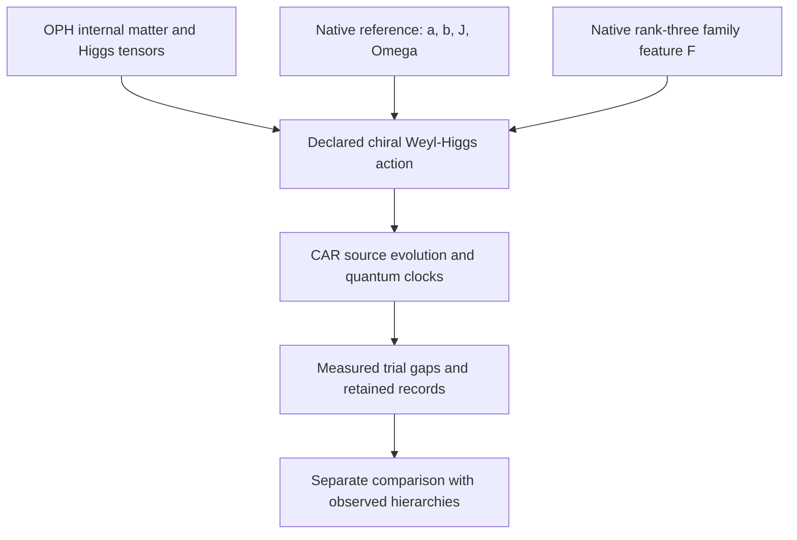

# OPH particle mass response and hierarchy audit

This document states the current chiral Weyl–Higgs candidate, hierarchy
diagnosis and full repair-response result. Its calculations and retained
outputs are in the linked model packages.
The source-identity test in [§5.16](#516-persistent-native-objects-and-the-finite-gauge-theorem)
starts with persistent native objects and their actual port action.
Two record-correctable carriers contain the geometric $3\oplus3'$ required
for comparison with the finite gauge construction. Their tested reversible
exchange-response algebra has dimension 17 and fails the finite Standard
Model theorem's complete 12-current premise. Twelve ports alone do not
impose that premise. A separately specified coherent control law on the
same geometric object realizes a closed 12-current algebra, with native
rotation covariance and an observable relative central phase. Its control
menu and spin/exterior lift are architecture choices; completeness with
respect to every physically accessible intervention is not established.
Gauge representation alone also leaves the invariant mass-generating
couplings undetermined.
The native recorded repair supports a propagating **collective core-relative
charge response**, an exact correlation current, and compatible local detector
records. Exact signed-current histories also recover nonzero finite-frequency
occupation readouts. The collective operators are even matrix-unit transfers
with a diffusive response. A specified 15-dimensional exterior carrier fits
inside the same native 66-state space, but the complete recorded repair does
not preserve any noiseless 15-dimensional work subspace.
Active record correction on multiple native carriers supplies a different
finite construction: the same declared Weyl–Higgs field propagates at zero
and three opposite momentum pairs, with complete continuing detector and
clock outputs. Its representation, trial Yukawa law, spectral cutoff and
coherent services remain supplied.
An explicitly [calibrated action control](#56-calibrated-action-and-matching-control)
also realizes the charged-family matrices and measured mixing inputs on this
representation. Its external Standard Model mass matching is a calibration
check, not a mass measurement from native observer records or a derivation.
Separate finite source experiments recover the supplied running gaps from
complete simulated records. A moving-field experiment uses fixed preparation
and fixed Pauli readouts; its adaptive phase rotation is classical. The
[fixed-cycle audit](#58-what-the-fixed-corrected-repair-can-select) tests
parameter selection without those calibrated inputs. The
[regional vacuum calculation](#59-regional-vacuum-of-the-same-fermion-action)
connects the calibrated action to a finite matter entropy calculation.
The uncalibrated source constructions in §§5.10–5.15 instead test native
correlation coefficients, a three-dimensional staggered field, a composed
two-carrier detector history, interacting charged poles and vacuum modular
response. Their control choices, states and continuum domains are explicit.
The calibrated experiments recover supplied running mass parameters from
simulated observer records. **The measured Standard Model mass hierarchy is
not derived from the native repair law.** The uncalibrated candidate's mass
prescription fails the hierarchy comparison, and the collective operators
are not identified with Standard Model fields in the observer's physical
Lorentzian description.
The [record-driven family feedback](#520-family-couplings-from-a-specified-record-feedback-law)
removes measured mass inputs from one explicitly specified extension of the
repair law. It produces three unequal Higgs couplings, with ratios about
`1 : 30.84 : 452.62`, without fitting them. This fixed candidate fails the
charged-lepton hierarchy comparison; it does not replace the calibrated
control with a successful physical mass derivation.

**Operational particle mass.** A mass is inferred from jointly accessible
detector records and interventions in a stated observer clock and spacetime
description. Observers must agree on the same response law and on the
energy–momentum quantity extracted from it. A sharp stable rest mass requires
the corresponding physical pole and dispersion; thresholds and unstable or
confined species require their stated alternatives. Agreement on a detector
outcome after its state update is an essential observation contract. It does
not by itself identify a repair decay rate, modular frequency or graph
eigenvalue with that mass observable.

- [Candidate construction](#candidate-construction)
- [Hierarchy diagnosis](#hierarchy-diagnosis)
- [Full repair response](#full-repair-response)
- [Current conclusions and open tests](#8-current-conclusions)

## Candidate construction

This section describes a concrete OPH-compatible chiral matter architecture and
what its executable tests establish. It combines the existing internal
matter representation, verified Higgs interaction tensors and a native
family-dependent operator. Its fixed-Higgs-background fermion sector is
executed as a 90-mode CAR system, with a continuing source-clock experiment
that reads three charged rest gaps.

The uncalibrated candidate has the minimal Standard Model's chiral fermion
representation types and the expected Weyl–Higgs dispersion. **Its chosen
mass prescription does not reproduce measured particle hierarchies.**
Three fixed nonlinear comparison prescriptions also fail the joint
charged-lepton hierarchy test. The calibrated controls in §§5.6–5.7 use a
separate empirical mass packet and do not change this exclusion.
No observed particle spectrum, complete interacting Standard Model, or
theory of gravity is claimed as derived by this construction.

The implementation and retained evidence are in
[the candidate package](../../model/common_source/chiral_candidate/README.md),
[its receipt](../../model/common_source/chiral_candidate/results.json) and
[its quantum-state artifact](../../model/common_source/chiral_candidate/results.npz).
The equations below explain their construction independently of the code.

### 1. The question being tested

The [continuing response experiment](../../model/common_source/mass_response/README.md)
joined a finite charged gap, interactions, neighboring-site response and
quantum-clock measurements in one history. Its
[operator-response audit](../../model/common_source/particle_identification/README.md)
showed that this gap has nonzero CAR spectral residue and can be read by an
even, charge-conserving transfer instrument. It also classified the separate
eight-component free continuum extension as two degenerate Dirac copies.

That establishes a charged fermionic response in the tested model. The
chiral candidate combines the existing OPH matter and Higgs representations
with an explicit propagating field, whose gaps are measured against the same
clock convention. The representation attachment and its family mass law are
declared construction choices.

The candidate supplies a finite execution of that representation and a direct
mass test that rejects its simplest trial coupling map.

### 2. Source inputs and construction choices

The calculation has three independent inputs: an internal representation,
a prepared native reference and a native spatial response band. Their
combination into a coherent action is a declared architecture choice.



#### 2.1 Internal matter and Higgs channels

The existing
[representation decoder](../../model/observer_particles/representation_identification.py)
recovers the nonvacuum even exterior module

```math
\mathcal M_{15}=\Lambda^2(\mathbb C^5)\oplus\Lambda^4(\mathbb C^5)
               =\mathbf{10}\oplus\bar{\mathbf5},
```

under its stated source-linked lift. Its five joint charge/Casimir blocks
are the following, in **all-left Weyl notation**:

| Internal field type | $(SU(3),SU(2),Y)$ | Internal dimension |
| --- | --- | ---: |
| $Q$ | $(3,2,1/6)$ | 6 |
| $u^c$ | $(\bar3,1,-2/3)$ | 3 |
| $d^c$ | $(\bar3,1,1/3)$ | 3 |
| $L$ | $(1,2,-1/2)$ | 2 |
| $e^c$ | $(1,1,1)$ | 1 |

Here $Q_{\mathrm{electric}}=T_3+Y$. The superscript $c$ denotes the
left-handed charge conjugate of a right-handed singlet. Those signs matter
when forming both masses and currents. The minimal module contains a left
neutrino and no independent right-neutrino singlet.

The existing
[one-Higgs construction](../../model/observer_particles/unified_yukawa_action.py)
supplies a single $H=(1,2,1/2)$, its conjugate, and exact invariant tensors
for the channels

```math
Q u^c H,\qquad Q d^c H^*,\qquad L e^c H^*.
```

The new action uses these tensors directly and rechecks their current
covariance and anomaly traces. The internal representation is conditional
on the stated lift; its existence does not force a unique field action or
choose Yukawa coefficients. The
[Standard Model comparison map](../../model/common_source/particle_identification/SM_MATCH.md)
records the precise existing theorem and ledger dependencies. For physical
conventions, see the [PDG electroweak review](https://pdg.lbl.gov/2025/reviews/rpp2025-rev-standard-model.pdf);
its hypercharge variable is twice the $Y$ used here.

#### 2.2 Exact native reference coefficients

The [public reference producer](../../model/native_modular_reference/local_preparation.py)
defines an ideal faithful distribution on 66 binary configurations with
total native load two. A distinguished two-port core has occupation
$q=0,1,2$, multiplicities $45,20,1$, and respective weights **per
configuration**

```math
(w_0,w_1,w_2)=\left(\frac{2}{225},\frac1{36},\frac2{45}\right).
```

The logarithmic source statistics used in the candidate are

```math
\begin{aligned}
a&=\log(w_1/w_0)=\log(25/8),\\
b&=\log(w_2/w_1)=\log(8/5),\\
J&=\log\frac{w_1^2}{w_0w_2}=\log(125/64)=a-b,\\
\Omega&=\log(w_2/w_0)=\log5=a+b.
\end{aligned}
```

For the two core occupations, the modular generator $K=-\log\sigma$ can
be written as a constant plus $-a(n_0+n_1)+J n_0n_1$. These coefficients do not
themselves create a propagating Weyl Hamiltonian. Assigning them to the
coherent channels below is part of the architecture being tested.

This calculation consumes the **exact ideal reference target**. It does
not execute a finite native warmup or propagate its preparation error.
The protected core, coherent controls, blank states and clock calibration
are declared operational inputs.

#### 2.3 A native family symmetry breaker

The prepared reference is not invariant under the full carrier rotation
group. Its one-body occupation means are

```math
\mathbb E[n_i]=
\begin{cases}
29/90,&i\text{ in the two-port core},\\
61/450,&i\text{ outside it}.
\end{cases}
```

Let $B$ span the actual selected rank-three native slow band and
$G=B^T B$. Compressing the occupation matrix gives

```math
F=G^{-1}B^T\mathrm{diag}(\mathbb E[n_i])B.
```

The [exact producer](../../model/common_source/particle_identification/family_attachment.py)
obtains three distinct positive eigenvalues:

```math
\lambda_1=\frac{61}{450},\qquad
\lambda_{2,3}=\frac{41}{225}\mp\frac{7\sqrt5}{750}.
```

They are approximately $0.135556,0.161352,0.203092$. The calculation
checks all 60 rotation-covariance identities, explicitly transports the
different native and retained-family port charts, and obtains the exact
group average $I_3/6$.

This supplies a concrete nonscalar native family operator. The earlier
unbroken-family theorem, whose invariant commutant is scalar, remains
correct: its full-invariance hypothesis is absent for this prepared
reference. Physical family interpretation and a coupling to masses remain
additional attachments. The protected-core preparation has not thereby
selected the electron, muon and tau basis.

### 3. The declared Weyl–Higgs action

The candidate uses two left spin components, 15 internal components and
three native family axes: **90 complex CAR modes** in one momentum block.
The trial family matrices and neutral background are

```math
Y_u=aF,\qquad Y_d=bF,\qquad Y_e=JF,\qquad
H=(0,v),\quad v=\Omega.
```

The kinetic coordinate speed is chosen as $c=\Omega/2$. The value $v$
is the neutral component norm in this convention, not an independently
derived electroweak scale in GeV.

Using the verified Higgs tensors produces a symmetric 45-dimensional
all-left internal mass kernel $K$. With
$\epsilon=i\sigma_2$, the real-background creation pairing is

```math
\Delta=\epsilon\otimes K,\qquad \Delta^T=-\Delta.
```

The transpose antisymmetry is required by CAR. In particular, a Dirac mass
is formed through the appropriate Higgs line and charge-conjugated singlet;
it is not inserted directly between unrelated gauge representations.
The neutral background preserves the assigned electric charge.

For left fields $\chi$, the kinetic symbol is

```math
h(p)=-c\,\sigma\cdot p\otimes I_{45}.
```

The opposite-momentum Nambu operator is

```math
\mathcal B(p)=
\begin{pmatrix}
h(p)&\Delta\\
\Delta^\dagger&-h(-p)^T
\end{pmatrix}.
```

For a general complex action kernel the creation coefficient uses the
corresponding conjugation; the implemented default is real. Spin conjugation
of the hole block gives the standard massive chiral form, with

```math
E_j(p)^2=c^2|p|^2+s_j(K)^2.
```

Negative Nambu energies are conjugate partners, not extra mirror families.
Counting color and family, the massive channels form **21 charged Dirac
fields**, and the minimal module leaves **three massless left-Weyl neutrinos**.
The latter does not reproduce observed neutrino masses. At zero momentum
the 12 Nambu zero eigenvalues represent six complex CAR zero modes, not
twelve neutrino species.

The [action proof](../../model/common_source/chiral_candidate/ACTION.md) and
[kinetic proof](../../model/common_source/chiral_candidate/KINETIC.md) give
the matrix ordering, signs, count and dispersion checks.

### 4. What establishes chirality in this candidate

All-left notation alone is insufficient to establish a weak-current
discriminator. The implementation reconstructs a weak raising operator
from the actual source current generators and checks its action on the
decoded lepton projectors.

In the massless limit, its total charged-current coupling strength on the
physical charge-minus-one energy branches is one for negative helicity and
zero for positive helicity. With a nonzero trial mass, the weights follow

```math
w_{\mp}=\frac12\left(1\pm\frac{c|p|}{E}\right).
```

The check uses the complete $J^\dagger J$ final-state sum; it does not
mistake a same-momentum final-neutrino spin selection for chirality. These
are matrix vertex weights of the declared action, not measured scattering
cross sections. No dynamical $W$ field is executed. A charged current
drive would need its compensating charged apparatus or gauge field.

### 5. Source execution and the observer clock

#### 5.1 Finite CAR computation without a huge Fock vector

The source backend executes native two-mode hopping, pairing and onsite
words on **all four local Fock input columns**. Their completed action on
Majorana operators determines the full finite Gaussian transformation.
Nonadjacent modes use fermionic SWAP routing, including the minus sign on
double occupation. Every routing pulse is counted.

At rest the chosen background separates into 42 charged pair blocks and
six neutral zero modes. All are retained. An initial fermionic wire layout
places the three probed lepton blocks first. Their six-mode Fock factor and
two clocks are also executed literally, with both clock purification
references retained. This independent calculation checks the Gaussian
reduction rather than replacing a missing large-state simulation with an
unsupported assumption.

The finite Gaussian identity concerns completed logical blocks. Individual
processor pulses or intermediate routes need not preserve the physical
charge interpretation. No polar projection, covariance repair, clipping of
probabilities, or selection of successful detector outcomes is applied.
Floating residuals remain diagnostics rather than physical precision bounds.

#### 5.2 Continuing measurement protocol

The two clock references have populations $(1/6,5/6)$, contrast
$r=-2/3$, and modular gap $\Omega=\log5$. Their parameter is programmed
modular flow; it is not calibrated laboratory seconds.

One history prepares the field and clocks once, advances them for
$\tau=1/4$, and records three lepton-mode occupations. A committed result
can trigger a neutral phase on another block. The same field and clocks
continue for another $\tau$, after which a further occupation and two
clock quadratures are read. No field reset occurs. All 64 six-bit terminal
records and the 16 full-field Gaussian conditionals are retained.

For the initial empty-pair apparatus state,

```math
P_i(\text{empty at }\tau)-P_i(\text{occupied at }\tau)
=\cos(2m_i\tau).
```

The final clock quadratures recover

```math
\theta=\mathrm{atan2}\!\left(
\frac{\langle Y\rangle}{r},\frac{\langle X\rangle}{r}\right)
=2\Omega\tau.
```

Consequently the observer decoder uses only records, calibration and the
admitted phase branch:

```math
\frac{m_i}{\Omega}
=\frac{\arccos\langle(-1)^{n_i(\tau)}\rangle}{\theta}.
```

The prior branch condition matters: cosine data cannot exclude arbitrary
frequency aliases. For this trial, exact elementary bounds give
$J<1$, $\Omega<2$, $\max\lambda(F)<1/4$, hence
$2m_i\tau<1/4<\pi$. The decoder does not consult the hidden Hamiltonian
or simulator duration to obtain the displayed ratios.

The recovered ratios, in **native family-axis order**, are

| Native axis | Measured trial $m_i/\Omega$ |
| --- | ---: |
| 0 | 0.1080141452 |
| 1 | 0.1359561376 |
| 2 | 0.0907450442 |

The source and independent continuous probe outputs agree at numerical
residuals of order $10^{-14}$; full-field and probe probability marginals
agree at order $10^{-15}$. An independent state-level reduction also
compares all conditional six-mode covariances and clock references.
These are numerical checks, not outward roundoff or physical-service
certificates. Finite-shot confidence and finite native preparation errors
are not included in the point inverse.

The preparation is an apparatus state. It does not show that native repair
prepares the physical interacting vacuum. The measured frequencies agree
with the trial's charged quasiparticle gaps under its stated quadratic and
particle–hole interpretation.

#### 5.3 Protected nonzero-momentum continuation

The [protected momentum implementation](../../model/common_source/chiral_candidate/protected_momentum.py)
and its [retained output](../../model/common_source/chiral_candidate/protected_momentum_results.json)
retain one zero momentum and the three pairs `±(1/3,0,0)`,
`±(0,1/3,0)`, `±(0,0,1/3)` in one declared periodic coordinate box.
Each momentum carries all 90 Spin, internal and family modes: **630 CAR
modes in total**, with the zero mode included once. The fixed quadratic
background factors into 96 independent Fock blocks of at most eight modes.
Actual source matrices execute every input column of each block, and an
independent full 90/180-mode Gaussian calculation checks the factorization.
The retained complex factors specify every successful field/clock/reference
output without materializing a vector of dimension `2^630`.

Each occupation is the two-level factor of the exact six-state native
record-correctable code; its three-level spectator remains untouched.
Recorded C/E correction acts as identity on the complete encoded field and
arbitrary references. Source words address the decoded occupation wires,
with independently checked routing. This uses many carriers and active
coherent recovery; it does not contradict the single-carrier capacity bound
or turn the uncorrected dissipative response into a unitary field.

One protocol prepares once, evolves, reads an occupation, applies recorded
feedback, evolves again and reads again. All selector timeouts and disturbed
endpoints remain part of its output. One fixed charged-lepton component is
probed; all other components remain in the continuing field. A second
protocol repeats the same fixed elementary evolution word twice per interval. Its first-read marginal
cancels the nonzero-momentum visibility in the ideal response:

```math
P(t)=A\sin^2(E t),\qquad
\frac{P(2t)}{4P(t)}=\cos^2(E t).
```

The decoder uses those two recorded marginals and the final quantum-clock
quadratures under a declared alias window. It does not read Hamiltonian
eigenvalues. The three orientations test the same relation
`(E(p)^2-E(0)^2)/Omega^2=|p|^2/4` of the supplied Weyl–Higgs symbol.
Pointwise source comparisons are numerical diagnostics; a certified
frequency-inversion error or a physical particle pole is not established.
The budget charges all 630 native carriers and source/service calls; the
six-mode construction's smaller error admission is not transferred.
Export-failure blocks have their own flagged error bound, rather than
being discarded or represented as explicitly retained success vectors.
Floating composition diagnostics are not outward or hardware certificates.

This supplies protected propagation and continuing observation for the
chosen finite matter field. The coordinate box, cutoff, coherent services,
apparatus state, programmed modular clock and trial coupling law remain
construction choices. The measured hierarchy still fails; interacting
quantum gauge/Higgs dynamics, a complete chiral gauge theory, physical spacetime
and the joint gravity attachment remain open.

#### 5.4 Finite overlap kinetic regulator

The [overlap operator](../../model/common_source/overlap_regulator.py)
and [replay receipt](../../model/common_source/overlap_regulator_results.json)
use the same retained $M_{15}=\Lambda^2\mathbb C^5\oplus
\Lambda^4\mathbb C^5$ representation on a periodic four-dimensional
Euclidean lattice. All four Wilson transports and a nonconstant
$SU(3)\times SU(2)\times U(1)$ link background are implemented. The
modified left projector obeys the finite Ginsparg--Wilson, Weyl-map and
gauge-covariance checks. All 16 free corners leave exactly one massless Dirac
kernel species, from which the modified left projector supplies one Weyl
kinetic sector. A small-link domain gives a volume-independent ideal local
approximation tail $16(15/17)^{m+1}$ at range $2m+1$; its free symbol has
error at most $a|p|^2$ on $a|p|\le1/4$. Two complete native queries retain
both output branches and all four spinor input columns.

This constructs a finite chiral **kinetic** regulator. The gauge background,
spacing, three-family replication and source service accuracy are supplied.
Its global chiral fermion measure, quantum gauge/Higgs dynamics, interacting
continuum, Lorentzian continuation and link to the protected 630-mode
many-fermion history are not established. The failed Yukawa hierarchy is
unchanged.

#### 5.5 Local completion and a second-shell discriminator

The [identifiability check](../../model/common_source/chiral_candidate/dispersion_identifiability.py)
constructs a local two-hop six-cell-per-axis lattice symbol that equals the
continuum symbol at every momentum in the protected seven-mode field and has
the same derivative at zero. With the same internal matrices, trial mass,
current and clock, every restricted seven-mode quantum history agrees.
The larger local lattice carries additional modes, states and resource
requirements, and still has eight free kinetic nodes with balanced
handedness. The restricted data therefore do not select a unique spatial
completion or a chiral gauge regulator.

At coordinate momentum $2/3$, the two-hop kinetic coefficient divided by
the continuum speed is $1-\sqrt3/\pi$, versus $2/3$ for the continuum law.
The [second-shell receipt](../../model/common_source/chiral_candidate/dispersion_identifiability_results.json)
retains two number reads, feedback, a quantum clock, a neutral pair
quadrature and all terminal outcomes. Exact joint-event intervals for the
two fixed laws separate. The source replay checks that contrast; its source
arithmetic admission and the stipulated event implementation error are not
physical apparatus guarantees. The full 810-mode native correction/export
budget and the larger lattice's other modes are not executed. The additional
momentum read is a concrete discriminator for the proposed field attachment.

#### 5.6 Calibrated action and matching control

The separate [calibrated matter action](../../model/common_source/calibrated_matter.py)
uses the same internal representation, Higgs tensors and current matrices
with one explicit empirical parameter packet. All nine charged Yukawa
coordinates, the Higgs expectation value and the three gauge couplings share
a specified $\overline{\mathrm{MS}}$ boundary at $91.1876$ GeV. The actual
complex down-family matrix and its all-left conjugation convention produce
the supplied unitary CKM matrix in the charged current. Exact tensor, mass
and Weyl-dispersion checks retain the charged color/spin multiplicities.
These identities establish that this representation can carry the calibrated
mass pattern; they do not select its coefficients from the repair rule.

The [matching receipt](../../model/common_source/calibrated_matching_results.json)
records a separate execution of SMDR 1.3, including its source revision,
input conventions, inverse calibration and independent forward call.
The nine charged-fermion masses and the Higgs and Z calibration inputs
return within their quoted marginal standard uncertainties in that numerical
run. Those values are **external Standard Model outputs, not native observer
records**. Running quark masses retain their scale and scheme; unstable
particle masses retain their pole or Breit--Wigner convention. The unfitted
W output is $80.3491825273$ GeV, compared with the selected reference
$80.3692\pm0.0133$ GeV: a $-20.0175$ MeV difference, or $-1.5051$ quoted
standard uncertainties. It misses a one-standard-uncertainty criterion.
No combined input/theory covariance or OPH-specific empirical success follows.
The external matching neglects CKM effects at its declared approximation.

A rounded published parameter table is retained as an input-precision
control: it misses the electron and muon measurement precision. The fixed
full-precision packet resolves that calibration issue; it supplies no new
parameter derivation. The bosonic tree check explicitly chooses
$m^2_{\mathrm{tree}}=-\lambda_{\mathrm{SM}}v^2$ for its comparison potential;
this is not SMDR's loop-matched quadratic coefficient or a computation of
the full quantum effective-potential Hessian. The optional Weinberg sector
uses NuFIT mixing and mass-squared splittings, normal ordering, zero lightest
mass and zero Majorana phases. Its unmeasured choices and unexecuted
low-energy-to-common-scale matching remain explicit. The original native
candidate imports none of these calibration inputs.

#### 5.7 Calibrated masses read from simulated observer records

The separate [observer producer](../../model/common_source/calibrated_spectrum_observer.py)
executes the rest-field source factors and retains complete simulated detector
counts in its [receipt](../../model/common_source/calibrated_spectrum_observer_results.json)
and compressed array artifact. Its blind inverse reads the counts, clock
convention and error contract; it cannot read the parameter packet or call the
source generator. All nine supplied running-action gaps lie in its intervals:

| Field coordinate | Approximate record interval, GeV at the common MZ boundary |
| --- | --- |
| up | [0.00123406519, 0.00123679893] |
| charm | [0.624245749, 0.624253591] |
| top | [169.888809, 169.890205] |
| down | [0.00270061637, 0.00270336216] |
| strange | [0.0537463744, 0.0537495387] |
| bottom | [2.86239022, 2.86241641] |
| electron | [0.000486343406, 0.000489071040] |
| muon | [0.102758037, 0.102761603] |
| tau | [1.74550466, 1.74552170] |

The receipt contains exact rational endpoints; the displayed decimals are
rounded summaries. These are running-action coordinates, not the experimental
pole or low-scale quark masses returned by external matching. Their widths
range from about 2.73e-6 to 1.40e-3 GeV. In particular, this sampling campaign
does not recover electron or muon measurement precision.

There are 21 dyadic phase levels, two quadratures and two million complete
trials per setting: **84 million simulated trials**. Each trial retains the
selector address, nine field bits and two clock bits, including timeout
addresses. Adaptive analyzer offsets depend only on earlier records. A shared
clock gap `log(5)` and the single supplied conversion `1 GeV/log(5)` set the
units; the programmed modular parameter is not laboratory seconds. Exact
interval inversion and a simultaneous conditional sampling bound of about
1.17e-8 cover all 420 real statistics, under independent simulated trials and
the declared numerical, frame and physical-service bias allowances.

The source execution uses all four Fock input columns of 42 commuting charged
pair factors and retains six neutral zero modes. Actual CKM source frames and
a complete 64-column weak down-sector conjugation test the change of basis.
No dense 2^90-state source output is claimed; the complete weak-frame relation
uses a separate uniform error admission, not an outward analytic certificate.
Repeating the declared programs for all sampled trials would charge
341,796,000,000 native pulses and 683,592,000,000 load/export events. Those are
required resources, not an executed physical protection history.

This establishes a **calibrated source/readout sanity check**. The measured
inputs still determine the action. Interacting self-energies, confinement,
scattering, physical clock calibration and a source-derived mass law remain
unproved. Replay the retained counts and their source channels with:

```sh
python -W error -m model.common_source.calibrated_spectrum_observer --check model/common_source/calibrated_spectrum_observer_results.json
```

The [moving-field producer](../../model/common_source/calibrated_transport.py)
extends the calibrated control to one 1,170-CAR field on the 13 momenta
$0,\pm e_i,\pm2e_i$. Source factorization includes the scalar phase and odd
Fock sectors, with 79 native pulses for the base pair and 83 where the
Higgs-pair sign requires conjugation. Spin and weak-current
frames are checked on all three axes, including actual eight-CAR routing.
The detector samples rest, first-shell and second-shell responses against
the same clock. Its [receipt](../../model/common_source/calibrated_transport_results.json)
retains complete joint counts, source arrays, conditional energy and invariant
mass intervals, and the resources required by the full routed field.
The 78 neutral modes are massless kinetic spectators; the optional calibrated
Weinberg extension is not included.

The 31-level campaign retains **558 million simulated complete trials**.
All 27 invariant-mass intervals, for nine charged coordinates at momenta
0, 1 and 2 GeV, are positive and contain the supplied running masses.
The conditional simultaneous sampling failure bound is about $7.49\times10^{-8}$;
physical-service and frame errors have separate admissions. The electron
intervals at 1 and 2 GeV momentum are approximately
$[0.0004750,0.0005048]$ and $[0.0004321,0.0005381]$ GeV. They illustrate
the loss of mass sensitivity at large momentum and are not experimental
mass precision. Full campaign costs are about $9.11\times10^{14}$ native
pulses and $1.82\times10^{15}$ required load/export events, not an executed
physical protection history.

Every selected even pair starts in the same $+Y$ state and uses fixed
$X,Y,Z$ analyzers. For $H=eI+mX-eZ$, the three means are
$Y(t)=\cos(2Et)$, $X(t)=(e/E)\sin(2Et)$ and
$Z(t)=(m/E)\sin(2Et)$, where $E^2=m^2+e^2$.
For the selected $e=-p\le0$ and positive mass, the signed norm of $(-X,Z)$
and $Y$ determine the phase without a supplied
mass-dependent analyzer frame. Rotation of the interval box is classical
and uses earlier records; the quantum clock has no adaptive offset. The
same positive acceptance visibility must apply to all three settings.
This closes a potential parameter leak in probe preparation and readout.
The supplied action, spectral cutoff, programmed coordinate time and
physical-service admissions remain inputs. A moving invariant-mass interval
is inferred from the energy and declared momentum, not from a second fit;
intervals containing zero are retained as unresolved.

#### 5.8 What the fixed corrected repair can select

The [parameter-selection calculation](../../model/common_source/parameter_selection.py)
holds the existing six-dimensional recorded code, C/E instruments, completion
selector and record-dependent recovery fixed. It introduces no empirical
parameter packet or logical mass Hamiltonian. Every corrected branch on the
code is a scalar times the identity, including the terminal timeout. The
complete logical transfer is exactly $I_{36}$; its discrete response seed
$I-T$ vanishes and its algebraic inverse response is $zI$. Active protection
alone therefore selects no nonzero mass splitting in this fixed cycle.
The parameter is one completed native proposal. A single endpoint channel
does not determine an unwrapped continuous-time Hamiltonian; resolving
within-cycle phases requires a time family and an operational clock map.

This obstruction is also visible in the actual native observables.
$V^\dagger n_aV=I_6/6$ at every port, the three centered slow coordinates
compress to zero, and every native edge cost
$(n_a-n_b)^2$ compresses to a scalar. The specified weighted edge sum is
$9I_6/32$. The original faithful reference is not stationary under the active
corrected cycle on that same carrier: its code-projector probability changes
from $41/450$ to $241/1500$ for C and $26627/115200$ for E. These changes give
exact lower bounds $313/4500$ and $5377/38400$ on half the trace distance.
Keeping a separate reference clock is an additional tensor-factor contract.

A two-hop correlation tests what survives beyond these scalar observables.
For the existing accepted seam weights $W$, define
$H_2=\sum_{a<b}(W^2)_{ab}(n_a-n_b)^2$. Its six-level compression has
occupation differences $(1/256,-1/1024,-1/3072)$ in the declared
`logical_label = 2*spectator + occupation` factorization. Their absolute
ratio is $12:3:1$. This is one CAR mode with three spectator values, not
three independently occupiable physical species. $H_2$ leaks from the code
in every logical column; the retained complete-record calculation gives its
first-order logical response and positive quadratic syndrome leakage.
$H_2$ is not a phase interaction in the unmodified C/E cycle. Its compression
alone does not establish closed finite-step evolution or select a physical
coherent coupling; the continuation below has an explicit phase-service contract.
The uniform graph two-hop cost instead preserves the code and gives differences
$(4,0,0)$; all invariant diagonal pair costs have difference rank at most one
for this factorization.

The [receipt](../../model/common_source/parameter_selection_results.json)
retains exact algebra, every native raw branch and actual 512-dimensional
source controls. A separate factorization control changes the interpreted
gaps of the same $H_2$, but does not preserve or replay the M15 current and
observer apparatus. It diagnoses an unselected observable dictionary, not
two complete Standard Models with identical physical premises. These results
exclude the stated selection routes; they exclude neither other codes nor
coherent interactions and do not derive the measured hierarchy.

The [coherent continuation](../../model/common_source/repair_continuation.py)
tests a specified program that applies a phase generated by $H_2$ and then
the actual compiled C/E correction at every interval. Its outer schedule
retains a one-proposal timeout as an idle record and continues for a fixed
number of proposals. A globally terminal timeout defines a separate stopped
experiment. The phase service and continuing schedule are declared inputs.

The ideal target of the complete compiled recovery preserves the 36
matching-support rows reached by this program. Its complementary coherence transfer $M$ satisfies
$\|M^4\|<3/4$ for C and $\|M^2\|<2/3$ for E, certified by directed rational
arithmetic on the actual mixer blocks. Thus the sums of complementary
transfer norms are bounded by 15 and 5, respectively. This is a check of
the complete recovery, including its action outside the protected code.

Let $V$ encode the six-dimensional code, $J(\rho)=V\rho V^\dagger$,
$h=V^\dagger H_2V$, and $\Phi$ be the complete correction channel. With
$F_\delta=\Phi\circ\operatorname{Ad}(e^{-i\delta H_2})$, the explicit
finite-proposal bound is

```math
\left\|F_{t/N}^{N}J-J\operatorname{Ad}(e^{-ith})\right\|_\diamond
\leq\frac{2tb+t^2[(d^2+d_0^2)/2+b(d+d_0)]}{N},
```

where $d=17/512$ is the reachable Hamiltonian diameter, $d_0=5/1024$ and
$b=2(11/1024)\sum_{n\geq1}\|M^n\|$, using the stated upper sums.
The bound includes arbitrary untouched reference systems. It follows by
canceling the first-order code-to-syndrome defect with a bounded dressed
embedding and telescoping the remaining quadratic errors; the embedding is
a proof device, not an assumed prepared state. No syndrome projection or
successful-outcome conditioning is used.
This applies [finite quantum Zeno dynamics](https://arxiv.org/abs/1809.09570)
to the declared source and supplies its explicit finite-proposal error bound.

This derives the effective encoded dynamics of the specified continuing
program. The parameter $t$ is its coherent model coordinate. An admitted
per-proposal channel error $\epsilon$ contributes up to $N\epsilon$ in
the same norm, so the ideal rapid-correction limit does not eliminate a
finite service-error budget. Native records are retained; the unitary
comparison concerns the work/reference marginal, not equality of the full
record transcript with a record-free evolution. The resulting gaps remain
the one-mode spectator-dependent gaps of $h$, with no measured hierarchy or
physical clock inferred.

#### 5.9 Regional vacuum of the same fermion action

The [fermion-ball calculation](../../model/common_source/fermion_ball.py)
uses the same calibrated M15 action, mass packet and CKM frame. A local
canonical particle-hole map sends each charged all-left pair to
$h_D=\left(\begin{smallmatrix}-\sigma\cdot p&m\\m&\sigma\cdot p\end{smallmatrix}\right)$.
Both CAR anticommutators and the charge convention hold exactly; all 21
Dirac blocks, counting quark color, are checked against the actual 180-dimensional BdG
symbol. The remaining three Weyl species are massless. Optional phenomenological
Weinberg masses are not included.

One antiperiodic Fourier box and one ball radius $R=0.01\,\mathrm{GeV}^{-1}$
serve all species. Restricting the global filled negative-energy projector
to the ball gives $C_A$, its modular kernel
$K_A=\log[(1-C_A)/C_A]$ and its entropy. A positive-energy orbital with
occupation $\epsilon$ defines a legitimate variation of the same global
state. Its regional entropy derivative is $\psi_A^\dagger K_A\psi_A$,
checked against independent entropy secants and nested-region relative
entropy. This removes a separate scalar-only matter choice from this finite
entropy comparison; it does not supply dynamical gauge constraints, dressing
or gauge-field edge entropy for an interacting region.

At grid $28^3$ in a box of side $6R$, the massless modular response differs
by about $-0.1953\%$ from the independently fixed conformal stress integral.
The same comparison for the running top mass differs by $+22.83\%$.
The massless identity is not assumed for massive fields. Grid and box controls
retain their nonmonotone errors; no continuum rate or renormalized area
coefficient is inferred.

A $2^3$-site, 32-CAR source control prepares the filled vacuum with 568
completed source blocks and 13,616 native pulses, including the local
particle-hole change. Its covariance is checked against the independent
all-left BdG projector. Every local four-column Fock gate is executed;
the Gaussian composition avoids a dense $2^{32}$ Fock vector. The larger
regional calculations are covariance calculations, not prepared large source
histories. Passive vacuum selection, physical service accuracy, an interacting
continuum and joint entropy--geometry stationarity remain separate requirements.
The [receipt](../../model/common_source/fermion_ball_results.json) retains
the common cutoff, source costs, spectral admission and all comparison controls.

#### 5.10 A finite charged field from native correlations and carrier exchange

The [correlation/exchange construction](../../model/common_source/repair_field_attachment.py)
specifies a coherent control architecture without empirical mass inputs.
Within each of the six matching supports, a fixed six-cycle permutes its
native configurations. Averaging the native two-hop diagonal observable
$H_2$ over that cycle makes it constant on each support. The averaged
operator preserves the recorded code exactly and has the same six compressed
energies as $H_2$. This finite orbit average is a chosen control rule; C/E
repair alone does not select it.

For a fixed spectator sector $s$, the two code states with labels $2s$ and
$2s+1$ define an empty and an occupied state, ordered by their energies.
Different carriers supply independently occupiable modes. The positive gaps
and the common exchange strength are fixed from the native correlation:

```math
(\Delta_0,\Delta_1,\Delta_2)=\frac{(12,3,1)}{3072},\qquad
J=\sum_{a<b}(W^2)_{ab}=\frac{125}{1024}.
```

Whole-carrier exchange $S_{x,x+1}$ preserves two identical encoded sectors.
The declared positive bond cost $J(I-S_{x,x+1})$ gives the open-chain action

```math
H_s=L e_s^0 I+\Delta_s\sum_x n_x+
J\sum_{x=0}^{L-2}
\left(n_x+n_{x+1}-2n_xn_{x+1}
-a_x^\dagger a_{x+1}-a_{x+1}^\dagger a_x\right).
```

Here $e_s^0$ is the lower native energy in the selected sector. The ordered
Jordan–Wigner operators satisfy the canonical anticommutation relations.
The density interaction is required by ordinary carrier exchange; replacing
that exchange with fermionic SWAP changes the action. Each positive bond
annihilates the empty state, so its stability follows without a fitted
counterterm. At three sites the one-particle energies above the vacuum are
$\Delta_s,\Delta_s+J,\Delta_s+3J$. The same action determines occupation
currents and the sectors with multiple occupied modes.
Its one-particle kinetic term is a graph Laplacian; this action supplies no
Weyl–Higgs dispersion or identification with relativistic pole masses.

A uniform one-particle mode is fixed by every exchange bond. A separate
reference mode keeps total encoded occupation one while two fixed
quadratures read its relative phase at coherent model coordinate 512.
The reduced encoded processor retains 12 million simulated binary detector
records across the three sectors. A count-only inverse encloses the three
native gaps without reading their values. The operator-wide bound placing
all six matching means in $[18/512,21/512]$ bounds every oriented pair phase
by 3 at that duration, inside the declared non-aliasing half-circle.
Its sampling, phase-range and
numerical contracts are explicit; physical-service accuracy is an admitted
requirement. Native onsite, charge-readout and collective-exchange controls
are separate source attachment certificates. These records do not constitute
a composed many-carrier C/E, load and export failure history.

The density interaction vanishes in the one-particle sector, so retaining
it does not alter the vacuum-to-one-particle thresholds. The ascending gap
ratios are $1:3:12$, which fail the measured charged-lepton hierarchy if
assigned that role. The encoded occupation is
distinct from native load, which is two on every carrier. An identification
with electric, color or weak charges is not supplied. Nearest-neighbor
fermion locality uses the declared one-dimensional ordering; a
three-dimensional local chiral field requires additional parity transport
and a continuum construction. The orbit average, collective exchange,
sector choice and coherent model-time schedule remain architecture inputs.

#### 5.11 Reciprocal thermal matter and geometry

The [reciprocal thermal construction](../../model/native_equilibration/reciprocal_vacuum.py)
uses two declared finite matter Hamiltonians at geometry values $9/10$ and
$11/10$, with the same supplied inverse temperature $1/\sqrt{14}$. It tests
the three-oscillator, two-level Fock compression and the fixed-occupation-one
sector of the first native correlation/exchange chain. In the latter,
geometry multiplies both exchange bonds together and leaves the native gap
unchanged. The coupling is a specified architecture choice.

An auxiliary native proposal selects a geometry and an energy label.
A fixed-gap thermal bath qubit permits an energy-conserving exchange between
the proposed levels. With $w_i=e^{-\beta E_i}$, the acceptance probabilities
obey exact pairwise balance, $w_i w_j/(w_i+w_j)=w_j w_i/(w_i+w_j)$.
The resulting full quantum Gibbs state is stationary. Its geometry weights
are $p_g=Z_g/(Z_0+Z_1)$, so matter free energy affects geometric probabilities.
For the scalar control they are approximately $0.57509$ and $0.42491$;
forcing uniform weights violates the derived stationary law. The charge
conserving chain calculation is canonical within its stated occupation
sector, without a claim of attraction across other charge sectors.

All rejected proposals and bath outputs belong to the record law. Source
controls execute energy readout, native proposals and selected complete
collisions with their bath purifications. The complete reservoir-bank
controller and thermal refresh history are not executed. Temperature,
Hamiltonians, fresh thermal states and control accuracy remain supplied.
Endpoint energy conservation does not certify physical controller work.
The finite free-energy variation concerns geometry probabilities; it is
not a metric variation or the entropy--area stationarity required for the
Einstein construction.

#### 5.12 A three-dimensional relativistic field from specified native controls

The [staggered field](../../model/common_source/native_staggered_field.py)
uses the same $J$ and $\Delta_s$ without a calibrated mass packet. A local
phase and inverse-exchange echo cancels the density term exactly on every
two-mode Fock column. Explicit Jordan–Wigner parity controls and quarter-turn
phases give hopping $-i\eta_j(x)J/a$, where
$\eta_j(x)=(-1)^{x_0+\cdots+x_{j-1}}$. Alternating onsite signs give
$\Delta_s(-1)^{x_0+x_1+x_2}$. The cubic geometry, coherent controls and spacing
$a$ are specified architecture choices.

Fourier reduction derives the eight-corner matrices
$\alpha=(ZII,XZI,XXZ)$ and $\beta=XXX$, with exact Clifford relations and

```math
E_s(p)^2=\Delta_s^2+(2J/a)^2\sum_{j=0}^2\sin^2(ap_j).
```

The commuting taste algebra gives **two Dirac copies per native sector**;
both chiralities and all negative-energy modes remain. The continuum speed
is $c=2J$ in the declared model-coordinate clock. For a fixed compact momentum
band, $|\sin(ap)/a-p|\le a^2|p|^3/6$ bounds the propagator error. The positive
native mass floor also controls the negative-energy projector and smeared
CAR two-point/Wick readouts. This is a free, fixed-band continuum contract,
not a chiral Standard Model or an interacting ultraviolet limit. A common
clock, field or coordinate rescaling leaves the rest-gap ratios $1:3:12$.

An open $2^3$ cube executes every one of its 256 Fock input columns through
source-compiled occupation words. Its operator discrepancy is about
$5.40\times10^{-6}$, below the exact finite splitting bound
$5986375/549755813888$ plus the separate source numerical admission.
A half-filled Slater preparation and a four-outcome read/feedback/read
instrument retain the common quantum state and arbitrary references.
The periodic $4^3$ Fourier identity is independently checked; that larger
source history is not executed. The source words use decoded occupation
wires with identity spectator factors, rather than executing every native
carrier's load, export and C/E service history. Refinement requires hopping
control duration proportional to $1/a$; its physical accuracy and clock
interpretation remain requirements.

#### 5.13 A composed native two-carrier detector history

The [complete history](../../model/common_source/native_field_history.py)
executes the original nine-bit source carriers through onsite and collective
exchange controls at model-coordinate durations 3 and 5, with a detector
between them, complete C and E repair/recovery, and a final detector.
All four input columns are carried through 319 terminal records, including
raw aborts, failed exchange ancillas and padding. The nineteen-bit exchange
word is evaluated by tensor contractions; each numerical compression has an
explicit discarded-norm allowance. No ideal code projection or syndrome
reset replaces a source output.

The independently fixed two-site action matches the complete input/reference
dilation within its $10^{-7}$ numerical gate. Six compression allowances
give a conditional complete-history channel allowance
$3.200000256\times10^{-7}$; source seed preparation and physical service
errors are separate. These floating admissions are not outward certificates
or measured hardware errors. The specified $|10\rangle$ seed gives joint
detector probabilities approximately
$(0.086100,0.042122,0.286386,0.585393)$. Omitting the first read changes the
final marginal by about 0.628111 in L1 distance.

This number-read protocol probes exchange and backaction. Its fixed-charge
onsite contribution is a common phase, so these probabilities do **not**
identify the native mass gaps. It is a separate two-carrier composition test;
the twelve-million-record gap campaign remains a reduced-processor result.
The successful source path costs at most 5,607,475 primitive pulses and
requires 11,214,950 proper load/export service events. Those physical service
events and a protection campaign are charged requirements, not executed
hardware histories.

#### 5.14 Interaction-dressed charged poles and their volume dependence

The [charged-spectrum calculation](../../model/common_source/native_charged_spectrum.py)
retains the density interaction of ordinary carrier exchange and chooses
alternating signs for the native onsite phase on an even open path:

```math
H=J\sum_{x=0}^{L-2}(I-S_{x,x+1})+
  m\sum_{x=0}^{L-1}(-1)^x(n_x-1/2),\qquad m=\Delta_s.
```

The sign schedule is a declared inverse-phase control; no measured mass is
an input. At two sites the unique ground state has one occupied mode and
energy $J-\sqrt{J^2+m^2}$. Local CAR addition and removal each have nonzero
spectral residue at the exact positive gap
$g=\sqrt{J^2+m^2}-J$. Directed rational intervals enclose the gaps and
residues. A free lift of the one-particle matrix would incorrectly put the
two-particle energy at $2J$ instead of zero. This is an interaction-derived
change in charged response, rather than an imposed nonlinear mass function.
The three ascending gap ratios are approximately $1:8.999872:143.963411$.
They still fail both broad charged-lepton ratio windows; those windows are
not quoted experimental standard uncertainties.

The finite-volume response also follows analytically. At fixed occupation
$N$, the zero-field action is the symmetric-exclusion path Laplacian, whose
gap is supplied by [Caputo, Liggett and Richthammer, Theorem 1.1 and
§4.1.1](https://arxiv.org/abs/0906.1238). The path Poisson equation for
$w_x=(-1)^x$ gives $w\cdot f=L/2$. In the uniform Dicke ground vector this
yields

```math
E_N(m)=-\frac{m^2N(L-N)}{2J(L-1)}+O(m^4),\qquad
g_{L,\,N=L/2}(m)=\frac{m^2}{2J(L-1)}+O(m^4).
```

Reflection makes each fixed-charge ground energy even in $m$. With
$g_*=4J/L^2$ and $r=4|m|\min(N,L-N)/g_*<1$, the energy remainder after
second order is bounded by $(g_*/4)r^4/(1-r^2)$. The
[receipt](../../model/common_source/native_charged_spectrum_results.json)
checks every charge sector for $L=2,4,6,8,10$ and refuses the remainder
certificate outside its domain. The domain shrinks with volume: the
decreasing quadratic coefficient proves neither a vanishing gap at fixed
$m$ nor a positive thermodynamic mass. The finite poles have no derived
relativistic dispersion or physical clock dictionary. This interacting
path and the echoed free field use different specified actions.

#### 5.15 Zero-temperature modular response of the same free field

The [wedge construction](../../model/native_equilibration/wedge_modular.py)
uses the filled negative-energy vacuum of the free staggered action in §5.12.
For a plane cut, a transverse Fourier/unitary transformation acts separately
on each half-space. Each reduced transverse momentum gives four scalar
chains with masses $\pm M_\perp$, twice each, where
$M_\perp^2=m^2+(c/a)^2(\sin^2 ap_y+\sin^2 ap_z)$ and $c=2J$.
This preserves the two Dirac tastes and the spatial region.

Sites and bonds have independently specified normal positions
$a(n-1/2)$ and $an$. Lapse coupling $H[N]=\{N,H\}/2$ therefore fixes the
energy first moment $B=\{X,H\}/2$ before the vacuum modular calculation.
Mapping [Eisler's staggered half-chain theorem, Eqs. 64–72](https://arxiv.org/abs/2410.16433v1)
to these units gives

```math
K_{\rm half}=\gamma B,\qquad
\gamma=\frac{4\kappa K(\sqrt{1-\kappa^2})}{c},\qquad
\kappa=(1+\mu^2)^{-1/2},\quad \mu=M_\perp a/c.
```

Here the elliptic $K$ takes a modulus. Directed rational AGM bounds give
$0\le1-\gamma/(2\pi/c)\le\mu^2/4$, uniformly tending to zero on a fixed
low-momentum transverse band. No inverse temperature is supplied or fitted.
The displayed $H$, $B$ and $K_{\rm half}$ are one-particle kernels. For a
finite faithful region, $-\log\rho_A=d\Gamma(k_A)+\log Z_A\,I$, with
$k_A=\log[(I-C_A)/C_A]$; a finite truncation need not have $k_A=\gamma B$.
The infinite half-chain quadratic operator uses the filled-sea reference,
or equivalent particle/hole excitation normal ordering. Its scalar
normalization drops out of trace-zero first-law variations.
For a common spectral gap $m$ and norm bound $\Lambda$, the Legendre
sign-polynomial bounds local covariance differences by
$\Lambda r^{k+1}/m$, $r=(\Lambda-m)/(\Lambda+m)$, whenever all walks of
length $2k+1$ agree inside the observation window. This gives an explicit
preparation-size schedule; it does not bound global many-body trace distance.

An eight-CAR source preparation retains all 256 amplitudes and has a separate
exact binary Rayleigh/ground-gap fidelity certificate. Full-Fock partial
trace and quadratic CAR first-law derivatives agree for an actual local
phase-mixture tangent. The infinite-wedge weight differs on this finite
chain, and numerically unresolved regional logarithms are refused.
Exact staggered entanglement levels and transverse factorization give a
bare planar entropy per supplied geometric area. The coefficient depends
on regulator, mass and tastes; it is not a renormalized Newton constant.
The large-volume controls are ideal vacuum calculations, not executed
source histories. This closes the specified free half-space modular/stress
attachment. It supplies neither a small-ball modular identity for massive
matter, curved metric stationarity, nor an interacting Standard Model.

#### 5.16 Persistent native objects and the finite gauge theorem

The [native object construction](../../model/common_source/native_gauge_object.py)
starts with the binary load-two configurations, native seams and actual
proper port permutations. Two equivariant assignments of the 36 nonedge
pairs to six antipodal-axis labels each partition them into six perfect
matchings. For either integer encoder $W$,

```math
W^T W=6I_6,\qquad W^T n_p W=I_6,\qquad V=W/\sqrt6.
```

Every proper rotation preserves the code and acts by the actual permutation
of axis labels. All 720 raw C/E branches, including aborts, have scalar
code Grams and admit record-assisted correction. The code carries
$1\oplus5$; removing its uniform label vector leaves a protected quintet.
The two choices have $V_0^T V_1=\mathbf1\mathbf1^T/6$, so their quintets
are orthogonal. Native inversion exchanges the choices. This operation has
no established physical parity or Weyl-chirality interpretation.

On two carriers the product of protected quintets contains unique geometric
$3$ and $3'$ sectors. Character projectors from the actual native rotations
give exact intertwiners to both triplets. The six-dimensional sector lies
inside the antisymmetric color-product space; this tensor antisymmetry does
not establish physical fermion statistics. The full 36-dimensional code
product and the 30-dimensional complement of its geometric sector remain explicit.
The [source execution](../../model/common_source/native_code_transport.py)
prepares the geometric frame using a full six-qubit unitary extension and
the two opposite matching encoders. All 64 preparation output rows and all
eight local decoded input columns, including padding, are retained. The
preparation executes six unknown input columns with an arbitrary reference.
A separate continuing read/rotate/repair/read history
checks transport of a marker through record-controlled native rotations.
Persistence uses active correction and supplied coherent services. Autonomous
object creation, topological charge and a local particle field are unproved.

The [response calculation](../../model/common_source/native_persistent_response.py)
then applies corresponding-port exchanges on all 10,626 load-four native
states. It derives all 78 symmetric second port-weight responses and solves
their leakage constraints before restricting to the geometric sector.
Equal matching choices leave only a scalar preserving response. Opposite
choices give six independent Hermitian responses with real Lie closure

```math
\mathfrak{su}(3)\oplus\mathfrak{su}(3)\oplus\mathfrak u(1),
\qquad \dim_{\mathbb R}=17.
```

Both the flat joint-code response and the correctly weighted additive local
protection resolvent give this response span. Their coefficients differ.
On the geometric six-dimensional space the central direction is a common
phase; it is silent under conjugation on that space's full matrix algebra.
Relative phases involving retained complementary states can be observable.
The full product has nine independent Hermitian responses with a
three-dimensional restriction kernel, giving full Lie dimension at least
20 and at least 19 directions visible on its matrix algebra. Enlarging this
interface also fails the complete 12-current condition. No relative phase
between the two geometric triplets is selected here.

The finite gauge theorem assumes a faithful, complete, commutator-closed
response $D(\mathbb R^{12})$, with endogenous proper-carrier transport.
Injectivity makes this image twelve-dimensional; closure requires every
commutator to remain in that image. Neither condition follows from the
number of ports alone. The 17-dimensional exchange algebra fails this
model-to-theorem interface and is not a counterexample to the conditional
classification. Other finite theorems retain their own model-mapping
obligations. The required
12-port module is $1\oplus3\oplus3'\oplus5$; the tested response instead
contains a second $5$. Removing that component by decree would add a response
selection premise. These are ideal controlled response-algebra calculations;
exact preservation by each finite pulse word and autonomous selection of
that response grammar do not follow from the Lie closure.

A four-carrier interaction with code choices $(0,1,0,1)$ also tests a
possible reference-state selection. On the two geometric singlet lines
its compressed response is

```math
\begin{pmatrix}
92/5&-2/45\\
-2/45&92/5
\end{pmatrix}.
```

Both eigenvectors mix the triplet singlets, excluding a pure triplet
eigenstate for this interaction. The full interaction leaks outside
the geometric product, so even this reference calculation needs its stated
effective-protection hypothesis.

The [specified current law](../../model/common_source/native_sm_current.py)
keeps the twelve ports, incidence, proper rotations and C/E instruments.
It changes the coherent controls acting on the protected geometric sector.
Let $v_p$ be its actual native port coordinates, $\sigma$ the conjugation
$\sqrt5\mapsto-\sqrt5$, and $\widehat v\,x=v\times x$. The chosen generators are

```math
D_p=\operatorname{diag}\!\left(
\widehat{v_p/2}+iQ_p,\ \widehat{\sigma(v_p)/2}\right),
\qquad
Q_p=\tfrac12v_pv_p^T-\tfrac16\lVert v_p\rVert^2I_3+\tfrac1{12}I_3.
```

The native near-fivefold class sum distinguishes the two geometric
triplets before the complex-versus-real control choice is applied. Exact
checks give rank twelve, all 66 bracket closures and 720 port-covariance
identities. All sixty proper actions factor through this same connected
current group. The resulting algebra is $\mathfrak u(3)\oplus\mathfrak{so}(3)$,
with the Standard Model Lie-algebra type, and
$\sum_pD_p=\operatorname{diag}(iI_3,0)$. This central phase is relative:
complete matrix readout sees all twelve currents; block-diagonal readout
sees eleven.

This replaces the tested exchange law; it does not extract twelve currents
by discarding part of its seventeen-dimensional closure. Its operational
completeness is over the stated current-control menu. The coherent compiler,
encoders and detector operations remain declared apparatus. Their exclusion
from that menu does not prove they are physically inaccessible, nor does
it establish gauge redundancy or discharge A1 for the full physical model.
The retained source experiment checks all twelve primitive current words,
and composes selected currents with the same geometric preparation, opposite
native encoders, complete C/E recovery and a cross-triplet pointer. Raw
records and decoder syndromes are retained without postselection. The
current pulse occurs before the recorded native repair in this schedule;
the corresponding action on a preencoded object is a compositional
intertwining statement.

The [matter attachment](../../model/common_source/native_matter_attachment.py)
uses these actual generators. For a block current $(A,\widehat w)$ its
chosen weak spin lift is

```math
L(A,\widehat w)=\operatorname{diag}
\left(A,-\tfrac i2w\cdot\boldsymbol\sigma-\tfrac12\operatorname{tr}(A)I_2\right).
```

Exterior differentiation on five auxiliary modes gives an invariant
$\Lambda^2\oplus\Lambda^4$ sector of dimension fifteen. Its primitive
integer charge convention is $q=6Y$, with fundamental weights
$(-2,-2,-2,3,3)$. Charges and color/weak Casimirs classify its multiplets;
the invariant-tensor equations give the three Higgs coupling lines. An
explicit intertwiner matches these operators to the declared Weyl–Higgs
field used elsewhere in this document. Internal weak spin, physical
spacetime spin and auxiliary exterior parity are distinct. The spin cover,
exterior-sector choice, physical CAR field and family multiplicity remain
declared. These choices produce a consistent representation attachment;
they do not determine Yukawa values or measured particle masses.
At the ideal instrument level each recorded branch must lift as
$\sqrt{w_r}\,\rho(\widetilde g_r)$, preserving its scalar branch amplitude
and the chosen cover/path data. A $2\pi$ weak rotation is the identity on
the geometric triplet but changes the sign of a weak spinor, so its
six-dimensional endpoint matrix alone does not determine the lift.
Applying the exterior functor directly to $\sqrt{w_r}U_r$ would weight
degrees two and four differently. The source current and matter-pointer
experiments therefore keep their execution domains explicit; the ideal
lift is not a literal complete matter-register C/E history.

The [actual-current theorem bridge](../../model/common_source/native_matter_theorems.py)
also checks every component of the full 32-state exterior action against
the finite theorem tables. All twelve currents preserve each of the ten
non-vacuum, non-top components. Their computed charges, dimensions,
conjugation and auxiliary parity match `ExteriorComponentBridge` and
`ExteriorSelection`. Exhausting all 1,024 component subsets gives exactly
the two conjugate fifteen-state sectors under the nonempty, chiral,
anomaly-free conditions. The chosen even sector is one of these two.
The vacuum and top singlets remain in the full register; their exclusion
from the candidate menu is not forced by anomaly cancellation.

| Finite result reused | What it restricts here | Input still required |
| --- | --- | --- |
| Complete twelve-current classification | Internal Lie-algebra type of the specified response | Completeness of the physically accessible response, beyond the declared menu |
| Exterior component and selection theorems | Two conjugate chiral anomaly-free matter sectors in the actual five-mode lift | That lift and component menu; chirality and anomaly cancellation as selection conditions |
| Family-band theorem | Unique lowest-cost faithful complete native band has rank three | Realization of the family factor in that band and the operational selection rule |
| Same-current Higgs invariant equations | Three allowed coupling channels and their exact field intertwiner | Their family matrices and physical Higgs dynamics |
| Central-character descent | The common $\mathbb Z_6$ kernel of this representation | Physical global gauge-group and line-operator identification |

Anomaly forms add across identical copies. Since they vanish for one
generation, they also vanish for two, three or more; anomaly cancellation
alone cannot select three families. The family-band theorem addresses a
different question under its explicit selection premises.
The executable family attachment verifies an exact native-to-Lean incidence
chart, $V^TV=I_3$, $AV=\sqrt5V$ and $VV^T=P_3$, together with all sixty
rotation intertwiners. It retains the full coefficient-band dimensions
`1 + 3 + 3 + 5`. Selecting the complete rank-three band gives
$3\times15=45$ internal family/matter dimensions; the unfiltered coefficient
space would give $12\times15=180$. The isometry is a coefficient-space
map, not an executed native filter that removes the other bands.

#### 5.17 Native virtual interactions and controlled response

The [virtual-exchange construction](../../model/common_source/native_virtual_exchange.py)
tests two original matching-code carriers on the complete native load-four
space. With $P$ their 36-dimensional code product, $Q=I-P$ and
$V=\sum_{p=1}^{12}(I-\mathrm{SWAP}_p)$, it obtains
$PVP=(10/3)P$ and a nonscalar $B=PVQVP$. Uniform exchange enters both local
code complements, so additive protection $H_0=U(Q_A+Q_B)$ gives denominator
$2U$ and effective response

```math
H_{\mathrm{eff}}=(10/3)tI-\frac{t^2}{2U}B.
```

An explicit isolation domain bounds the omitted terms. Individual weighted
port exchanges can enter a single complement; applying the same $2U$
denominator to them would be incorrect. The geometric-object calculation
uses their correct resolvent weights. A finite native port-rotation and
joint-code-phase commutator word separately approximates the $B$ response,
retaining every native output and an analytic error bound. Joint code phases,
protection, reversible controls and their clock remain supplied. This
24-port calculation does not execute a complete load/export and C/E service
history or derive a physical mass spectrum.

#### 5.18 Charged poles inferred from complete native records

The [spectroscopy experiment](../../model/common_source/native_charged_spectroscopy.py)
uses the interacting dimer of §5.14 and a charge-conserving reference mode.
Its fixed occupation preparation and transfer quadratures contain neither
the ground-state vector nor either target pole. Complete source propagation,
detectors and C/E recovery retain 158 terminal records, including 38 halt
records, on all six input columns of the original matching code.

Four equally spaced model-coordinate samples determine a two-frequency
recurrence; two further samples test its prediction. The inverse consumes
only recorded quadratures, sampling interval and error allowance. It
resolves a positive charged gap about $4.34\times10^{-7}$ with numerical
allowance $7.90\times10^{-8}$; a refitted zero-gap control misses the
held-out contrasts. These are simulated complete-record contrasts with
floating numerical admissions, without a finite-shot or hardware precision
claim. The action supplies $J,m$, and the old matching code is distinct
from the geometric-object code. The experiment establishes record
identifiability for that specified dimer; its failed lepton ratios and
physical particle-identification obligations are unchanged.

#### 5.19 Joint charge and calibrated gap records

The [joint record experiment](../../model/common_source/native_particle_records.py)
uses the specified current's matter representation and the calibrated
Weyl–Higgs action. Its coherent 256-address register contains four family
addresses, a Nambu particle/hole bit and five auxiliary exterior bits.
Three families carry the calibrated action; the fourth family, exterior
complements and all output columns remain in the verification domain.
One fixed neutral-Higgs pairing frame supplies fourteen charged Nambu pairs
per physical family. The particle and hole members of each pair have the
same unbroken electric charge. The frame and probe choices contain no
mass values; the evolution word contains the calibrated running masses.

All 256 pointer outcomes are retained at each of four common clock settings.
Three settings resolve successive phase windings inside the declared
initial window; the fourth tests the inferred frequency. The inverse
consumes complete record laws, the clock settings, an error allowance and
the charge/Casimir dictionary. It receives no action coefficients, target
mass, species name or family label. Charge and color distinguish the
following effective particle classes before a mass ordering is assigned:

| Record charge $Q$ | Color Casimir | Effective charged class |
| --- | --- | --- |
| $-1$ | $0$ | Charged leptons |
| $2/3$ | $4/3$ | Up-type quarks |
| $-1/3$ | $4/3$ | Down-type quarks |

Opposite charges give their conjugate sectors. An exact field intertwiner
checks the calibrated action's mass-frame convention, including its
supplied CKM change of basis. These are analytic simulated record laws,
not a finite-shot experimental campaign. The underlying current service,
physical Weyl-spin block and common GeV clock reference are supplied.
The recovered gaps are the supplied $\overline{\mathrm{MS}}$ parameters
at $M_Z$, not physical pole masses or predictions of their measured values.
The construction checks that charge identification and calibrated mass
readout can coexist on one coherent register. It does not remove the mass
calibration, execute a full matter-register C/E history, or derive the
interacting Standard Model.

#### 5.20 Family couplings from a specified record-feedback law

The [repair-mass experiment](../../model/common_source/native_repair_mass.py)
uses the existing twelve-port geometry and C/E instruments. Corrected C/E
branches are scalar on the protected work code. The current controls also
act as the identity on the declared family factor. Consequently, passive
records and compositions of those controls do not select family couplings.
The experiment adds an explicit coherent feedback rule and neutral memory;
these are construction choices, not consequences of gauge covariance alone.
An independent [local-cost check](../../model/common_source/native_repair_mass_h2.py)
also tests transferring the existing two-hop cost onto the new geometric
object. Both signs of the two-carrier sum leak on all six input directions
when the full native complement is retained. Even support averaging leaves
no nonzero preserving combination of the two local coefficients. Its
compressed eigenvalues therefore cannot be used as a closed mass action
on this object.

A designated C outcome, `(coin=0, J=+1)`, has probability $p=1/12$ on
every protected input. It advances a five-state classical memory cyclically;
every other outcome resets that memory to zero. All records are retained.
With columns denoting the previous memory state, the transition is

```math
T=pS+(1-p)e_0\mathbf1^T,\qquad
\pi_k=\frac{(1-p)p^k}{1-p^5},\quad k=0,\ldots,4.
```

Here $S$ is the cyclic shift. Coupling two initial memory states to the
same records synchronizes them at the first reset, giving a total-variation
distance at most $p^n$ after $n$ cycles. The memory distribution therefore
does not introduce fitted weights.

Fix an order-five native rotation $U$ and a nonfixed native port vector $v$
by the executable geometry ordering. Set $P=vv^T/(v^Tv)$ and
$P_k=U^kPU^{-k}$. The family coordinates are a gauge-neutral copy of this
geometric triplet, not the colored triplet of the gauge representation.
After each memory update, the specified feedback applies the allowed Higgs
tensor with family matrix $P_k$. Its averaged coupling is

```math
Y=\sum_{k=0}^4\pi_kP_k.
```

The rotation, port, trigger and feedback are fixed before the empirical
comparison. No measured mass, fitted sector coefficient or target-dependent
spectral function enters $Y$. The same matrix is attached to all three
same-current Higgs lines. This choice preserves the verified internal
representation, but also gives equal family spectra across the three
charged sectors and no relative family mixing.

The complete finite-step process is a correlated memory-controlled quantum
channel, rather than unitary evolution under $Y$ at finite step size. In a
charged Nambu block it applies $\exp(-ih\sigma_x\otimes P_k)$, with
$t=Nh$ a model coordinate. For arbitrary initial classical memory and an
external quantum reference, its diamond-norm distance from the averaged unitary channel
is bounded by

```math
\frac{4pt+4(1+p)t^2}{N(1-p)}.
```

A stationary product of memory and quantum input removes the term linear
in $t$; a stationary memory marginal alone is insufficient. The bound uses
the exact contraction $T\eta=pS\eta$ on memory deviations with zero sum;
it does not replace correlated records by independent draws. This is a
controlled averaging limit for the specified coherent service, not a
physical clock calibration or a full native matter-register execution.

The resulting positive eigenvalues are approximately
`(0.00206415, 0.06365983, 0.93427602)`. Their ratios are
`1 : 30.84064479 : 452.61944633`. Both charged-lepton ratio tests fail
against the retained broad comparison windows `[206, 207]` and
`[3470, 3485]`. A common Higgs scale or clock rescaling cannot repair these
dimensionless discrepancies. The result establishes a particular repair-
record mechanism for unequal family couplings; it does not establish the
measured spectrum, sector splittings, mixing or interacting pole masses.

The exclusion extends to the stationary averaged kernels at other event
probabilities. For either fivefold rotation class and every $0<p\le1$, the five distinct
port rays have squared overlap $1/5$. With
$e_2(Y)=\tfrac12((\operatorname{tr}Y)^2-\operatorname{tr}(Y^2))$, their
geometrically weighted kernel obeys

```math
\frac{\det Y\,(\operatorname{tr}Y)^3}{e_2(Y)^3}
\ge\frac{25-5\sqrt5}{32}>0.43.
```

Every positive spectrum within both retained charged-lepton ratio windows
has this scale-invariant quantity below $0.098$. Thus changing the event
frequency, clock or common mass scale cannot rescue this averaged mass
family. This does not classify arbitrary finite-step noisy-channel resonances.
The $p=0$ endpoint has rank one and also fails; $p=1$ gives a uniform kernel
but has no memory-mixing guarantee.

A fixed-basis readout checks the kernel without supplying its eigenvectors
or eigenvalues to the probes. Three computational inputs and nine Pauli-Y
settings are applied to the complete finite correlated channel at
$t=2^{-14}$ and $N=64$. Every memory output and the two pointer outcomes
plus their complement are retained. The inverse reconstructs the family
matrix from contrasts, with averaging, finite-time and numerical allowances.
Its eigenvalue intervals are approximately
`[0.00205736, 0.00207095]`, `[0.06365303, 0.06366662]` and
`[0.93426923, 0.93428282]`; the ratio intervals are `[30.7362, 30.9458]`
and `[451.1312, 454.1175]`. These are inferred couplings of the specified
effective feedback action, not physical pole-mass or experimental intervals.

### 6. Relation to observers' effective 3+1D spacetime

There are two distinct levels of attachment.

**At the declared field-description level**, the action is a 3+1D
Lorentzian Weyl–Higgs candidate with the dispersion and chiral representation
above. The prior OPH metric construction also supplies an exact pointwise
comparison: for spatial principal tensor $A=L L^T$, use coordinate
principal momentum $q=L^T p$. For the retained metric with lapse $N$,
proper orthonormal spatial momentum is $\hat p=q/N$. The Weyl principal
symbol then shares the scalar characteristic cone. The native four-component
Clifford matrices can be put into chiral form by

```math
W=\frac1{\sqrt2}\begin{pmatrix}I&-I\\I&I\end{pmatrix},\qquad
W\alpha_jW^\dagger=\mathrm{diag}(-\sigma_j,+\sigma_j),\qquad
W\beta W^\dagger=\begin{pmatrix}0&I\\I&0\end{pmatrix}.
```

A proper mass carries the coordinate lapse factor
$K_{\mathrm{coordinate}}=N K_{\mathrm{proper}}$. Clock regraduation must transform
the kinetic, mass and clock rates together.

**At the same reconstructed-history level**, the global attachment is not
complete. The previous source spatial CAR construction uses an incidence
operator with 720 node and 2,850 edge modes, including 2,130 persistent
edge-cycle zero modes. It cannot be identified by a unitary basis change
with a minimal two-component Weyl field on those 720 sites. Discarding the
cycles would discard retained outputs.

There is also a terminology distinction: the earlier scalar effective
description's **Weyl operators are bosonic CCR displacement operators**.
That theorem is not already a theorem about left-Weyl fermions. Its scalar
smoothing controls do not supply the missing chiral spin-connection or
field-state intertwiner.

The old radial domain check gives another concrete requirement: imposing
scalar Dirichlet conditions on every component does not make the first-order
Weyl operator self-adjoint. A spin-compatible domain, boundary conditions,
connection and reference must be supplied and checked. On curved space,
the Dirac square also contains spin-connection and curvature contributions;
it is not simply the scalar spatial operator acting on each component.
The frozen comparison coefficient is not asserted to equal the limiting
native tensor. A common modular reference also needs its state/clock map:
under a time regraduation, $\beta H$ must remain fixed. One cannot hold
both reference conventions fixed and freely rescale only the field rates.

Thus a shared characteristic cone is available as an exact local
compatibility result. A complete chiral field history on the observers'
recovered spacetime has not been established. The
[existing geometric construction](../../model/observer_particles/geometric_matter_join.py)
and [new attachment check](../../model/common_source/chiral_candidate/spacetime_attachment.py)
state that boundary explicitly.

The attachment check also uses the **same native incident clock** as the
collective detector. Conditioning on one successful incident event while
retaining the separate selector and deadline timeout probabilities, the
ten-mode charged response has exact operator norm and spectral radius
$7/10$ under C and $2/5$ under E. The complete Ramsey histories reproduce
those contrast factors. For any linear map $J$ to an unmeasured closed
quadratic Weyl–Higgs propagator $U$, the measured response $R$ obeys
$\lVert UJ-JR\rVert_{\mathrm{HS}}\ge(1-\lVert R\rVert_2)\lVert J\rVert_{\mathrm{HS}}$.
Thus no nonzero exact intertwiner attaches that **record-conditioned response**
to the declared closed unitary evolution. Even at one incident tick, the
site-$2$ to site-$7$ conditional response is zero with a one-proposal
deadline and $1/540$ with a two-proposal deadline: the waiting record matters.
A field coupled to a measured environment can contract; a complete dephasing
control verifies that logical possibility without identifying a physical
detector interaction or a Standard Model field.

A finite spectral menu is also not a completed local chiral gauge
regulator. The naive lattice control has eight Weyl nodes with balanced
handedness. Relevant published regulator routes and their hypotheses are
collected in [REGULATOR_ROUTES.md](../../model/common_source/chiral_candidate/REGULATOR_ROUTES.md).

### 7. The hierarchy tests and their outcome

#### 7.1 Linear native family map

The three trial Yukawa matrices are proportional to the same $F$.
Therefore all three charged channels have the same family ratios. The
family spread is strictly below $3/2$; the spread across **all** charged
tree masses is strictly below $15/4$. The canonical tree quark mixing is
identity, up to basis ordering and rephasings, with no generated CP phase.

Those are exact exclusions of this trial prescription as an observed
spectrum. A common Higgs scale or a permutation of the modes cannot change
the ratios. This conclusion does not depend on a costly QCD calculation.

#### 7.2 Fixed nonlinear controls

To test whether a nonperturbative numerical dependence could amplify the
small native anisotropy, three further prescriptions were fixed without
fitting observed masses. They evaluate the half-filled one-dimensional
Hubbard charge-threshold function with $t=\Omega/2$ and
$U=a\lambda_i(F),b\lambda_i(F),J\lambda_i(F)$.

The underlying [Lieb–Wu theorem](https://arxiv.org/html/cond-mat/0207529)
and [positive threshold representation](https://arxiv.org/html/cond-mat/9911281)
support a quadrature-free rational enclosure. Here that function is only a
**declared nonlinear texture prescription**. Its use does not turn a
one-dimensional gap theorem into a three-dimensional dynamical mass theorem.
The very small thresholds are not claimed as resolved measurements in the
finite clock history.

| Prescription | Ascending ratios, lightest normalized to one |
| --- | --- |
| Linear $F$ | $1:1.1903:1.4982$ |
| Hubbard function, $U=a\lambda_i$ | $1:204.97:65{,}743.94$ |
| Hubbard function, $U=b\lambda_i$ | $1:353{,}640.05:3.5494\times10^{11}$ |
| Hubbard function, $U=J\lambda_i$ | $1:8{,}075.31:1.3683\times10^8$ |

The source predictions are computed before a separate comparison with the
[PDG lepton summary](https://pdg.lbl.gov/2025/download/db2024.pdf). The charged
leptons require approximately $1:206.77:3477.23$. The benchmark uses broad
windows $[206,207]$ and $[3470,3485]$, so the rejection is not an argument
about the last measured digit.

**All four fixed prescriptions fail the joint two-ratio test.** The nearby
middle ratio in the first nonlinear control cannot compensate for its much
larger heaviest ratio. No continuous parameter search or empirical mass fit
was performed. Other nonlinear couplings and interacting repair actions are
not excluded by these tests.

### 8. What is established, and what remains

| Item | Result in this candidate |
| --- | --- |
| Persistent native geometric object | Two equivariant record-correctable codes supply actual geometric 3 + 3′ on a source-prepared two-carrier sector; active correction and code-domain selection are explicit |
| Same-object finite gauge interface | Exchange gives 17 currents and fails A1. A specified coherent law gives a closed 12-current algebra on the same geometric sector; its control-menu completeness does not establish completeness over all physical interventions |
| Native charged-pole identification | Fixed preparation and transfer records identify both specified dimer frequencies with held-out tests; no empirical mass input enters the inverse |
| Joint charged-species and calibrated mass readout | One coherent 256-address register supplies charge, color and running-gap records with a blind inverse and held-out read; the source action retains measured running parameters |
| Internal chiral matter types and Higgs channels | The specified native 12-current law has an exact spin/exterior lift, fifteen-dimensional matter intertwiner and three invariant Higgs lines; lift and physical field attachment remain explicit architecture choices |
| Native family-dependent operator | Exact, covariant, nonscalar, with three distinct eigenvalues |
| Weyl/Higgs Spin, charge and dispersion | Checked on the same declared action and Nambu conventions |
| Weak-chirality discriminator | Correct operator vertex weights; no dynamical weak scattering calculation |
| Continuing source readout | Full 90-mode rest field and protected 630-mode seven-momentum field; complete factorized complex outputs and flagged failures |
| Charged rest-gap ratios and propagation | Rest ratios and three-axis moving response read from source records and quantum-clock quadratures; physical identification remains open |
| Spatial completion from seven momentum modes | Nonunique: a distinct two-hop local symbol agrees on the restricted histories; a second-shell read separates the fixed alternatives |
| Uncalibrated hierarchy tests | The Weyl–Higgs prescriptions and native exchange-chain gaps fail the measured charged-lepton hierarchy |
| Coherent correction limit | Actual compiled recovery has a certified reachable-space contraction and finite-proposal reference bound under a supplied phase and continuing schedule |
| Native correlation/exchange field | Independent encoded fermion modes, conserved occupation currents and interaction terms; 12 million reduced-processor records recover native gaps with ratios 1:3:12 |
| Native free cubic continuum | Echo/parity controls derive two Dirac tastes per sector and a fixed-band continuum contract; full small-cube Fock source words and filled vacuum are executed, with ratios still 1:3:12 |
| Complete native composition | Two actual carriers, four input/reference columns and 319 terminal records retain detector backaction, C/E recovery and failures; this number law cannot identify a uniform onsite mass gap |
| Interaction-dressed charged poles | Exact dimer CAR gaps sqrt(J²+m²)−J and a controlled finite-volume response; ratios 1:8.999872:143.963411 fail both broad lepton windows and do not establish a bulk mass |
| Separate calibrated action | Carries supplied charged masses/mixing; external SMDR matching checks calibration, with an unfitted W miss. No source derivation or full physical observer attachment follows. |
| Quantum gauge/Higgs dynamics | Not executed by this fixed-background quadratic trial |
| Local chiral kinetic regulator | Finite Euclidean overlap operator, modified projector and uniform ideal locality tail on an admissible link domain; full quantum chiral theory open |
| Same recovered-spacetime field history | Local principal-symbol compatibility; full domain/history attachment open |
| Physical units and observed particle identification | Not established |
| Free-vacuum modular/stress attachment | Same-action zero-temperature half-space theorem, directed continuum normalization, local preparation-size schedule and exact small-source fidelity certificate; bare planar entropy is regulator-dependent |
| GR entropy stationarity and responsive geometry | Finite reciprocal Gibbs response and free half-space modular attachment have distinct domains; renormalized small-ball metric stationarity and Newton coefficient remain unproved |

The source-identity problem comes before a new mass prescription: select
the persistent physical degrees of freedom, their accessible complete
current algebra, spin/statistics and propagation from one repair law.
The geometric triplets give an explicit native carrier for this test.
Their exchange interaction fails the 12-current theorem interface. The
specified complex-triplet/real-triplet control law realizes that algebra
on the same carrier, conditional on its response-menu boundary and chosen
lift. The subsequent mass problem is to determine and test the
coupling to the Higgs channels, kinetic forms and physical vacuum. The current example
shows that getting the chiral representation right and computing every
number from a chosen source prescription does not guarantee the measured
hierarchy. A new prescription must earn that agreement through its actual
charged response, including its extra modes and error accounting.

### 9. Reproduction and evidence

From the public repository root, using Python 3.12 and the root
[pinned requirements](../../requirements.txt):

```sh
OPENBLAS_NUM_THREADS=1 OMP_NUM_THREADS=1 .venv/bin/python -m pytest -q model/common_source/chiral_candidate
OPENBLAS_NUM_THREADS=1 OMP_NUM_THREADS=1 .venv/bin/python -u -m model.common_source.chiral_candidate.run --output /tmp/chiral-candidate.json
.venv/bin/python -m model.common_source.chiral_candidate.run --verify model/common_source/chiral_candidate/results.json
.venv/bin/python -m model.common_source.chiral_candidate.protected_momentum --check model/common_source/chiral_candidate/protected_momentum_results.json
.venv/bin/python -m model.common_source.chiral_candidate.dispersion_identifiability --check model/common_source/chiral_candidate/dispersion_identifiability_results.json
.venv/bin/python -m model.common_source.overlap_regulator --check model/common_source/overlap_regulator_results.json
```

The chiral-candidate producer requires fresh JSON and companion NPZ paths and refuses to
overwrite them. The NPZ retains all literal source work/reference outputs
and the complete Gaussian conditional descriptors with their separate branch
weights. Its `--verify` checks source custody and retained state/weight
consistency; it does not rerun the dynamics.

The coherent-continuation, native-field and reciprocal-thermal checks
recompute their producers and independently validate retained source arrays:

```sh
.venv/bin/python -m model.common_source.repair_continuation --check model/common_source/repair_continuation_results.json
.venv/bin/python -m model.common_source.repair_field_attachment --check model/common_source/repair_field_attachment_results.json
.venv/bin/python -m model.native_equilibration.reciprocal_vacuum --check model/native_equilibration/reciprocal_vacuum_results.json
.venv/bin/python -m model.common_source.native_staggered_field --check model/common_source/native_staggered_field_results.json
.venv/bin/python -m model.common_source.native_field_history --check model/common_source/native_field_history_results.json
.venv/bin/python -m model.common_source.native_charged_spectrum --check model/common_source/native_charged_spectrum_results.json
.venv/bin/python -m model.native_equilibration.wedge_modular --check model/native_equilibration/wedge_modular_results.json
.venv/bin/python -m model.common_source.native_gauge_object --check model/common_source/native_gauge_object_results.json
.venv/bin/python -m model.common_source.native_persistent_response --check model/common_source/native_persistent_response_results.json
.venv/bin/python -m model.common_source.native_virtual_exchange --check model/common_source/native_virtual_exchange_results.json
.venv/bin/python -m model.common_source.native_code_transport --check model/common_source/native_code_transport_results.json
.venv/bin/python -m model.common_source.native_charged_spectroscopy --check model/common_source/native_charged_spectroscopy_results.json
.venv/bin/python -m model.common_source.native_sm_current --check model/common_source/native_sm_current_results.json
.venv/bin/python -m model.common_source.native_matter_attachment --check model/common_source/native_matter_attachment_results.json
.venv/bin/python -m model.common_source.native_particle_records --check model/common_source/native_particle_records_results.json
.venv/bin/python -m model.common_source.native_repair_mass --check model/common_source/native_repair_mass_results.json
```

The retained calculation binds the source code, native reference, exact
representation and interaction artifacts, and prior response evidence.
Exact algebra, rational interval certificates and floating execution checks
remain distinct forms of support. The protected propagation receipt has its
own source bindings and complete complex factor artifact; it preserves the
distinct rest experiment and passive repair-response contracts.


## Hierarchy diagnosis

The immediate failure is in the candidate's **mass-generating prescription**.
The observer reads the implemented quadratic action correctly, but that
action makes masses proportional to a nearly degenerate occupation feature.
Its fixed Higgs background supplies no further interaction that could turn
those coefficients into the measured hierarchy. This diagnoses a rejected
architecture, not a contradiction of every OPH construction.

This diagnosis extends the
[candidate construction](#candidate-construction).
The underlying source dynamics and retained quantum-state artifact are the
same ones used in that construction.
New exact calculations, tests and the reproducible diagnosis are in
[hierarchy_diagnosis](../../model/common_source/hierarchy_diagnosis/README.md).

### 1. Locate the failure before changing the readout

The declared action uses

```math
Y_u=aF,\qquad Y_d=bF,\qquad Y_e=JF,\qquad H=(0,v),\quad v=\Omega.
```

Here the native source computes

```math
a=\log(25/8),\quad b=\log(8/5),\quad J=a-b,\quad\Omega=a+b,
```

and the eigenvalues of the actual family feature are

```math
f_1=\frac{61}{450},\qquad
f_2=\frac{41}{225}-\frac{7\sqrt5}{750},\qquad
f_3=\frac{41}{225}+\frac{7\sqrt5}{750}.
```

The step that turns this occupation feature into a left–right mass coupling
is a declared choice. The source derivation of $F$, internal chiral
representation and invariant Higgs tensors does not prove that
$Y_e=JF$ is the physical coupling.

With canonical kinetic terms the charged-lepton mass parameters are
$m_i=vJf_i$. Their ascending ratios are approximately
$1:1.1903:1.4982$. The retained clock records independently recover those
same ratios. The observed target is approximately $1:206.77:3477.23$;
the audit uses the much wider windows $[206,207]$ and $[3470,3485]$,
so experimental uncertainty is immaterial to this exclusion. These are
comparison inputs only. See the PDG
[muon](https://pdgweb.lbl.gov/2025/listings/rpp2025-list-muon.pdf) and
[tau](https://pdg.lbl.gov/2025/listings/rpp2025-list-tau.pdf) listings.

The current 90-mode field law is quadratic in CAR operators once the Higgs
background is fixed. The earlier four-mode response construction had an
explicit density–density interaction. The current chiral extension uses
the number $J$ as a coefficient of a bilinear pairing; it does not retain
that four-mode interacting dynamics as a field interaction. Nor does it
execute quantum Higgs or gauge fluctuations. A logarithmic statistic from
the native reference is not, by itself, a derivation of a fermion self-energy.

Consequently there is no uncomputed many-body mass enhancement inside this
particular quadratic Hamiltonian. Its dispersion is already exactly
$E_i(p)^2=c^2|p|^2+m_i^2$. A genuinely interacting extension could change
that conclusion, but would be a new dynamics to derive and test.

### 2. The clock, pair factor and vacuum cannot repair this action

For a selected rest pair the implemented Hamiltonian is

```math
H_d=d\,a^\dagger b^\dagger+d^*ba.
```

Its four Fock energies are $-|d|,0,0,+|d|$. A charged odd-CAR excitation
above its ground state costs $|d|$, whereas an initially empty pair has
occupation oscillation frequency $2|d|$. The observer inverse already
accounts for this factor of two. The normal CAR response has nonzero
residues at both signed poles; the three family gaps are not hidden by
vanishing detector overlap.

More generally a quadratic Nambu field satisfies

```math
\Xi(t)=e^{-i\mathcal B t}\Xi(0),\qquad
\{\Xi(t),\Xi^\dagger(0)\}=e^{-i\mathcal B t}.
```

Thus the retarded linear-field response has state-independent pole
locations for this fixed law. Changing the reference state can change
other correlation functions and occupations; it cannot create a different
mass spectrum in this response. This statement does not extend to a
state-dependent interacting self-energy. The time parameter here is the
declared coherent model coordinate, compared with the calibrated modular
clock in the retained experiment, not laboratory seconds.

A common lapse, clock regraduation, Higgs normalization or conversion to
physical units multiplies all three masses by the same factor. It leaves
their ratios unchanged. A change of field basis also preserves poles when
both kinetic and mass forms are transformed consistently.
The native band Gram matrix is exactly $(10+2\sqrt5)I_3$, so the
implemented family frame conceals no anisotropic Gram normalization.
Measuring all families at the same nonzero momentum would compress their
energy ratios toward one, not enlarge the rest-mass hierarchy.

### 3. A stronger exclusion: every affine law built from this feature fails

The result is broader than failure of the coefficients $a,b,J$. Let

```math
Y=uI+vF,\qquad u,v\in\mathbb C,
```

with canonical kinetic normalization and one common Higgs factor. Since
$F$ is Hermitian, its complex eigenvalues under this map are
$z_i=u+vf_i$, and the masses are proportional to $|z_i|$.
Writing $\phi=(1+\sqrt5)/2$, the source eigenvalues obey

```math
\frac{f_3-f_1}{f_2-f_1}=\phi^2,
\qquad z_3-\phi^2z_2+\phi z_1=0.
```

The triangle inequality, allowing every assignment of the largest modulus
to the three coefficients, gives the necessary bound

```math
\boxed{m_{\max}\leq\phi^2m_{\mathrm{middle}}+\phi m_{\min}.}
```

To see that it covers every assignment, the absolute coefficients in the
linear relation are $1,\phi,\phi^2$. Placing the largest mass on the
smallest coefficient gives the weakest constraint; assigning the larger
remaining coefficient to the middle mass maximizes its right-hand side.
Any other placement gives a smaller bound. Complex phases do not evade
the triangle inequality.

For the retained broad comparison windows this requires

```math
\frac{m_{\max}}{m_{\min}}
\leq207\phi^2+\phi=543.55106966\ldots,
```

while the observed lower bound is 3470. Therefore **the entire complex
affine class fails**, including arbitrary identity shifts, overall scales,
sign changes and phases. This is an exact exclusion of that class, not a
numerical search.

It also explains why merely changing the same protected-core reference
weights is insufficient. If $w_q$ is the weight per configuration with
core occupation $q$, direct counting gives

```math
\mathbb E[n_{\mathrm{core}}]=10w_1+w_2,\qquad
\mathbb E[n_{\mathrm{outer}}]=9w_0+2w_1.
```

For the same core and band, its compressed mean is always

```math
(9w_0+2w_1)I+(8w_1+w_2-9w_0)S_{\mathrm{core}},
```

where $S_{\mathrm{core}}$ is the compressed core projector. The present
$F$ is a nonscalar affine function of that same projector, so this whole
family of mean-based linear prescriptions remains in the excluded class.
This argument does not cover arbitrary changes to the carrier, core type,
observables or interaction law.

### 4. Nonlinearity can amplify masses without fixing their pattern

The three previously tested Hubbard-function textures are fixed
prescriptions, not fits. All amplify the source eigenvalue differences,
but all give the wrong relative spacing:

| Prescription | Middle/light | Heavy/light | Heavy/middle |
| --- | ---: | ---: | ---: |
| Linear $F$ | 1.1903 | 1.4982 | 1.2587 |
| Hubbard function with $U=af_i$ | 204.975 | 65,743.94 | 320.74 |
| Hubbard function with $U=bf_i$ | 353,640.05 | $3.5494\times10^{11}$ | $1.0037\times10^6$ |
| Hubbard function with $U=Jf_i$ | 8,075.31 | $1.3683\times10^8$ | 16,943.78 |
| Observed charged leptons, approximately | 206.77 | 3,477.23 | 16.82 |

The near-middle ratio in the $a$ control is accompanied by a heavy mass
about nineteen times too large after light-mass normalization. A common
scale cannot correct it. A useful scale-independent shape statistic is

```math
Q=\frac{\log(m_3/m_2)}{\log(m_2/m_1)}.
```

The controls give $Q$ near 1.082–1.084, while the broad empirical windows
give approximately 0.529–0.531. Certified rational logarithm bounds make
these intervals disjoint. The wrong *shape*, not inadequate arithmetic
precision, is the issue.

The mechanism is understandable: the weak-coupling one-dimensional
Hubbard threshold contains an exponential in $-1/U$, so using
$U=sf_i$ amplifies the reciprocal eigenvalue spacings in a specific
pattern. The source theorem is for the half-filled one-dimensional
Hubbard chain, as discussed by
[Jeckelmann, Gebhard and Essler](https://arxiv.org/html/cond-mat/9911281).
Its use as a numerical texture does not derive an interacting 3+1D chiral
mass. These fixed tests do not exclude all nonlinear laws or all values
of a continuously varied coupling.

An arbitrary function $f(F)$ is also not a prediction by itself. Since
$F$ has three distinct eigenvalues, quadratic polynomial interpolation
can assign any three target values to them. Those polynomial coefficients
would encode the desired answer unless an independently specified source
law determines them.

### 5. Small normalization corrections cannot hide the discrepancy

Let $r=\kappa_2(M)<3/2$ be the current mass-matrix condition number. For
new positive constant kinetic forms $Z_L,Z_R$, canonical normalization
gives, in the usual Dirac convention,

```math
M_c=Z_L^{-1/2}MZ_R^{-1/2},\qquad
\kappa_2(M_c)\leq r\sqrt{\kappa_2(Z_L)\kappa_2(Z_R)}.
```

The transpose in an all-left convention does not change this norm bound.
Reaching a heavy/light ratio of at least 3470 requires the product of
kinetic condition numbers to exceed $5.35\times10^6$. If both
$\|Z-I\|_2\leq\epsilon<1$, it requires
$\epsilon>6937/6943$, approximately 0.999136.

Similarly, a constant additive mass correction with
$\|\delta M\|_2=\delta\,s_{\min}(M)$, $\delta<1$, obeys

```math
\kappa_2(M+\delta M)\leq\frac{r+\delta}{1-\delta}.
```

The same target requires $\delta>6937/6942$, approximately 0.999280.
These are necessary bounds, not sufficient constructions or claims about
the size of every possible quantum correction. They rule out explanations
that leave the current action almost unchanged in the specified norms.
Strong dynamics, additional fields and momentum-dependent self-energies
remain outside this argument.

### 6. Family structure must be recovered from more than one mean matrix

Every separate function of $F$ shares its eigenvectors. Consequently
$Y_uY_u^\dagger$ and $Y_dY_d^\dagger$ commute when the Yukawa
matrices are functions of this one Hermitian feature. For nondegenerate
masses and canonical common kinetic terms their CKM matrix is trivial
up to phases and permutations. Choosing more elaborate eigenvalue
functions cannot supply physical quark mixing.

The new audit also computes the full connected occupation covariance

```math
C_{ij}=\mathbb E[n_in_j]-\mathbb E[n_i]\mathbb E[n_j]
```

from all 66 configurations. Its full rank is 11, with the single constant
null direction required by fixed total load. Its compression to the actual
three-dimensional band is positive definite, has spread below $5/4$,
and **commutes exactly with $F$**. Thus replacing the mean by this
equal-reference covariance does not produce either a large linear
hierarchy or an independent family basis. This is a computed negative
control, not a claim that every dynamical response is determined by these
two matrices.

There is a further symmetry restriction on using only this stationary
reference. Its native stabilizer contains a half-turn represented on the
family band by $R=\mathrm{diag}(-1,+1,-1)$. Any covariant
endomorphism built solely from that reference and rotation-invariant
carrier data must commute with $R$. For the same family action on both
fermion factors and a family-neutral Higgs, the allowed matrices have a
common two-dimensional block and an unmixed one-dimensional block.
They can support at most two-family mixing, with no three-family CKM
CP violation. This restriction is conditional on those inputs; it is not
a symmetry theorem for every full repair context.

#### The existing update contains information that the stationary feature loses

The actual
[reference preparation](../../model/native_modular_reference/local_preparation.py)
already uses two distinct completion caps, $(0,1,5,7)$ and
$(0,1,2,8)$. The half-turn fixes the first and moves the second. Its full
update context therefore has less symmetry than its stationary reference.
The new
[native response audit](../../model/common_source/hierarchy_diagnosis/native_family_dynamics.py)
uses the existing finite selector and endpoint repair, without adding a
mass-dependent parameter.

It enumerates the reduced outcomes on every one of the 66 binary inputs,
including the selector's terminal timeout. Each accepted outcome retains
its seam, coin, current, output state and exact probability. The timeout
retains unchanged work with a separate terminal flag. The complete
one-proposal mean response is

```math
T=\sum_e w_e E_e+\tau I,
\qquad \sum_e w_e+\tau=1,
```

where $E_e$ averages the two endpoint occupations. Its diagonal native
reference is exactly stationary. With orthonormal band frame
$U=B/\sqrt{10+2\sqrt5}$, define the compressed response
$K=U^TTU$. The calculation finds

```math
[F,K]\ne0,\qquad [R,K]\ne0.
```

All three off-diagonal links of $K$ are nonzero. Since $F$ has simple
eigenvalues, its spectral projectors $P_i$ are polynomials in $F$.
Each $P_iKP_j/K_{ij}$ is a matrix unit. Therefore $F,K$ generate
the full three-by-three matrix algebra, an exact statement rather than a
numerical rank guess.

This is a concrete positive result: **the existing update context supplies
independent family structure omitted by the mean-based mass ansatz**.
It does not select Yukawa matrices or predict mixing angles. These
retained matrices are real and do not by themselves derive a physical
CP phase. The caps and preparation protocol also remain declared
operational inputs, not a selected autonomous matter dynamics.

There is a second important limitation: the band is not closed under
this update. For $V=(I-UU^T)TU$, the exact calculation gives

```math
V\ne0,\qquad U^TT^2U-K^2=V^TV\ne0.
```

Thus iterating only the compressed matrix would lose the complement's
response. The displayed identity is an algebraic marginal comparison;
it is **not** a protocol that restarts after a terminal timeout. A continuing
reduction must retain the complementary modes or their derived memory,
along with the actual event and timeout rules. The parameter of this
calculation is one completion proposal, not physical time, modular time
or a calibrated count of elapsed native attempts. No eigenvalue of this
relaxing response has been identified with a Lorentzian particle mass.

### 7. What the next mass calculation must actually derive

The next target is the charged response of a specified continuing,
interacting repair construction. It must determine the effective mass
coupling and kinetic response together. Schematically its charged inverse
response has a kinetic part, a Higgs-dependent part and any interaction
self-energy; physical rest energies follow its singularities in the
observer's calibrated clock. An occupation statistic alone does not
supply that complete response.

Three checks make this a concrete research target:

1. Start from the existing update's independent family response and retain
   its complementary modes or derived memory. Derive the actual coupling to charged
   left and conjugated-right fields, rather than choose an eigenvalue
   function to match masses.
2. Compute the same law's kinetic normalization, background and charged
   response, with its state, regulator and clock assumptions explicit.
   Compare action parameters with observable poles or thresholds in the
   appropriate domain; native relaxation rates need their own bridge.
3. Test both independent charged-lepton ratios and nontrivial family
   mixing before moving to costly QCD or making physical-species claims.

This diagnosis does not require proving that one microscopic architecture
is uniquely possible. It requires a specified architecture to produce its
mass prediction without using the target masses to choose its couplings.
It also leaves intact the separate obligation to attach a complete chiral
field history to the observers' reconstructed spacetime; the current
frozen principal-symbol comparison is not that full attachment.


## Full repair response

This response audit follows the
[hierarchy diagnosis](#hierarchy-diagnosis)
by retaining the actual repair complement and investigating the charged
quantum response. The implementation is
[full_repair_response](../../model/common_source/full_repair_response/README.md).

**Outcome:** the measured Standard Model mass hierarchy is not recovered.
The charged rest-energy observable is calibrated in the declared Weyl–Higgs
control, including its momentum dependence and its distinction from neutral
decay. Identifying that physical field with a native continuing repair
history remains unresolved. Full complementary memory and alternative clock
readings do not repair the tested mass assignments.

The objective is to derive masses from the observer's charged response of
one specified continuing repair construction, then compare its ratios with
measurements. Replacing one trial Yukawa matrix by another source statistic
is a conditional model test; it is not automatically a physical derivation.

### Upstream audit

The concrete concern is upstream of the arithmetic: **we have computed
neutral occupation response and then assigned its coefficients to a charged
fermion mass interaction. The physical identification between those two
objects has not been established.** The earlier assignment $Y_e=JF$
and the new harmonic-kernel assignment below are explicit choices. Their
failures reject those assignments in their stated domains; they do not
invalidate unrelated OPH theorems.

| Connection | What is established in these constructions | What is still required |
| --- | --- | --- |
| Native repair to occupation response | Exact finite maps and complete population outcomes | Identification of the observer's charged particle field |
| Rank-three band to family coordinates | A three-dimensional native response band | Proof that its coordinates are three physical generations, with the appropriate poles and currents |
| Internal matter module and Higgs lines | Conditional chiral representation, current identities and invariant tensors | A source-derived physical coupling and state for those fields |
| Lorentzian description | Declared Weyl–Higgs kinetic symbol and an exact frozen local principal-symbol attachment | A complete chiral field history on the same reconstructed spacetime, with its domains and reference |
| Clock | Operational incident-clock maps and separate modular-flow constructions | The charged observable's response in that clock; a clock alone does not select its Hamiltonian |
| GR theorem stack | Conditional implications under stated entropy and geometric inputs | The same matter/history witness satisfying the outstanding inputs |

This makes the audit falsifiable. Check the microscopic law, observable
algebra, projection, state, clock and effective-field identification at each
link. Do not classify an unsuccessful conditional field attachment as a
failed prediction of the full framework. Conversely, do not count a
conditional representation or geometric compatibility result as confirmation
of all observed particle physics.

### 1. Continuing repair with every termination outcome retained

The starting source is the existing protected-core mixed-cap completion
protocol. Its finite selector has accepted work map $A$, state-independent
success weight $q=1-\tau$, and a separate terminal-timeout output
$\tau I$. The declared continuation experiment repeats accepted updates
until the first timeout. It does not restart a failed history.

After $n$ proposals the live work output is $A^n\rho$. The timeout
after $j$ successful updates retains $\tau A^j\rho$, with its own event
label and no later evolution. Their total weight is exactly one. The
normalized map $C=A/q$ is useful for reporting conditional response;
all survival weights remain part of the experiment.

This distinction prevents a false hierarchy. The eigenvalue $q$ on a
conserved work direction measures the selector's termination hazard.
Interpreting $-\log q$ as a small mass would make that mass depend on the
controller's rejection-round setting. It is not a charged rest gap.

The population model has 66 binary total-two configurations. Its accepted
first-moment response is computed on all twelve ports, rather than only
the selected three coordinates. Completion protects each of the two core
occupations separately. The port response consequently has three conserved
directions; the population response has four connected invariant sectors
of sizes $45,10,10,1$.

### 2. Exact complementary memory and the actual observable dimension

Let $B$ be the existing native band frame, $L=(B^TB)^{-1}B^T$,
$P=BL$, and $Q=I-P$. For any specified transfer $M$, its visible
coordinates satisfy

```math
y_{n+1}=R y_n+\sum_{j=0}^{n-1}M_{n-1-j}y_j
              +LMQ(QMQ)^n q_0,
```

where

```math
R=LMB,\qquad M_k=LMQ(QMQ)^kQMB,
```

and $q_0$ is the initial complementary component. No modes are removed
from the underlying source. Equivalently,

```math
L(zI-M)^{-1}B
=\left[zI-R-LMQ(zI-QMQ)^{-1}QMB\right]^{-1},
```

where the inverses exist. This is the finite block-resolvent identity, not
a new general reduction theorem; see
[Dusson, Sigal and Stamm](https://arxiv.org/html/2105.02058) for the
Feshbach–Schur framework.

For the specified population input/output, the exact reachable and
observable realization has dimension **11**, comprising two visible
conserved directions and nine decaying directions. The remaining global
total-load direction remains in the twelve-port source but has zero
residue for this band input/output. The result is a minimal representation
of an observable response, not eleven particle species.

In particular, three readout coordinates do not imply three spectral poles.
In the uniform original source the rank-three band is a degeneracy at one
relaxation eigenvalue. It was not already a theorem establishing three
distinct physical fermion masses.

### 3. Check the observer's incident clock rather than rescale a counter

The source already defines a local incident clock at the first completion
cap. Split each accepted proposal into incident map $J$ and nonincident
map $R_c$. The next-tick success and failure maps are

```math
S=J(I-R_c)^{-1},\qquad F_{\mathrm{timeout}}=\tau(I-R_c)^{-1}.
```

Finite waiting cutoffs retain the unfinished $R_c^h$ output as well as
all incident successes and terminal failures. The matrix formulas preserve
their distinct meanings.
The resolvent poles describe the infinite-wait stopping limit; the earlier
finite-deadline preparation protocol is not reexecuted in this calculation.

The incident-clock transformation need not be a common rescaling of rates:
incident and nonincident maps need not commute. We therefore compute it
explicitly. The full population response has a conditional logarithmic
decay-rate spread of about **14.81** per accepted proposal. The twelve-port
response has spread about **7.46**, and the twelve-port incident-clock
response about **5.07**. These are numerical spectral diagnostics with
their clock parameter named; they are not charged-particle masses or
certified experimental predictions.
The full 66-state incident-clock logarithmic spread is approximately 9.79.

### 4. A source-computed harmonic kernel and its kinetic derivative

The full one-proposal occupation Dirichlet form is

```math
D=I-T=\sum_e\frac{w_e}{2}(e_a-e_b)(e_a-e_b)^T\geq0,
\qquad T=A+\tau I.
```

It is an algebraic form of that single-proposal work marginal. Iterating
$T$ would discard the terminal status and is not our continuing protocol.
The complement-retaining inverse response is

```math
\mathcal S(z)=\left[(B^TB)^{-1}B^T(D+zI)^{-1}B\right]^{-1}.
```

Its zero-frequency limit and first derivative are computed exactly. With
$G=10+2\sqrt5$, the harmonic extension $U_h$ satisfies
$B^TU_h=GI$, and

```math
\mathcal S(0)=\mathrm{diag}(0,0,\lambda),\quad
\lambda\simeq0.03717449835,
```

```math
Z=\mathcal S'(0)=U_h^TU_h/G
  =I+(U_h-B)^T(U_h-B)/G\geq I.
```

The two zero directions follow from the protected core, not numerical
precision. Positive canonical normalization preserves them.

As a conditional field test, insert this kernel in the existing exact
Higgs tensors through $Y_{u,d,e}=(a,b,J)\mathcal S(0)$, with the computed
common kinetic form $Z$. The actual tensor insertion passes 72 current
identities and charge/antisymmetry checks. The internal mass kernel has
rank 14 and the spin-pairing kernel rank 28. Each charged sector has
family ratios **$0:0:1$**: seven massive Dirac fields counting color,
fourteen massless charged Dirac fields, and three massless left-Weyl
neutrinos in the minimal module.

This is a valid gauge-consistent trial attachment. It does **not** recover
the observed nonzero light-family masses. The exact memory or kinetic
derivative cannot lift the protected static zeros within this law.

A second existing source law provides a useful control: uniform repair on
all thirty seams removes the protected preparation boundary and closes
the original band. It gives

```math
\mathcal S(z)=\left(z+\frac{5-\sqrt5}{60}\right)I,\qquad Z=I,
```

hence three degenerate coefficients under the same kind of attachment.
Neither source was adjusted to observed masses.

The central identification remains open in both tests. $\mathcal S$ is a
Laplace inverse response of **neutral occupation means**. It is not yet
the observer's charged CAR inverse propagator. Its conserved directions
are not established massless fermions until that additional field
attachment is made. A positive transfer can define a separate quantum
Hamiltonian under an explicit reconstruction, as in the
[stochastic-matrix-form construction](https://arxiv.org/html/cond-mat/0502068).
That mathematical possibility does not prove that its unitary history and
charged observables are the native observer's physical ones.

### 5. Charged quantum response: test the observable algebra itself

The diagonal occupation algebra is fixed by the reference's modular flow.
The nontrivial modular clock frequencies occur in off-diagonal operators,
precisely the information absent from a population-only reduction.
Consequently a better population projection, even an exact one with memory,
does not supply the missing charged quantum field.

For the native C/E current instruments, the signed configuration difference
$\delta=x-y$ of a matrix unit $|x\rangle\langle y|$ is preserved by
each current branch. Common occupations can move, but the positive and
negative support of the relative-charge coherence does not. A classical
record-dependent choice of later seams preserves this property; retaining
memory does not by itself create charged transport. Diagonal modular
evolution adds phases and also preserves that support.
Here “support” means support on the native ports. This is not an exclusion
of propagation in every possible collective or transformed spacetime field
basis. Such an alternative needs its actual observable map and response.

There is a finite-domain issue too. On the single-carrier total-two space,
$P_2c_iP_2=0$ for a native occupation-changing annihilator. The 66-state
space cannot itself carry the full canonical algebra of twelve CAR modes.
This does not forbid encoded fields on multiple carriers, approximate
continuum fields, neutral composite operators, or a different coherent
construction. It does show why the separately constructed 90-mode chiral
CAR field must have an explicit physical realization map. It is not
already identified by the native occupation band.

#### Adjacent charge sectors and the actual repair rule

The [adjacent-sector calculation](../../model/common_source/hierarchy_diagnosis/charged_sector.py)
extends the existing endpoint primitive unchanged to binary loads zero
through three, with dimensions $1,12,66,220$. It checks all 7,920 retained
total-two C/E input addresses against the existing instrument. The adjacent
sectors suffice to verify
$P_2\{c_i,c_j^\dagger\}P_2=\delta_{ij}P_2$ and to evaluate the two-insertion
charged response about the actual total-two reference. The chosen ordering
in this CAR completion is explicit; this is a test of a possible native
field representation.

This enlargement does **not** restore charged propagation on native ports.
For the same placement coin, equal C records have the same current $j$.
Equal E records have the same initial endpoint contrast and therefore the
same current. Hence every surviving matrix unit obeys

```math
x'=x-j(e_a-e_b),\qquad y'=y-j(e_a-e_b),\qquad x'-y'=x-y.
```

The identity holds for arbitrary nonnegative integer loads, independently
of the total-two restriction. It composes along every finite recorded seam
history, including record-dependent seam choices. An operator carrying one
native-port charge remains in its original signed-difference block. Against
the diagonal source reference, the two-point charged response between
distinct ports is exactly zero. The executable one-proposal calculation
retains both accepted responses and the terminal timeout separately and
verifies every off-port entry as a rational zero. No finite timeout is
restarted or divided away.

Thus the next field construction must change a substantive ingredient:
coherently recombine different current records, or derive a collective or
encoded charged field with its own propagation map. The result does not
exclude those alternatives or propagation of neutral occupation densities.

#### A collective charged response with local observation records

The [collective response calculation](../../model/common_source/hierarchy_diagnosis/collective_response.py)
constructs an observable directly on the existing 66-state carrier. Write
$|a,j\rangle$ for the binary configuration occupied at ports $a,j$. With
protected port $a=0$ and reference port $b=5$, set

```math
X_j=|0,j\rangle\langle5,j|,\qquad j\notin\{0,5\},
\qquad Q_l=n_0n_l\quad(l\ne0).
```

The same source gives $\sum_{l\ne0}Q_l=n_0$ and
$[Q_l,X_j]=\delta_{lj}X_j$. Every completion seam $(u,v)$ preserves $n_0$
and satisfies

```math
Q'_u-Q_u=-n_0j_{\mathrm{native}},\qquad
Q'_v-Q_v=+n_0j_{\mathrm{native}}.
```

Thus the collective field has a local charge and conserved correlation
current. All 2,640 source/coin/seam input addresses are checked exactly.
This is a core-relative charge whose electric identification remains open.
Reading its current additionally requires access to the protected occupation;
that occupation is not inferred from the native current record alone.
Density and Ramsey quadrature readouts are alternative interventions.
The [native current experiment](../../model/common_source/full_repair_response/README.md#a-measured-native-current-response)
also derives the collective current covariance scale $1/36$, alongside the
raw current scale $19/150$, with the source instrument's actual first and
second moments. Its repair-count response and modular response use distinct
parameters; neither covariance scale is an electromagnetic coupling.
The complete signed records determine every nonzero temporal Fourier
coordinate of the occupation field over a finite native-event window,
including open paths; the zero-frequency occupation remains ambiguous.
The exact frequency Ward identity relates this reconstructed density to the
recorded current. In the fixed selector's stationary linear response, all
nonwhite current poles are positive real density-relaxation poles. The eleven
cycle-current directions instead have white two-point spectra and zero
conditional mean; one bounded cycle read has variance $19/1620$. This
operational current field has no oscillatory photon pole or derived Maxwell
normalization. These frequencies are in native event index, not calibrated
physical time.

The signed endpoints $0,5$ remain fixed, while their common occupation $j$
propagates. For the existing one-round completion selector, its accepted
ten-mode response is

```math
T=(q-k)I-\tfrac12L_{\mathrm{common}},\qquad
q=\frac{27}{32},\qquad k_C=\frac3{64},\quad k_E=\frac3{32}.
```

$L_{\mathrm{common}}$ is the graph Laplacian formed from the actual seam weights.
The generating response is $(I-zT)^{-1}$ on its convergence domain, with
all ten modes retained. Averaging signed local return measurements over the
ten separately prepared coordinates gives
$\mathrm{Tr}(I-zT)^{-1}/10=\sum_r[10(1-z\lambda_r)]^{-1}$.
Every transfer eigenvalue therefore has a nonzero residue in this declared
local measurement family, with multiplicities included. These positive real transfer modes describe decay
and diffusion in proposal count. The ideal reference's modular frequency is
$\log(25/8)$ for the nine outer common-occupation coordinates and
$\log(8/5)$ for the isolated $j=1$ coordinate. A modular advance remains a
separately implemented control with its own parameter.

The actual first incident event on cap $(0,1,5,7)$ supplies a stopping clock.
With two work proposals allowed, the complete recorded histories transport
the prepared relative phase from $j=2$ to $j=7$ along $2\to6\to7$ and
$2\to10\to7$. A local Ramsey detector has exact **unconditional signed
success response $1/2048$**, for both C and E. Success has probability
$135/512$, selector timeout $135/512$, and deadline timeout $121/256$.
No timeout is continued or success probability divided away. All 4,881 C
paths and 10,921 E paths retain their native work records, zero probabilities,
twenty Ramsey/location outputs and complementary detector output.
The selector's auxiliary transcripts are marginalized to the accepted seam
or timeout at this interface; these counts are complete work-path counts,
not an enumeration of every auxiliary selector transcript.
Reversing the input phase reverses the transported signal; the incoherent
mixture has zero signal. One allowed work proposal cannot reach that detector.
Preparation and coherent readout are declared apparatus, executed here as
exact CP semantics without a new pulse-level implementation claim.

The $j=7$ detector needs only ports $\{0,5,7\}$, with effects

```math
E_\pm=\tfrac12(|0,7\rangle\pm|5,7\rangle)
                    (\langle0,7|\pm\langle5,7|),\qquad
E_{\mathrm{rest}}=I-E_+-E_-.
```

The actual incident cap and a second declared access region $(0,5,7,10)$
overlap on those ports. Their local effects embed identically on the source,
preserve total occupation, and satisfy $E_vE_u=\delta_{uv}E_u$. Conditional
on a nonzero-probability outcome, the work state becomes
$E_u\rho E_u/\mathrm{Tr}(E_u\rho)$. Two same-event reads therefore have
joint record law $p(u,v)=\delta_{uv}p(u)$, including the rest and timeout
outputs. These are compatible observations after a concrete local state
update. The work state can continue repairing while the classical record
remains protected; a fresh measurement after intervening repair need not
return the same outcome.

The field statistics are also explicit: $X_j^2=0$ and
$\{X_j,X_j^\dagger\}=P_j$, a rank-two projector. Different $j$ act on
disjoint supports and commute. Their algebra is a direct sum of ten
$M_2(\mathbb C)$ blocks, without ten independent CAR modes or a derived
bosonic field algebra. The sum of the $X_j$ realizes one CAR mode on their
20-dimensional support with coordinate multiplicity. These are even
occupation-transfer operators.

Their accepted ten-mode transfer has one double eigenvalue and eight simple
eigenvalues under each C/E law, certified by its exact characteristic
polynomial. Any unbroken continuous $SU(3)$ action confined to these linear
response modes and commuting with that transfer must act trivially: every
invariant eigenspace has dimension at most two, while a nonzero map from the
simple eight-dimensional $\mathfrak{su}(3)$ into $\mathfrak u(2)$ would have
to be injective. This excludes a direct color-triplet reading of these ten
linear modes under the stated symmetry condition, rather than color in an
enlarged or differently encoded field.

A separate [same-carrier exterior test](../../model/common_source/hierarchy_diagnosis/native_exterior_attachment.py)
maps binary two-port configurations to a chosen exterior basis. The native
constant and rank-five bands give a rank-15 subspace split as $10+5$; the
protected core projects to a rank-two plane in the five-band, with exact
Gram determinant $1/6$. Under the additive one-body charge $q_{6Y}=-2$
on its three-dimensional complement and $q_{6Y}=3$ on that plane, the
ten-component charges match the decoded matter module. The five-component
charges are three copies of $-2$ and two of $3$, whereas the decoded
conjugate-five charges are three copies of $2$ and two of $-3$. A single
charge shift of the constant line would require
both $4$ and $-6$ and cannot repair the mismatch. Exterior orientation
signs are an additional representation choice; native unordered-pair repair
does not supply them.

The actual one-round mixed-cap population transfer fails to preserve this
particular rank-15 projector: its commutator has rank 30 and squared
Frobenius norm $961/8192$. That is a population-transfer diagnostic;
the actual quantum Kraus branches also leak from input $Q_{15}/15$, with
accepted-branch outside probabilities $379/2560$ (C) and $703/2560$ (E).
The complete C/E channel yields a stronger
work-state result. Its positive 20-seam support has the existing
protected-core fixed algebra
$\mathbb C I_{45}\oplus(M_2\otimes I_{10})\oplus\mathbb C I_1$;
the finite selector minorizes the ideal connected schedule by $3/4$ and
retains its $5/32$ timeout. Exact bistochastic Kraus counts give possible
fixed-projector ranks $0,1,10,11,20,21,45,46,55,56,65,66$.
Because an invariant work-subspace projector of a bistochastic channel is
fixed, **no noiseless rank-15 work-state code exists in this fixed carrier
under the current repair rule**. This does not exclude an operator-response
module, a record-corrected code, an ancilla, or another coherent action.
A declared signed exterior lift of the same port Laplacian preserves the
$10+5$ carrier exactly; the recorded native rule does not select that lift.

A conditional fluctuation construction gives a precise bosonic route from
these same operators. For $M$ independently prepared ideal reference copies,
set $F_j=(M\delta)^{-1/2}\sum_r X_j^{(r)}$ on the nine outer coordinates,
where $\delta=1/36-2/225=17/900$. Direct tensor calculations give

```math
\langle[F_j,F_k^\dagger]\rangle=\delta_{jk},\qquad
n_B=\langle F_j^\dagger F_j\rangle=\frac8{17},\qquad
\left\langle([F_j,F_j^\dagger]-I)^2\right\rangle
=\frac{29411}{289M},\qquad
\langle(F_j^\dagger)^2F_j^2\rangle
=2\left(1-\frac1M\right)\left(\frac8{17}\right)^2.
```

The [bounded IID ordered-Weyl argument](../../model/observer_time_fields/REFINEMENT.md#source-coded-quantum-fluctuations-and-an-ordered-detector-law)
applies to the actual nonuniform source weights: the ordered characteristic
functions converge to the thermal CCR state with occupation $8/17$ and
$e^\Omega=25/8$. Direct finite tensor exponentials and reversed ordering
check the noncommuting phase. This is convergence of the specified state
and observables, without a finite operator-norm CCR claim. Independent
reference copies, joint control and their preparation/error costs are
additional services; a growing-copy detector is not executed here.
With identical separate-copy evolution in the same declared parameter,
this normalization leaves every two-point transfer pole unchanged.

The hierarchy conclusion is consequently explicit. This linear collective
response contains only two positive modular frequencies,
$\log(8/5)$ and $\log(25/8)$, whose ratio is less than three. It cannot
supply three distinct charged-lepton masses under one common modular-clock
calibration. Even the additional assignment of attenuation rates to masses
fails the hierarchy test for each of these named conventions:

| Transfer whose positive eigenvalues are logged | C: certified rate-spread upper bound | E: certified rate-spread upper bound |
| --- | ---: | ---: |
| Accepted proposal, including survival loss | $1856/455$ | $4$ |
| Proposal conditioned on selector survival | $342/35$ | $99/16$ |
| Two-proposal first-incident success map | $3072/167$ | $16128/229$ |
| Same success map conditioned on its flag | $515/48$ | $635/24$ |

These exact bounds follow from $0<l\le\lambda\le u<1$ and
$1-u\le-\log\lambda\le(1-l)/l$. For the incident map
$J(I+R)$, positivity follows by similarity to
$(I+R)^{1/2}J(I+R)^{1/2}$. Every bound is below 71, whereas the measured
muon/electron ratio exceeds 206. A common scale, field normalization or
choice among these response modes cannot close that difference. The
conditional success map is a diagnostic of the same finite experiment;
it does not continue failed clocks. These are bounded exclusions of the
listed linear response and clock assignments, not of composite fields or
other continuing constructions.

An exact attachment test locates the spacetime gap. The connected outer
graph has one zero Laplacian mode and eight positive modes, while all nine
have the same modular frequency. If that frequency is identified with one
field's energy and a positive multiple of the Laplacian eigenvalue with its
momentum squared, the sharp free relation $E^2=m^2+c^2p^2$ fails for every
nonzero $c$. The actual native transfer also has no oscillation phases.
This rejects that specific free-pole dictionary. It does not identify graph
eigenvalues with measured continuum momenta, turn proposal count into proper
or Euclidean time, or exclude interacting, thermal or other continuum field
descriptions. The positive result is native collective charge transport and
an agreed local readout; the physical energy–momentum map, field statistics
and Standard Model mass spectrum remain unresolved.

#### A modular clock within one shell does not select charged thresholds

There is an independent ambiguity even if coherent dynamics is admitted.
On the full 4,096-state binary carrier, consider the faithful references

```math
\sigma_\eta(x)=\frac{w_{q(x)}\eta^{(N(x)-2)^2}}{Z_\eta},
\qquad \eta>0.
```

Here $q$ is the protected-core occupation and $N$ the total load. Every
$\sigma_\eta$, conditioned on $N=2$, is exactly the existing source
reference. Each completion seam preserves $q$ and $N$ and connects equal
diagonal weights, so the same completion repair preserves all these
references. Their modular generators differ, up to a scalar, by

```math
K_\eta-K_1=-\log\eta\,(N-2)^2.
```

All total-two histories and their within-shell modular clock frequencies
are identical. Yet adjacent-sector addition and removal frequencies each
shift by $-\log\eta$. A charge-conserving two-copy transition
$(2,2)\leftrightarrow(3,1)$ shifts by $-2\log\eta$; a common chemical
potential cancels from this comparison. Exact binomial sums verify two
distinct examples, $\eta=1$ and $\eta=1/2$, without empirical inputs.

These are explicit reference extensions, not selected physical vacua or a
proof that either extension has a local Lorentzian realization. They show
precisely what the existing clock data leave undetermined: the relative
coherent dynamics of sectors visited by a charged field. Selecting the
full reference and continuing action, or deriving an internal
charge-transfer experiment that fixes their relative response, is an
additional obligation. The remaining uncertainty cannot be resolved by
relabeling the already measured within-shell clock frequencies as masses.

The quantum calculation resolves all 4,356 matrix units into exact
signed-difference blocks. Six operator directions are fixed by completion.
The unmodified C/E maps have real positive spectra, without intrinsic
oscillation phases in their proposal parameter. The same reference's
modular frequency menu is exactly
$0,\pm a,\pm b,\pm\Omega$, whose positive-frequency spread is about
3.4243. Composing one modular advance with a repair tick is an explicit
additional prescription; it gives multipliers

```math
z=\lambda e^{i\omega s},\qquad
\text{attenuation per proposal}=-\log|z|,\quad
\text{phase per proposal}=\omega s\pmod{2\pi}.
```

The frequency per modular parameter is $\omega$ after using the specified
advance $s$ and fixing the phase-alias branch. A proposal count and a
modular parameter are different time labels.

Changing C to E or changing to the incident clock changes the attenuation
in the tested probe while preserving its modular frequency. The two
quantities are therefore operationally different. Logging the accepted
map also adds the common selector-survival term $-\log q$; that term
must not be mistaken for a new light species.

Complete two-proposal quantum histories retain 12,962 C paths and 29,042 E
paths, including zero outcomes, selector timeouts and both terminal pointer
results. No physical charged-particle interpretation follows merely from
resolving these quantum records.

There is also an exact finite exclusion for the direct operator-log
assignment. In the six protected operator sectors, rational positive-pivot
LDL factorizations prove a nonfixed conditional-transfer gap of at least
$1/100$. Exact row-sum loss bounds cover the other 4,270 matrix units.
Together with the exact positive transfer floor, every nonzero rate obeys

```math
\frac1{100}<-\log\lambda<2,
\qquad
\frac{\max(-\log\lambda)}{\min_{\lambda<1}(-\log\lambda)}<200.
```

This is a finite rational certificate for both C/E laws, not a fitted
eigenspectrum or an imported exclusion-process theorem. The measured
muon/electron ratio already exceeds 200. Thus no common-scale assignment of
these nonzero proposal-log rates to the charged leptons works. The conclusion
is restricted to that assignment; the rates have not been identified with
physical masses. It does not alter the earlier $1/600$ source gap bound.

For the geometric-wait incident clock, all 4,356 quantum modes are also
retained using blocks of dimension at most 66. The stopped map is similar
to a positive operator. Its resolved finite positive logarithmic spreads
are approximately **13.65 for C** and **22.29 for E**, with six fixed modes
in each. E also has 264 zero transfer modes at the numerical tolerance;
260 are certified by identically zero incident blocks. They are retained
as erased modes with no finite logarithm, not discarded or relabeled as
particles. These floating clock diagnostics have no outward spectral
certificate and do not inherit the proposal-log bound above.

### 6. An independently specified coherent continuation

We also test the existing coherent-record continuation with the ideal
mixed-cap weights. Its isometry $A_c$ coherently prepares all seam/coin
events, and $S_c$ reverses the native branch while retaining its record.
The declared unitary is

```math
W=S_c(2A_cA_c^\dagger-I).
```

This is a weighted extension of the existing executable continuation,
using the standard spectral relation underlying
[Szegedy's quantum walks](https://arxiv.org/abs/quant-ph/0401053). It is a
different coherent operational contract from the finite selector with
committed timeouts; no failed history is restarted. Event records stay
coherent, and the reflection phase is a declared choice.

All 2,640 native arcs and the 1,584 coin-code padding amplitudes are
retained. The coin reflection is executed with the existing pulse compiler
on all 64 input columns. Native branch reversal is executed as the exact
source-defined permutation; a complete pulse compilation of that entire
permutation is not claimed. Two untouched reference columns and both
terminal Ramsey outputs are retained for the continuing walk. Intermediate
rows describe alternative terminal horizons, not a sequence of committed
measurements followed by undisturbed evolution. The controlled-walk Ramsey
instrument is declared mathematically; its entire pulse word is not compiled.

On its cyclic subspace, the principal phases are
$\pm\arccos\lambda(T_{66})$; the complementary zero and $\pi$ modes
are explicitly counted. The existing ideal completion gap bound
$1/600$ gives a nonzero cyclic phase above $1/18$. Since every
principal absolute phase is at most $\pi<22/7$, the spread of all
nonzero elementary principal phases is less than **$396/7<57$**.
Thus identifying those frequencies directly with the three charged-lepton
masses cannot reproduce their hierarchy.

This bound is about principal elementary frequencies relative to zero.
It does not classify arbitrary transition differences, composite operators
or other logarithm branches. Nor does it supply a chiral species assignment,
a 3+1D dispersion or a calibrated physical clock for the walk. It tests a
concrete coherent alternative; it does not exclude all coherent OPH laws.

### 7. Calibrate the mass observable on an actual charged field

An additional test uses the declared chiral candidate as a control whose
charged field and dynamics are fully specified. Charge/weak-Casimir
projectors select its charged-lepton field responses; nonzero spectral
residues and three unequal momentum probes along different axes test
whether the same response has a common rest-energy parameter.

Using its source clock and $c=\Omega/2$, the control recovers

```math
\left(\frac{E_i(p)}{\Omega}\right)^2-\frac{|p|^2}{4}
=\left(\frac{m_i}{\Omega}\right)^2.
```

The independent finite-matrix residual is below $7\times10^{-16}$.
A separate eight-CAR-mode source calculation at paired momenta uses the
existing compiled local words. Refining from four to eight split steps
reduces the rest-energy-square discrepancy from roughly
$3.22\times10^{-6}$ to $8.06\times10^{-7}$. These are numerical
convergence diagnostics. This operator-response calculation is not a newly
compiled, committed charged-reference detector experiment on the native
66-state repair history.

The most useful control compares **different observables of the same
Hamiltonian and ground state**. For the existing rest pair,

```math
C_{\mathrm{charged}}^{E}(\tau)=\tfrac12 e^{-m\tau},\qquad
C_{\mathrm{neutral,connected}}^{E}(\tau)=\tfrac14 e^{-2m\tau}.
```

Its Lorentzian charged response has signed poles at $\pm m$, while the
empty-pair occupation quench oscillates at $2m$. Thus an exponential
decay rate can equal the mass parameter when it is the appropriate charged
Euclidean correlator of that same Hamiltonian. Even in this elementary
control, a neutral decay rate gives a different excitation energy. Generic
repair relaxation has no automatic identification with either correlator.

The operational target is therefore a spectral pole or appropriate
threshold in the identified physical channel, with its charge/statistics,
dispersion, state and clock established. The current finite quadratic
control has isolated poles. General interacting physics requires more
care: charged infrared sectors can lack a sharp mass eigenstate under
Gauss-law assumptions, as shown by
[Buchholz](https://www.sciencedirect.com/science/article/pii/037026938691110X).
Unstable particles require the appropriate pole convention; see the
[PDG electroweak review](https://pdg.lbl.gov/2025/reviews/rpp2025-rev-standard-model.pdf).
Quark mass parameters require a stated renormalization scheme and scale;
see the [PDG quark-mass review](https://pdg.lbl.gov/2025/reviews/rpp2025-rev-quark-masses.pdf).
Those qualifications are not mechanisms for changing the failed trial's
coefficients without deriving additional dynamics.

### 8. Current conclusions

The calculation retains the complete complementary response. The incident-clock
transformation is explicit. Both the static mass-seed test and the charged
operator test expose structural limits that were hidden by assigning a
single mean matrix to Yukawa couplings. The current tested routes do not
recover the measured mass ratios.

The [stationary schedule classification](../../model/common_source/full_repair_response/stationary_selection.py)
tests every nonnegative, state-independent seam weight while preserving the
same faithful core-biased native reference. Stationarity forces the weights
of all eight core-to-outer seams to zero; the maximal allowed schedule has
22 seams, including the core-internal seam. Every
admitted recorded history conserves core occupation. Its static Schur family
seed has rank two, and the same declared $M_{15}$ Higgs route then has
14 massive and seven massless charged Dirac fields, counting color. Positive
kinetic normalization cannot remove the zero. Giving one crossing seam
weight $1/64$ restores rank three but changes the reference by the exact
Dirichlet defect $157/5{,}760{,}000$; uniform positive use of all 30 seams
instead selects the uniform diagonal reference with scalar family feature
$I_3/6$. Thus passive schedule changes within this fixed-reference route
cannot supply three nonzero charged-family masses. The result does not
exclude active recovery, other references or other mass laws.

The collective correlation field supplies an explicit positive result: local
charge continuity, transported phase-sensitive response, and compatible
overlapping observer records through the same native history. Independent
reference copies admit a thermal bosonic fluctuation limit under their
declared preparation contract. Their two-point poles retain the native
frequency and attenuation bounds, which do not recover the lepton hierarchy.
The signed records determine the nonzero finite-frequency density response,
while the measured linear current has no photon pole. The same 66-state
carrier admits a specified $10+5$ exterior subspace, but its natural
five-component charge is not the decoded conjugate-five and the complete
native channel has no invariant rank-15 work-state code. The recorded
incident response cannot be intertwined with the unmeasured closed
Weyl–Higgs evolution by a nonzero linear map. A detector/environment
channel or a different encoded history requires its own source derivation.
The physical field and energy–momentum attachment remains open. The positive
detector and continuity results resolve specific finite observation questions;
they do not establish the full physical detector map. The hierarchy failures
exclude the stated action prescriptions and clock/readout assignments. They
do not prove that every possible OPH construction, interacting effective
description or collective field fails.

The protected seven-momentum construction implements a finite encoded
operator map with active record correction. It removes the rest-only
execution restriction for the supplied trial action. It does not select that
action from the native records, alter the failed hierarchy, or establish a
physical spatial/clock dictionary. Its use of many corrected carriers is
outside the single uncorrected rank-15 obstruction. The coherent native
entropy theorem separately supplies a constrained endpoint Hessian and
recovery algebra; no physical area, stress or joint matter/gravity variation
is inferred by placing these results together.

The next physical construction must supply an operator map from a
continuing repair history to the charged left/right field response. It
must preserve charge, CAR or its justified effective limit, propagation,
current vertices, the state and clock, and the complementary information
needed for subsequent measurements. The same map must produce the mass
and kinetic terms; their numerical resemblance to a desired matrix is
insufficient.

This is the point at which to examine an unproved attachment, incomplete
repair context, larger carrier or genuinely different coherent realization.
It is not a reason to tune the successful-decoder branch, count a timeout
hazard as a light particle, or fit an arbitrary function of the family
matrices and call its coefficients derived. A successful construction
would have to pass the joint measured ratios after those choices are fixed.

#### Prioritized open tests

The immediate research target is an effective particle description of the
**same jointly recorded observations**. Settled records need not imply a
static source. Different observers must recover compatible response functions
after the measurement update, including their future conditional predictions.
The following routes remain hypotheses to test, rather than assumed solutions.

| Priority and route | Concrete calculation | Criterion for progress |
| --- | --- | --- |
| 1. Attach the response to spacetime and a clock | Specify a charged field, spatial translations, observer-clock readings and detector/environment channel from one continuing history. Measure several spatial modes and orientations with every terminal flag and waiting record. Test a sharp pole where appropriate, or state an interacting/thermal spectral alternative. | One fixed map preserves the joint detector/intervention law and gives compatible energy–momentum parameters across observers and probes. It must address the exact incident contraction and failed direct free-dispersion map. |
| 2. Determine the continuing coherent implementation | Compare explicit admissible source implementations, including coherent versus committed records and the actual nonzero-frequency current/density readouts. Fix each before examining particle targets, and measure multi-time phase-sensitive responses with its own clock. | The complete source program determines the observable evolution and errors. One incident count cannot replace the waiting record, and committed C/E probabilities alone do not select an unread coherent continuation. |
| 3. Derive interactions and family structure together | Calculate charged response, kinetic normalization and vertices from one action. The free staggered field has two Dirac tastes per sector; the distinct interacting path has action-derived charged poles but no controlled physical bulk mass. Attach chiral currents and the family symmetry breaker to the actual carrier. | Distinct physical gaps and residues survive the same charge/statistics and spacetime tests. Both the free 1:3:12 ratios and interacting dimer ratios fail; continuum and volume limits must satisfy their own domains. |
| 4. Test controlled enlargement or refinement | For an operator-response code, active record correction, larger carrier, collective sector or copy limit, state preparation, locality, interactions and observer access. Bound complete-record errors as the construction grows. | A common limiting response is obtained with controlled clock and state errors. It must bypass the fixed-work-carrier rank-15 obstruction by an explicit mechanism. Independent copies alone preserve the existing two-point poles. |
| 5. Join the matter and entropy readouts | Extend the same-action free half-space modular/stress and bare planar entropy results to a controlled physical small-ball family and its source history. Derive the renormalized area/volume and metric response independently. | The common variation domain satisfies the geometric stationarity contract; a finite first law, a half-space identity or a regulator-dependent area coefficient alone is insufficient. Interacting matter requires its own vacuum and modular control. |

For any route that passes these checks, freeze its architecture, state,
controls and physical readout before comparing mass ratios with observations.
Use a common clock and justified uncertainties; specify the renormalization
scheme and scale where the physical mass definition requires them. The
comparison must include the simultaneous hierarchy and relevant interaction
tests. Numerical replay tolerances are not physical theory-error budgets.
An inconclusive attachment or a failed specified construction should remain
explicit, with the other admissible routes open.

### 9. Reproduction

The retained machine-readable report and complete coherent-work arrays are
[results.json](../../model/common_source/full_repair_response/results.json) and
[results.npz](../../model/common_source/full_repair_response/results.npz).
The receipt binds the implementation, tests, these notes, pinned dependency
file and supporting evidence by SHA-256. Its verification command recomputes the
report and arrays; an artifact digest alone is not the replay check.
Exact identities and discrete claims are checked exactly. Floating diagnostics
use the stated replay tolerances, which are not physical error certificates.

From the repository root, using Python 3.12 and the root `requirements.txt`:

```sh
OPENBLAS_NUM_THREADS=1 OMP_NUM_THREADS=1 .venv/bin/python -m pytest -q model/common_source/mass_response model/common_source/particle_identification model/common_source/chiral_candidate model/common_source/hierarchy_diagnosis model/common_source/full_repair_response
OPENBLAS_NUM_THREADS=1 OMP_NUM_THREADS=1 .venv/bin/python -m model.common_source.full_repair_response.run --verify model/common_source/full_repair_response/results.json
.venv/bin/python -m model.common_source.full_repair_response.stationary_selection --check model/common_source/full_repair_response/stationary_selection_results.json
```

For a new independent output, use `--output` with a fresh JSON pathname;
the producer also writes its adjacent NPZ and refuses to replace either.
The [package README](../../model/common_source/full_repair_response/README.md)
links the supporting packages' separate replay commands. Their source-binding
receipts point to this unified report; the calculated trial predictions are
unchanged. The present research does not promote conditional
field constructions into a released proof of the Standard Model spectrum.

A continuation should begin with an explicit proposed field operator,
carrier/domain, state and continuing law, then specify how its charged
two-point response is read with the observer's clock. Test that proposed
map against the native support and fixed-sector obstructions above before
introducing a new family mass matrix. If an enlarged carrier or coherent
record protocol is needed, declare that change and reproduce both its
observable response and the existing successful construction checks.
Only then compare rest-energy ratios and interaction currents with the
physical species. The unresolved task is **the native-to-physical charged-field
map and the coherent dynamics of the sectors it connects.**
