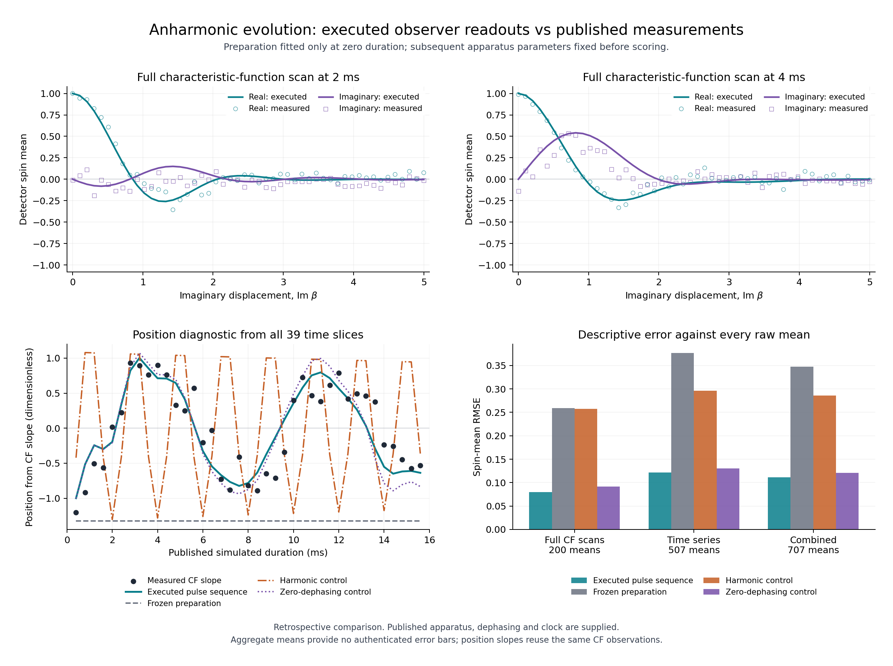

# Anharmonic evolution against physical detector measurements

This packet tests a new dynamical postdiction: prepare an oscillator using
zero-duration calibration, execute the published anharmonic pulse sequence,
and predict the later binary spin measurements. The observations come from
McGarry et al., [*Programmable quantum simulation of anharmonic dynamics*](https://arxiv.org/html/2603.04744v1),
with raw data deposited under [DOI 10.5281/zenodo.18752287](https://zenodo.org/records/18752287).

The earlier [source-executed preparation/readout comparison](../scalar_observations/experimental_readout/EXECUTABLE_READOUT.md)
has no intervening evolution. Here the state evolves through the entire
spin–oscillator pulse history, including continuous detuning, a supplied
dephasing channel and the final spin-selection condition. All positive-duration
measurements are excluded from calibration. This is retrospective: the paper
and its qualitative results were already known.

## What is measured

The raw measurements are binary spin averages that estimate the real or
imaginary part of the oscillator characteristic function `chi(beta)`.
The outcome-zero probability is `(1+spin_mean)/2`. We compare these detector
probabilities directly; a plotted position is a derived slope of the same
observations, not another independent measurement.

The [protocol](protocol.json) uses fifty zero-duration complex measurements
with explicit displacement coordinates to fit only the real preparation
displacement and thermal occupation. It then predicts:

- All fifty complex probes at 2 ms and at 4 ms: **200 scalar means**.
- All thirteen imaginary probes at each of 39 positive durations from 0.4
  to 15.6 ms: **507 scalar means**.

The durations are the experiment's published simulated durations, calibrated
through its pulse settings. They are not the execution host's runtime or
the number of native source pulses. No later response is used to fit a
frequency, noise rate, amplitude, phase, offset or visibility.

## What executes

1. A supplied capped thermal draw selects a number preparation. Native Fock
   and displacement words prepare the calibrated oscillator state; no
   preparation branch is dropped.
2. The source executes the continuously detuned spin–oscillator pulse
   Hamiltonians. A canonical real eigenbasis, diagonal eigenphases, controlled
   parity and spin rotations are each contracted from native twelve-port
   words. Direct finite matrix exponentials are independent checks only.
3. A supplied phase-diffusion channel with the published rate `18 s^-1`
   acts during evolution. Symmetric splitting interleaves it with executed
   subpulses. The initial spin remains coherent throughout every complete
   evolution step.
4. At each requested endpoint, the execution retains both final spin
   probabilities. Source pointer Kraus operators produce both subsequent
   detector outcomes. The comparison conditions on the same accepted spin
   outcome as the experiment, while retaining rejected probability mass.
   Different endpoint/probe settings represent fresh trials; a readout does
   not collapse the state reused to compute another trial's prediction.
5. Every predicted law is fixed and hashed before positive-duration values
   are loaded for scoring. Numerical refinements and all declared controls
   are retained regardless of their agreement.

The computational prediction runs on a classical host. It contracts the
source's declared quantum operations; it is not a new laboratory execution.
Cached operation matrices save host work while the resource ledger counts
their full word on every application. The preparation family, coherent
services, apparatus Hamiltonian, environment, detector and clock calibration
remain supplied. The [derivation](DERIVATION.md) gives the maps and selection
semantics, including the paper's sign/phase convention issues.

## Results and analysis

The complete [receipt](results.json) retains every scored prediction,
observation and residual, both conditional detector probabilities, joint
selection/readout probabilities, source word bindings and numerical checks.

The zero-duration fit gives `alpha=-1.00812923265` and
`nbar=0.133141251725`. The later binary-probability RMSE is:

| Fixed model | Full 2/4 ms scans, 200 means | Time series, 507 means | All 707 means |
| --- | ---: | ---: | ---: |
| Executed pulse sequence + published dephasing | 0.039974 | 0.060644 | **0.055582** |
| Frozen preparation | 0.129498 | 0.188290 | 0.173689 |
| Harmonic evolution + same dephasing | 0.128540 | 0.148071 | 0.142817 |
| Complete pulse sequence, no dephasing | 0.045870 | 0.065130 | 0.060308 |

The primary model reduces overall RMSE by 68.0% relative to the frozen state
and 61.1% relative to the harmonic control. It reproduces the broad slow
oscillation and the shapes of the later characteristic scans. The published
dephasing improves this score by 7.8% relative to the zero-dephasing control.
These percentages compare descriptive errors, not statistical significance.



The primary model is fixed at occupation 32 and eight dephasing subdivisions
per 50 microsecond pulse. Occupation 64 and sixteen subdivisions test numerical
stability. The controls keep the frozen preparation, retain only harmonic
evolution with the same dephasing, or execute the complete pulse sequence
without dephasing. They are fixed comparisons, not alternatives selected by
their scores.

Material discrepancies remain. The imaginary component of the 4 ms scan is
overpredicted in part of its central hump, and the later time series has
zero-crossing and amplitude mismatches. The largest individual probability
residual is 0.21618: at 13.6 ms and `Im(beta)=0.2828427`, the prediction is
`P0=0.44382` and the deposited frequency is `0.66000`. The separate zero-duration
position scan, which was not fitted, already has spin-mean RMSE 0.07462;
differences across preparation/readout scans therefore also need assessment.

Increasing occupation 32 to 64 changes an individual predicted probability
by at most **0.0008704**. Doubling the dephasing subdivisions changes one by
at most **0.00001369**. Their combined-score changes are similarly small.
These tested numerical refinements do not explain the main discrepancies;
they do not certify all remaining cutoff or apparatus errors.

RMSE is descriptive. Accepted shot counts, full apparatus errors and
calibration-parameter uncertainty are not authenticated here. Numerical
refinement differences are not a rigorous unrestricted-oscillator error
bound. Software `all_pass` checks execution and comparison contracts; it
does not establish empirical agreement or statistical significance.

## What it means and next steps

This is a direct test of later observations produced from executed dynamics,
with the preparation and apparatus inputs fixed independently of those
observations. Its physical scope is a supplied single-mode quantum simulator;
it does not test the separate spatially coupled scalar construction.

The result supports approximate dynamical agreement for this conditional
preparation–evolution–selection–readout model, with substantially lower error
than its frozen and harmonic controls. It is not a precise fit to every
measurement. It does not distinguish OPH from ordinary quantum mechanics:
the anharmonic action and apparatus have not been selected by OPH. The
discrepancies remain in the receipt; no withheld trajectory was refitted.

Useful next steps are a calibrated preparation uncertainty region, an
authenticated detector/selection error budget, and transport to independently
specified changed-potential experiments. Native action selection and the
connection between native geometry and field propagation remain separate
construction obligations.

## Reproduce

From the repository root, using `model/requirements.txt`:

```sh
OPENBLAS_NUM_THREADS=1 OMP_NUM_THREADS=1 python -m model.anharmonic_observations --check model/anharmonic_observations/results.json
OPENBLAS_NUM_THREADS=1 OMP_NUM_THREADS=1 python -m pytest -q -W error model/anharmonic_observations
python -m model.verify --hashes-only
```

The retained plot can be regenerated with Matplotlib additionally installed:

```sh
MPLCONFIGDIR=/tmp/oph-mpl python -m model.anharmonic_observations.plot
```

A cold full replay can take several minutes because it compiles and executes
the source words at both occupation cutoffs. The CLI can also save a complete
prediction payload with `--predictions-write PATH` before scoring. Raw data,
license, byte counts and published checksums are retained in
[provenance](provenance.json). All earlier evidence packets remain unchanged.

Replay checks each receipt's own exact pre-scoring prediction hash, then
compares floating diagnostics with tolerance `2e-9`. Fresh Linux and Windows
executions of the macOS receipt differ from it by about `1.6e-10` on one
runner and by more than `2e-10` on another; the tolerance is not a physical
error bound. Source words, protocol and data hashes, counts and other strings
remain exact. The hash of a full
floating payload can differ between valid platform runs; it is validated
individually rather than used as a cross-platform numerical equality test.
