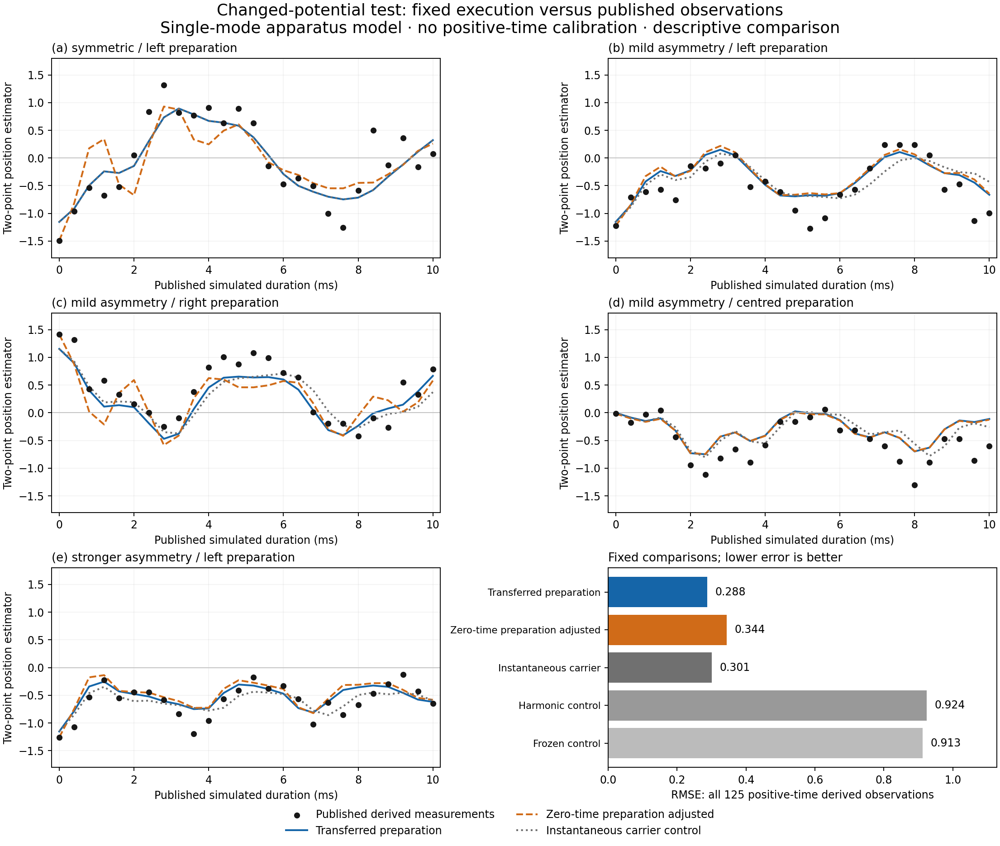

# Changed-potential empirical transfer and executed environment

This packet extends the [anharmonic observation test](../anharmonic_observations/README.md)
in two ways: it executes the supplied noise through a finite native channel,
and tests changed potentials and preparations without calibrating on their
later measurements. All five experiments and all 125 positive-time derived
observations are retained. The experiment is McGarry et al.,
[*Programmable quantum simulation of anharmonic dynamics*](https://arxiv.org/html/2603.04744v1),
with [published data](https://zenodo.org/records/18752287) under CC-BY-4.0.

The [identifiability checks](../identifiability_checks/README.md) provide an
independent effective-Hamiltonian comparison and characterize the unresolved
measurement normalization. Replay verifies derived summaries against each
run's predictions and uses the fixed `2e-10` tolerance for primitive floating
predictions. Calibration inputs are immutable, independently authenticated
payloads.

## Executed environment channel

Here a positive finite classical draw selects one of sixteen phase rotations,
and **every phase rotation is contracted from native source words**. Averaging
these executed branches yields the finite environment channel. The Gaussian
noise family, rate and independent draws remain supplied; execution does not
infer the laboratory's noise mechanism or correlation time.

For each requested trial the computation is:

1. Prepare the supplied displaced thermal family through native number and
   displacement words. The primary uses the separate zero-duration scan's
   `|alpha|=1.0081292326480422`, `nbar=0.13314125172459518`, changing only the
   declared initial side or centre.
2. Execute the full detuned spin–oscillator pulse sequence, with the selected
   potential phase, positive finite environment channels and finite-duration
   carrier rotations. The spin continues through every step.
3. At the terminal step, retain accepted and rejected spin masses. Contract
   the native pointer instrument and retain all four joint spin/detector
   probabilities. Only the published comparison conditions on spin down.
4. Convert the conditional detector mean into the paper-described two-point
   estimator used for comparison with the deposited values. Each trial retains its declared preparation and complete selection law.
5. Seal every prediction, including controls and numerical refinements,
   **before loading positive-time outcomes for scoring**.

The host sums the finite instrument law; it does not simulate one noisy
laboratory shot. Caches avoid recompiling identical words while the ledger
counts their application on every step. Source word hashes, exact protocol
and data bindings, rejected mass and numerical error budgets accompany the
complete [result receipt](results.json).

## What is measured, and what is supplied

The deposited values are derived position estimates. For the published
probe `h=.4`, the executed detector gives the spin mean `Im chi(i*h)` and

\[
 x_{\mathrm{2PFD}}=\frac{\operatorname{Im}\chi(ih)}{\sqrt2 h}.
\]

This is a finite-difference estimate, not the exact expectation of the position
operator. The latter is stored only as a diagnostic. The deposit does not
provide authenticated raw spin counts or accepted shot counts for these
trajectories. No probability-frequency reinterpretation or statistical
significance claim is made.

The apparatus supplies detuning `2*pi*500 /s`, force rate `pi/(150 us)`,
50 us sideband pulses, spin angle `.8`, carrier rate `pi/(35 us)` and
number-dephasing rate `18 /s`. The table fixes the five cases:

| Case | Potential phase | Executor phase | Initial preparation |
|---|---:|---:|---|
| a | 0 | 0 | left |
| b | -pi/20 | +pi/20 | left |
| c | -pi/20 | +pi/20 | right |
| d | -pi/20 | +pi/20 | centre |
| e | -pi/10 | +pi/10 | left |

The executor sign follows by differentiating the small-angle native sequence;
it was not chosen from the trajectories. The paper's caption and prose agree
on the case mapping. The deposited README swaps d/e; its zero-time row
independently identifies d as the centred preparation.

A second provenance issue remains unresolved: the zero-time printed values
have quantization compatible with integer hundredths divided by `.636`,
whereas the paper specifies `h=.4`. This does not authenticate another
probe coordinate, gain, shot count or correction. The protocol preserves the
literal paper value and the unmodified deposited data. Resolving this with
authenticated measurement metadata is necessary for a precise empirical test.

The horizontal coordinate is the **published simulated duration** `K*200 us`.
With finite carrier rotations, elapsed drive duration is 207 us per step
for cases b/c/d and 214 us for e. Both clocks are retained. Laboratory phase
compensation during the extra durations is undocumented. The fixed
instantaneous-carrier control tests this modeling choice; a better score
would not by itself establish the laboratory convention.

## Fixed comparisons and numerical guarantees

The primary is a no-new-fit transfer. A separate secondary analysis uses
one zero-time value per case to recalibrate only displacement, with the same
thermal occupation. It inverts the finite-difference formula on its principal
branch, rather than setting `alpha=x/sqrt(2)`. The five new displacements are
approximately `[-1.51051, -1.09411, +1.36038, -0.01230, -1.13325]`.
These five preparation calibrations are disclosed; one datum cannot identify
thermal occupation or non-Gaussian preparation errors.

The transferred preparation is read from the compressed
[original calibration receipt](data/calibration_receipt.json.gz). Decompression
must reproduce the original receipt SHA-256 `80504ae1e92e94de0e5f50484da4a5dbbdb0981389c5733066468b36e961f215`
before its parameters are read. This frozen input preserves the reviewed fit
when the live anharmonic receipt is regenerated to refresh source custody;
it does not replace the live source execution or its current bindings.

Other fixed controls retain the initial state, or remove the anharmonic drive
while preserving the same elapsed schedule. In the harmonic control the
opposite carrier rotations cancel, but their durations still advance the
harmonic phase and dephasing. All controls are reported, regardless of score.

Primary execution uses occupation dimension 32 and 128 subdivisions per
50 us pulse. Step refinement uses dimension 32/256 subdivisions. Occupation
refinement compares dimension 64/256 subdivisions to 32/256 subdivisions,
so these checks change one numerical choice at a time. These occupation
checks apply to the primary transferred preparations; the secondary
preparation-adjusted analysis has no separate cutoff check in this packet.

The new [finite-model certificate](DERIVATION_BOUNDS.md) bounds splitting
against the unsplit finite Lindblad law, with arbitrary input/reference
entanglement. It retains the finite oscillator commutator boundary term.
At the longest duration, its unconditioned probability-error bound is
`0.00033954` at dimension 32/128 subdivisions and `0.00030686` at
dimension 64/256 subdivisions. Each record
also adds its ideal finite-environment quadrature error and divides by its
retained acceptance mass to bound the selected detector law.

This is an **ideal finite-model** certificate. Floating contractions,
quadrature rounding, acceptance roundoff, occupation removal, preparation
uncertainty and apparatus errors are not covered. The quadrature remainder
is far below floating precision; no corresponding numerical precision claim
is made. Numerical refinement diagnostics and physical residuals remain
separate from this mathematical statement.

## Results and analysis

RMSE below is in **dimensionless two-point position-estimator units**. It is
not the binary-probability RMSE reported by the earlier packet.

| Fixed comparison | a | b | c | d | e | All 125 |
|---|---:|---:|---:|---:|---:|---:|
| Transferred preparation (primary) | 0.357529 | 0.283991 | 0.269777 | 0.302882 | 0.201735 | 0.287643 |
| Five zero-time displacement adjustments | 0.470288 | 0.305289 | 0.369199 | 0.300995 | 0.226822 | 0.344304 |
| Instantaneous carrier control | 0.357529 | 0.331371 | 0.295649 | 0.304619 | 0.184492 | 0.300623 |
| Harmonic control | 1.007644 | 0.984895 | 0.935711 | 0.641178 | 1.000014 | 0.924344 |
| Frozen control | 1.363180 | 0.809437 | 0.912844 | 0.641178 | 0.640102 | 0.912970 |

The primary reduces aggregate RMSE by **68.49% against the frozen control**
and **68.88% against harmonic evolution**, and beats both controls in each of
the five cases. It reproduces broad oscillation in case a and the
persistently negative position estimates under the stronger asymmetry in e. This is approximate dynamical
transfer within the declared apparatus model, not close agreement with every
measurement.



The largest primary discrepancy is case a at 8.4 ms: prediction `-0.579113`
versus deposited `+0.503145`, an estimator residual of `-1.082258`. Several
extrema have appreciable amplitude errors. Every such row remains in the
receipt; there is no exclusion or later-trajectory refit.

The separately declared zero-time adjustment **worsens** aggregate RMSE from
`0.287643` to `0.344304` (19.70%). It worsens cases a/b/c/e and slightly improves
d. Correcting only initial displacement under the same thermal-family and
readout assumptions therefore does not repair the transfer. This does not
identify which preparation or apparatus assumption is responsible.

Including finite carrier durations improves the combined score from
`0.300623` to `0.287643` (4.32%) compared with the instantaneous control.
Cases b/c/d improve, case a is unchanged, and case e becomes worse. The
comparison does not authenticate the laboratory phase convention.

The maximum ideal selected probability bound for the primary is
`0.000429036`, equivalent to **0.00151687 estimator units**. The smallest
retained acceptance probability is `0.791399`. The actual step refinement
changes an estimator by at most `2.46650e-7`; the occupation refinement changes
one by at most `0.00449740` (binary probability change `0.00127206`). These are
small relative to the empirical discrepancies. The ideal splitting and
finite-quadrature approximation within the declared finite model cannot
account for those discrepancies. The cutoff comparison remains a diagnostic,
and floating execution and physical errors remain outside the ideal bound.

The receipt now also attaches the independent
[unrestricted-apparatus certificate](../occupation_control/README.md) before
opening later observations. It verifies the same binary preparation, pulse,
dephasing, detector and time parameters, and binds the certificate's original
source and result bytes. This evaluator includes occupation removal,
integration, preparation, detector evaluation and arithmetic error. It does
not certify native compilation or physical services.

For a deposited decimal value `y` and a certified apparatus interval
`[c-r,c+r]`, any remaining combined measurement, calibration or model error
must be at least `max(0, |y-c|-r)`. The producer calculates this distance with
exact rationals. The 64-level certificate gives these case-a comparisons:

| Time | Certified centre | Certified radius, rounded up | Deposited value | Remaining allowance, rounded down |
| --- | ---: | ---: | ---: | ---: |
| 0.4 ms | -0.9122189395 | 0.00000009905 | -0.959119497 | 0.04690045 |
| 2 ms | -0.1434118369 | 0.016264164 | 0.047169811 | 0.17431748 |
| 10 ms | 0.3230507467 | 1.676153790 | 0.078616352 | 0 |

Thus certified occupation and numerical errors cannot cover the early
discrepancies under the fixed apparatus. The zero at 10 ms means its wide
interval gives no positive correction floor. Both existing cutoffs remain
visible: dimension 32 has two eligible certified observations and dimension
64 has three. Every other one of the 125 held-out observations remains
explicitly unavailable; the certificate's 5 ms endpoint has no matching
measurement and is not interpolated. The separate zero-time case-a value
requires at least `0.34054967` beyond its certified numerical interval. It is
kept outside the held-out comparisons and supplies no independent evidence
for the secondary preparation adjustment.

These are necessary discrepancy allowances, not estimated detector biases
or statistical rejection levels. The paper reports 200 measurements per
position point, but its two postselections and aggregate deposition do not
authenticate per-point accepted counts, raw trials, preparation covariance
or the unresolved estimator conversion. No experimental confidence band is
inferred from the printed values. Agreement within a complete physical
uncertainty budget remains unestablished; no parameter or datum is corrected.

The package tests include independent unsplit master-equation comparisons,
the finite-occupation boundary counterexample, full spin continuation, native
environment accounting, poisoned-outcome isolation, protocol mutation rejection
and portable receipt replay. The `--check` command below reproduces the
retained receipt, and `model.verify` checks every model artifact binding. The
plotted figure was visually inspected for clipping and overlaps. Software `all_pass` records
execution/comparison contract success, not an empirical acceptance threshold.

## What it means and next steps

This adds an executed open-system component and a stricter empirical transfer
test to the model. It reduces an implementation shortcut and gives an explicit
finite evolution error budget. The single-mode Hamiltonian, preparation
family, apparatus, noise law and calibrated durations remain premises. Their
selection from OPH, the spatially coupled model's empirical comparison and
an interacting relativistic continuum remain separate open work.

The comparison is retrospective and tests a supplied quantum-mechanical
apparatus model compiled through the OPH source interface. It does not
distinguish OPH from ordinary quantum mechanics. Preparation adjustments,
phase-duration sensitivities and metadata ambiguities must remain visible
when interpreting agreement or disagreement.

The next empirical priority is authenticated probe-coordinate, carrier-phase
and accepted-count metadata, followed by independent preparation constraints
and a complete physical uncertainty budget. The published selection dwell
periods are another apparatus timing question: the current terminal
selection/readout is an ideal instrument, without an additional dwell-noise
model. No residual is attributed to this missing information. The next construction priority is
to connect native action selection to experimentally discriminating records,
rather than infer it from successful compilation of supplied dynamics.

## Reproduce

From the repository root with `model/requirements.txt`:

```sh
OPENBLAS_NUM_THREADS=1 OMP_NUM_THREADS=1 python -m model.anharmonic_transfer --check model/anharmonic_transfer/results.json
OPENBLAS_NUM_THREADS=1 OMP_NUM_THREADS=1 python -m pytest -q -W error model/anharmonic_transfer
python -m model.verify --hashes-only
```

Use `--predictions-write PATH` to save the prediction payload before scoring,
and `--write PATH` to retain a new receipt; both use exclusive creation.
Cold execution compiles large native source words at both occupation cutoffs.
The optional plot requires Matplotlib:

```sh
MPLCONFIGDIR=/tmp/oph-mpl python -m model.anharmonic_transfer.plot
```

The [protocol](protocol.json), [source derivation](DERIVATION_SOURCE.md),
[finite environment derivation](DERIVATION_ENVIRONMENT.md) and
[byte-level provenance](provenance.json) specify the experiment and its limits.
Calibration snapshots fix the preparation inputs independently of live replay.
Narrow rational intervals are checked at high precision. These are numerical
verification contracts, separate from physical apparatus error.

Replay validates each receipt's exact pre-scoring seal and each conditional
certificate against its own retained acceptance. It also recomputes every
position estimator from its spin mean and the fixed probe coordinate, and
every score and refinement from that receipt's complete prediction and the
fixed comparison data. Those dependent values, their types, and their
metadata must agree exactly with this recomputation before being omitted
from the cross-receipt numerical comparison. This avoids applying the same
dimensionless tolerance again after an estimator conversion amplifies its
checked inputs.

Primitive spin means, probabilities, and other floating diagnostics retain
the `2e-10` replay tolerance. The separate exact-position diagnostic is
compared in units of the rigorous finite operator bound
`||Q_d|| <= sqrt(2(d-1))`; it is neither dropped nor identified with the
finite-difference estimator. The five exact-rational strings derived from
floating acceptance are omitted only after their own-input verification.
Fixed splitting/quadrature certificates, source word hashes, data/protocol
bindings, counts and all other strings remain exact. These replay checks
are numerical consistency controls, not physical precision certificates.

Short Hamiltonian subpulses use a stable evaluation of their ideal inverse
source words: `B D B^-1 = I + B (D-I) B^-1`, with the corresponding axis
and sign conjugations. Both independently executed basis matrices remain
in the calculation. The twice-applied parity contributes its literal
`P^2-I` remainder; it is not replaced with an inverse. Each pulse also
retains the original straight-product contraction, checks both forms
against the independent finite Hamiltonian target, and caps their
representation difference at the fixed `2e-10` native numerical scale.
The final increment matrix also passes the compiler's existing guarded polar
representation. This prevents its residual nonunitarity from accumulating
through repeated applications. The raw product and increment checks remain
mandatory; the corrected matrix is checked against the independent target
and against the raw product. The correction receives no state or observed
outcome, and does not replace an operation with its target. The retained
metadata reports both representation changes and the restored defect.
These operations represent ideal words numerically; they do not cancel
physical service errors or certify floating precision.

Controlled occupation parity uses two native pulses, including its scalar
phase. Number drift uses one scalar pulse plus one Z pulse per occupation bit.
At dimension 64 these words use 2 and 7 pulses respectively, compared with
2,054 and 838 for their generic diagonal compilations. Full-matrix checks
include the highest occupations and global phase. Source hashes and resource
receipts bind the implemented words; calibration input bytes are fixed.
Dense basis words dominate cold compilation.

The repository-wide verifier shares parameter-keyed source compilation caches
between the two empirical CLIs. Both execute their full canonical prediction,
score and receipt checks; no trajectory, result or fitted preparation is reused.
