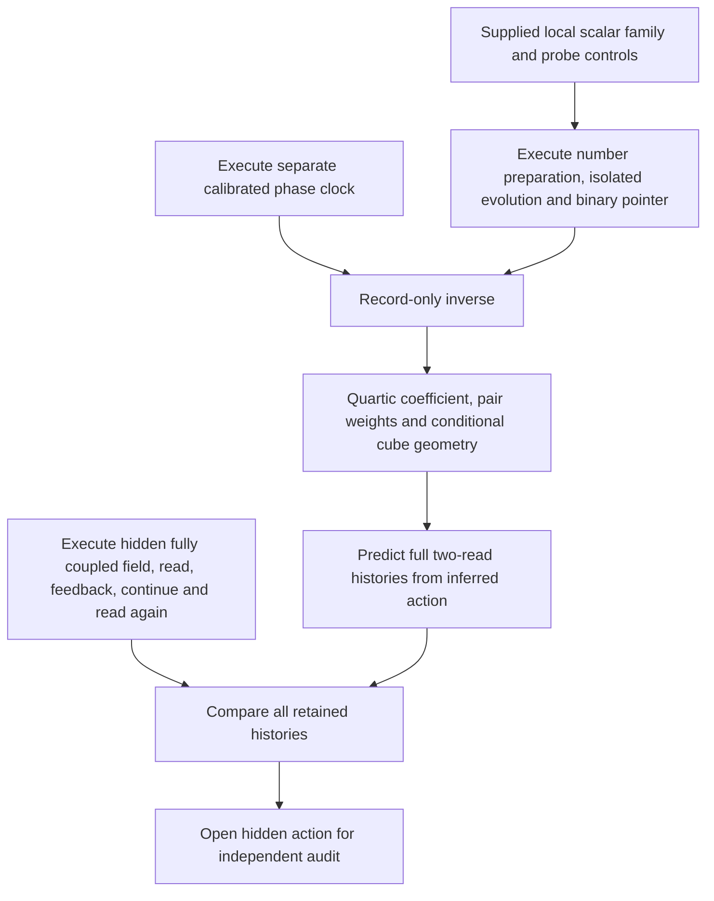

# Recovering an interacting field from observer records

This executable benchmark identifies a **local quartic scalar action** from
source-executed binary probabilities and predicts a fully coupled, disturbed
two-read history. It extends the [free-field reconstruction](../observer_reconstruction/README.md)
and uses the existing [canonical scalar regulator](../relativistic_scalar/README.md).
The interaction, coupling graph and bare coefficients are hidden from the
estimator. The oscillator/action family, isolation controls, preparations,
detectors and clock calibration remain supplied.

This is conditional finite-field identification, not full interacting
spacetime recovery or an empirical comparison. The inference arithmetic runs
in Python on accessible records; it has not been compiled into the source
observer's own control operations.

## What runs



There are eight opaque channel labels, with a hidden permutation of the
supplied cube. The backend action is

```text
H = sum_i [p_i²/2 + A_i q_i²/2 + g_i q_i⁴] - sum_(i<j) kappa_ij q_i q_j,
A_i = m² + sum_j kappa_ij,     g = lambda/(24 a³).
```

Its supplied values are `m=c=a=lambda=1`, with oscillator basis frequency
`Omega=2`. These values are exposed only in the final audit, not passed to
the inverse or predictor. Infinite oscillator polynomials are formed before
occupation compression: `P q⁴ P` is not replaced by `(P q P)⁴`.

Calibration executes 176 fresh binary trials, **as complete probability
laws**, at clock intervals near `1/2048` and `1/1024`:

1. At each site, isolate its four-level onsite service. Execute number-state
   preparation of `|0>` or `|1>`, evolution, then a binary pointer projecting
   onto `(|0> ± i|2>)/sqrt(2)` or `(|1> ± i|3>)/sqrt(2)`. Both pointer
   outcomes are retained. Opposite phase settings use fresh preparations.
2. For every one of the 28 pairs, isolate its two-level-per-site bond service,
   prepare `|00>`, evolve and read `(|00> ± i|11>)/sqrt(2)`. A missing bond
   executes an identity service using the same request/resource schedule.
3. Execute a separate phase clock for each interval. The inverse receives its
   two quadrature probabilities, rather than a backend duration. The clock's
   rate, shared interval correspondence and unwrapped window are premises.

All preparation, evolution and detector matrices are contractions of emitted
twelve-port source words. Independent finite targets check those matrices;
they do not replace the execution. Code services, blanks, computational
pointer readout and negligible numerical stabilization retain their existing
scope. The displayed probabilities are calculated Born laws, not sampled
experimental frequencies or measured physical hardware outputs.

The inverse estimates generator matrix elements from the two phase differences
at both intervals, cancelling the leading finite-duration bias. The onsite
elements `h02` and `h13` distinguish the quartic coefficient from a quadratic
mass change. The pair elements identify the coupling weights. The estimator
assesses every pair before testing the cube geometry; unit edge length and
the cube embedding convention are supplied. Exact absent edges require the
explicit family premise `kappa_ij=0` or `kappa_ij>=0.1`.

The recovered action is then assembled on the opaque labels. At each of two
cutoffs, the predictor computes both native-phase-conditioned two-read laws
**before** the corresponding withheld field executes. One site has eight
levels; each of its seven spectators has two or four. Starting from a supplied
product oscillator blank, the actual source runs 128 symmetric local steps
over model interval `1/128`, reads the existing level-0/4 pointer, applies
first-bit-controlled feedback to level 4, continues for another `1/128`, and
reads again. The disturbed field is retained throughout. Every one of the
four bit histories is kept, and the native preparation/actuation attachment
retains all 1,056 joint histories at each cutoff. This is the existing
classical native attachment, not a new coherent native encoding.

## Results

The retained [receipt](results.json) recovers all 12 hidden edges and a
rank-three unit-edge cube Gram matrix. It estimates:

| Quantity | Recovered value | Ideal finite-duration interval |
| --- | ---: | ---: |
| Bare mass squared | 1.000000000075 | [0.9999989912, 1.0000010089] |
| Bond weight `kappa` | 0.999999999995 | [0.999999999989, 1.000000000002] |
| Local quartic coefficient `g` | 0.041666666652 | [0.0416664303, 0.0416669030] |

The target quartic coefficient is `1/24`. Its positive interval excludes a
purely quadratic onsite action within the declared family. An independently
executed zero-quartic calibration returns an interval containing zero. The
reported bare mass and speed coefficient are **action parameters**, not a
measured interacting excitation gap or measured relativistic propagation speed.
Table values are rounded for display; the receipt retains numerical bounds.

| Complete two-read law | 8 × 2⁷ levels | 8 × 4⁷ levels |
| --- | ---: | ---: |
| Hilbert dimension | 1,024 | 131,072 |
| Largest prediction/execution TV | 2.54e-13 | 2.06e-13 |
| Ideal parameter + splitting TV bound | 2.44e-6 | 2.03e-5 |
| Smallest matched quartic-deletion discrepancy | 3.90e-5 | 3.90e-5 |
| Ideal source-to-unrestricted-occupation TV bound | 1.133e-3 | 6.371e-4 |

TV denotes half the sum of absolute differences across all four histories.
The first row of errors reports numerical agreement; it is not a numerical
roundoff certificate. Parameter and splitting bounds apply to the ideal
finite operations and exclude clock uncertainty, floating error and physical
service imperfections. The largest source-word count per phase-conditioned
history is 2,912,262 or 4,729,350 native pulses, respectively; the source
matrices are cached, so those counts are not host runtime or physical durations.

Deleting first-bit feedback changes the smaller-cutoff history by
`0.00287015` in TV; the same recovered action also predicts that changed
protocol. Thus the successful comparison includes measurement disturbance
and continued feedback. It is not a comparison of independently reset reads.

The matched quadratic forecast keeps the recovered quadratic terms and
removes `g q⁴`. Its mismatch exceeds the finite interacting prediction
budget at both cutoffs. This rejects that matched finite deletion, not every
possible Gaussian description, classical simulator or alternative field
theory. The present occupation budgets are larger than that contrast:
**this particular discriminator is not certified after occupation removal**.
The earlier regulator's separate bounded interaction witness retains its own
scope and is not being replaced by this comparison.

## Error and access boundaries

[DERIVATION.md](DERIVATION.md) derives the finite-duration and parameter
budgets and maps the inherited occupation certificate. The latter transfers
by a cube automorphism moving the hidden read site to the certificate's
origin, preserving all seven equal spectator cutoffs, preparation, pointer,
feedback and interval lengths. It compares with eight unrestricted
oscillators at fixed spatial volume, not an infinite spatial or continuum
limit. No old retained result is overwritten.

The estimator is granted isolated onsite/pair controls and a trusted
oscillator basis. Cross-cutoff predictions rely on the same supplied
polynomial family being implemented by those controls. Passive access to
one uncontrolled field does not automatically provide this calibration.
Two onsite transitions do not exclude arbitrary additional diagonal, sextic
or multisite terms outside that family. The withheld histories test transfer
at their declared settings, not uniqueness among all compatible Hamiltonians.
Finite dimension two cannot separate onsite mass and quartic coefficients;
the four-level calibration is essential. The probe generator norm caps
`16` and `2` are declared before inference and independently checked later.

The receipt also propagates a hypothetical simultaneous `1e-7` error per
calibration probability. It still resolves positive `g`, conditional on
exact clock readings. A simple independent-Bernoulli/Hoeffding guarantee
would require about `4.43e14` shots per law, or `7.80e16` total, for 95%
simultaneous coverage. **No such sampling was run.** This deliberately
conservative calculation makes the limitation of a very short-time,
exact-probability estimator visible; it is not an efficient experimental
proposal. Clock and systematic control errors would need their own budgets.

## What this advances, and next steps

The recovered description now includes a number-changing local interaction,
spatial connectivity, a calibrated model-coordinate duration, and a prediction
for a continuing measured field. The free Gaussian reconstruction alone did
not establish that combination. The compatibility target is fixed in advance:
agreement of all withheld bit-history probabilities within declared budgets,
with supplied preparation, instruments and feedback held fixed.

The next construction should reduce the strong calibration access and short-time
sampling cost, then maintain identifiable interacting observables over a common
spatial, occupation and energy refinement domain. Renormalized parameters,
interacting propagation/Lorentz-error estimates, and a state/clock correspondence
must be controlled on that same domain. Native selection of the action and
identification of native and field geometry remain separate unfinished steps.
Physical spacetime, gravity, the Standard Model, an interacting continuum QFT
and new agreement with nature are not established by this finite receipt.

## Reproduce

From the repository root with `model/requirements.txt` installed:

```sh
OPENBLAS_NUM_THREADS=1 OMP_NUM_THREADS=1 python -m model.interacting_reconstruction --check model/interacting_reconstruction/results.json
OPENBLAS_NUM_THREADS=1 OMP_NUM_THREADS=1 python -m pytest -q -W error model/interacting_reconstruction
python -m model.verify --hashes-only
```

Use `--write <new-path>` for a new receipt; existing paths are refused.
The package is included in `python -m model.verify` alongside the existing
model receipts. The [manifest](manifest.json) binds the code, tests, derivation
and result; the result additionally binds its imported numerical producers.
Portable replay keeps numerical parameter bounds and the fixed rational
occupation/splitting certificates. Exact expansions of bounds derived from
floating clock readings are regenerated by the bound helpers from their
inputs, so last-bit differences do not become exact-string replay failures.
