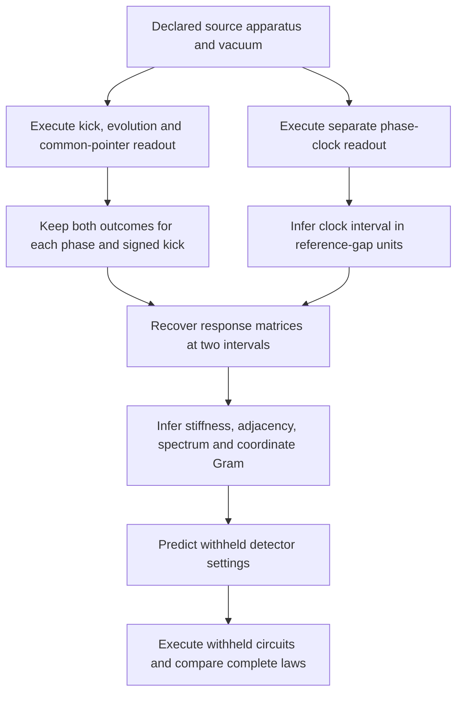

# Recovering a finite field description from observer records

This package executes an observation protocol, hides the apparatus's
Hamiltonian and coordinates from an inverse routine, and reconstructs a
finite spatial field description from its records. It joins field propagation
to an independently read clock and predicts measurements withheld from the
reconstruction. It is a finite **free-field identification benchmark**, not
completion of the interacting 3+1-dimensional QFT or gravity construction.

```sh
OPENBLAS_NUM_THREADS=1 OMP_NUM_THREADS=1 python3 -m model.observer_reconstruction \
  --check model/observer_reconstruction/results.json
OPENBLAS_NUM_THREADS=1 OMP_NUM_THREADS=1 python3 -m pytest -q -W error \
  model/observer_reconstruction
```

The readout probabilities are floating evaluations of complete ensemble laws.
No physical shots or empirical comparison data are introduced. Both detector
outcomes are retained, including outcomes that have very small probability.

## What the observer receives

The field estimator receives labels for eight accessible channels, two binary
Ramsey readout laws for each signed intervention, the two quadratures of an
independent phase-clock readout, calibrated kick/probe strengths and a
frequency alias bound. It receives no coordinates, Hamiltonian, eigenbasis,
mass, coupling or backend evolution-duration variable.
The inverse is a classical Python calculation on those accessible records;
its arithmetic has not been compiled into native observer hardware. The
source-execution claim concerns the preparations, evolution and instruments.



The source apparatus supplies an eight-site canonical quadratic action
`H=(pᵀp+qᵀKq)/2`, where `K=m²I+κL` and `L` is the open-cube graph
Laplacian. Site names are permuted before the records are produced. This
is the free member of the existing [canonical scalar](../relativistic_scalar/README.md)
action. Its occupation regulator retains eight or sixteen levels **per normal mode**.
Local-site cutoff certificates concern a different regulator and do not
automatically apply to these normal-mode levels.

For each setting, [source.py](source.py) performs the following computation:

1. Initialize eight oscillator codes in their normal-mode vacuum blanks.
2. Compile and execute the kick `exp(i γ q_x)` through the retained
   twelve-port proper-code controls on every affected mode.
3. Execute each mode's number rotation for the declared model interval.
4. Prepare one coherent binary pointer. Execute its controlled
   `exp(i η q_y)` across all eight modes and perform a final Ramsey read.
5. Contract the actual executed local matrices to obtain both pointer
   probabilities. Repeat on a fresh preparation for the other Ramsey phase
   and for the opposite kick. This is not a sequential two-read experiment.
6. Separately execute the reference clock circuit for the same model
   interval. Its two phase probabilities provide the estimator's time input.

The common-pointer circuit is evaluated as a sequence of two-dimensional
pointer channels obtained by tracing each mode after its interaction. This
contracts the full circuit without allocating its `2 d^8` amplitudes. All
four blocks of each executed controlled matrix are used, including floating
off-block residuals. This is exact tensor contraction of the finite circuit
up to arithmetic error; an analytic Gaussian formula never supplies an
executed field probability. The full dilation specifies the disturbed field,
but this package does not implement later feedback on that field.

The normal-mode encoding, coherent load/export services, vacuum preparation,
addressed interventions, pointer readout and clock are supplied apparatus.
Normal-mode controls can be spatially nonlocal. Reconstructing a local
quadratic action does not prove locality of these hardware services or
derive that action from native repair. Fresh clock trials share a supplied
model interval with the field trials; they are not an autonomous clock
embedded in a continuing observer.

## What is recovered

The [inverse](recovery.py) first reads the characteristic function from
`p0(0)` and `p0(π/2)`. Opposite kicks isolate the response
`R(t)=K^(-1/2) sin(t sqrt(K))`. Two observed intervals in the ratio two give
`R(2t) R(t)^(-1)/2 = cos(t sqrt(K))`. Matrix arccos reconstructs `K` on
the explicitly supplied nonaliasing band. Reciprocity, response amplitude,
conditioning, the band, equal edge weights and cube geometry are checked.
The [derivation](DERIVATION.md) states the assumptions and error boundaries.

The recovered adjacency determines a unit-edge cube Gram matrix of rank
three. Coordinates have an arbitrary orthogonal orientation and origin;
the receipt retains the invariant Gram. The inverse tests the cube hypothesis
for these eight channels. It does not infer the dimensionality of the
Universe from an unrestricted set of possibilities.

| Quantity | Supplied audit target | Recovered at both cutoffs |
| --- | --- | --- |
| Graph | Hidden-label eight-vertex cube | Twelve edges and rank-three Gram |
| Mass / reference clock gap | `1.25` | `1.25`, numerical error below `1e-11` |
| Gradient coefficient `κ` | `0.75` | `0.75`, numerical error below `1e-11` |
| Frequencies | `sqrt(25+24j)/4`, `j=0,1,2,3` | Multiplicities `1,3,3,1` |
| Spatial scale | Edge length one by convention | Speed parameter `sqrt(κ)` per edge per clock unit |
| Withheld detector laws | Sixteen settings at new intervals/strengths | Maximum probability discrepancy below `3e-14` in the retained run |

The sixteen settings are fixed before calibration. Their predictions use
only the inferred matrix and newly read clocks, and are computed before the
corresponding field circuit executes. Only afterward does a separate audit
open the backend matrix to report its discrepancy. These are simulated
withheld predictions, not new predictions tested against physical data.

The code also supplies the conditional vacuum two-point function
`W(t)=exp(-it sqrt(K))/(2 sqrt(K))`. This requires the declared canonical
commutation relations and vacuum; susceptibility alone also admits a
classical harmonic description. A separate source-executed ordered `Q/P`
loop reads a phase of approximately `+0.12` radians and `-0.12` when the
order is reversed. Its largest probability separation from the specified
commuting-operator hypothesis is approximately `0.05986`. A source-executed
zero-`Q` deletion returns the identity-loop law. These controls test the
declared coherent apparatus, not arbitrary untrusted classical simulators.

## Native geometry and rejection controls

[native_geometry.py](native_geometry.py) independently executes 720 exact
native branches: twelve initial load preparations, thirty seams and two
coin values. Its estimator receives only the committed seam/current records
and their exact weights. It reconstructs the transition matrix, slow
projector and unit-diagonal rank-three Gram, with exact identities over
`Q(sqrt(5))`. It never reads hidden output loads or source coordinates.
Relabeling preserves the Gram; biased schedules and erased currents do not
inherit the uniform-schedule certificate.

This native response geometry and the field cube are distinct constructions.
They have **not** been identified as the same physical space. In particular,
the native uniform mean-load diffusion is not converted into an undamped
wave equation by changing clocks; the existing
[native-field obstruction](../common_source/NATIVE_FIELDS.md) remains intact.

Other retained controls expose a clock's full-cycle ambiguity and a
deliberately changed quartic action in **normal-mode** coordinates. The latter
differs from the fitted free predictions by about `0.00176` in probability.
It is a numerical model-change control, not a local interacting field limit;
the free coherent-state cutoff certificate does not apply to it.

## Error accounting and what remains

The [exact cutoff calculation](bounds.py) bounds the complete ideal output,
including terminal fields and both pointer outcomes, against eight
unrestricted oscillators for the declared vacuum protocol:

| Levels per normal mode | Ideal complete-output trace-distance bound |
| --- | --- |
| 8 | `< 1.572e-8` |
| 16 | `< 2.681e-19` |

These are occupation bounds, not total errors. Floating source execution,
physical services, finite-shot uncertainty and inverse-fit amplification are
separate. In particular, the tiny sixteen-level occupation bound does not
make floating probabilities accurate to nineteen decimal places. Inverse
diagnostic tolerances do not constitute a rigorous uncertainty interval for
the recovered mass or geometry. The inverse accepts and clips at most
`1e-12` probability endpoint dust; raw source records remain preserved.
Field-trial pulse/service counts and clock-word metadata are retained;
they are not a total engineering cost for every diagnostic or apparatus.

The finite result adds **executed records → inferred field description →
withheld records** to the prior supplied-matrix analyses. Completing the
[operational target](../CONSTRUCTION.md#completion-target-and-acceptance-criteria)
still requires a common native construction selecting or identifying the
field action and its spatial meaning, a controlled interacting spacetime
validity domain with the observed matter sectors, compatible physical clock
and gravitational responses, and independent empirical comparisons. A
larger occupation cutoff on this cell does not discharge spatial refinement.
