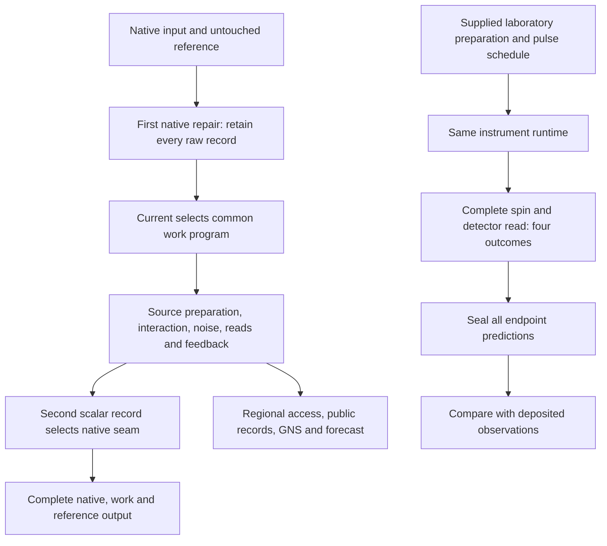

# One finite primitive-observer runtime

This construction executes quantum operations, complete classical records,
feedback and continuation through one finite instrument runtime. The native
repair observer and the laboratory anharmonic apparatus use this runtime.
Their states, interactions and physical interpretations remain separately
declared programs. Sharing an interpreter establishes a common operational
interface; agreement with nature has to be measured for each physical model.

The [complete numerical certificate](COMPLETE_CERTIFICATE.md) bounds the
shared runtime's native/work output against its exact finite and infinite
prepared-history targets. It covers both native laws, active and passive
logical memory, all raw records and arbitrary logical/reference inputs.
The comparison includes the computed encoder, repair and recovery maps;
physical service errors and initially correlated native/work states remain
outside this prepared-work contract.

The retained comparison covers all **125 positive-time observations and five
zero-time endpoints** of the existing anharmonic experiment. Its position
estimator RMSE is **0.2876427868**, with material empirical discrepancies.
The runtime provides explicit state, record, access and replay contracts. This result does not
establish exact empirical agreement, an OPH-specific physical discriminator,
or completion of the [physical-model target](../CONSTRUCTION.md).

## What executes

[runtime.py](runtime.py) represents a finite experiment by a prepared density
matrix and a sequence of instruments. An instrument contains Kraus maps for
every visible outcome, or a hidden complete channel. Feedback selects the
declared next instrument from an earlier committed record. An untouched
reference system is carried through each operation.

For visible record `r` and outcome `b`, execution applies

```text
rho_(r,b) = sum_a (K_(b,a) tensor I_reference)
                    rho_r (K_(b,a) tensor I_reference)^dagger.
p(r,b) = trace(rho_(r,b)).
```

Every branch density remains unnormalized. Its trace is its unconditional
probability, and all outcomes sum to total probability one. A reported
conditional expectation divides by the selected probability only at the
reporting boundary. The underlying history retains rejected outcomes and
the quantum states disturbed by measurement.



The computation is a classical simulation of the declared quantum process.
Source-generated operations are contracted from emitted native pulse words;
finite matrix arithmetic evaluates their complete output laws. This does
not establish that the source selects the apparatus action, preparation,
detector basis or calibration used in an experimental comparison.

## Native repair, work and observer access

[common.py](common.py) compiles the existing charged/scalar work program into
the shared runtime. [native.py](native.py) surrounds it with the actual
compiled native repair maps: the first native record determines current
`-1`, `0` or `1`, and the second scalar record determines the subsequent seam.
The wrapper retains every raw record, including reserved, abort and padding
outcomes. The declared native/reference input can be entangled; work is
prepared independently of that input. Arbitrary initial native/work
correlations are outside this wrapper's contract.

The canonical [observer report](observer_report.py) executes both native
laws C and E, with active protected memory and a passive-memory control. Its
common work register has two scalar sites with occupation dimension two and
a four-dimensional gauge/matter sector. Each declared Hamiltonian interval
uses eight product steps. A finite phase environment supplies variance
`1/20` after the declared first operation. The action, coherent code services,
noise, scheduling and dimensionless Hamiltonian model coordinate are inputs.

The observer-access audit uses the **same current-zero work history** retained
inside the active C wrapper. This is a conditional component of that native
construction; it is not the marginal over all native currents. From its
four-read, sixteen-record state, [algebra.py](algebra.py) constructs:

- The accessible quantum algebra and its state, with the inaccessible
  reference traced out and every public record weight preserved.
- Regional restrictions and observable embeddings that give the same
  expectation values on the common state.
- GNS spaces and an isometric regional inclusion, checked against the
  actual state and its supported numerical ranks.
- Modular flow on faithful regional blocks, preserving their state
  expectations and public records. Its parameter `s` is a modular
  parameter, with no identification as a physical clock.
- Forecasts for a declared complete instrument, compared with the actual
  next source-executed read. Regional forecasts are used only when the
  instrument acts entirely inside that accessible region.

Equal regional marginals do not determine every future interacting
measurement. Tests retain a correlated-state counterexample. Likewise,
partial trace and the regional conditional expectation are completely
positive but generally fail to preserve products. The multiplicative map
is the observable inclusion `A -> A tensor I`.

## Which finite mathematics is attached

The construction connects explicit maps to compatible theorem hypotheses.
It does not discharge every theorem in the repository or generate a Lean
proof from each floating matrix execution.

| Finite result | Concrete attachment and scope |
| --- | --- |
| [Kraus complete positivity and CPTP composition](../../Lean/Dynamics/ChoiCPTP.lean) | Each runtime instrument has a complete Kraus or finite Schur representation; completeness and continuation are checked on the executed program. A growing classical record is a direct-sum output algebra; applying fixed square-matrix formulations also requires an explicit fixed-tape embedding. |
| [Commutative public-record algebra](../../Lean/EventAlgebra/PublicRecordAlgebra.lean) | Functions of retained records act blockwise on the actual classical/quantum history and commute. The remaining quantum algebra can be noncommutative. |
| [Finite entropy completion](../../code/quantum_information/ALGEBRAS_AND_REPAIR.md#the-complete-finite-completion-theorem) | The actual binary native E channel is identified exactly with a tracial conditional expectation on an independently specified retained algebra. The domain and reference are stated below. |
| GNS representation and regional inclusion | The mixed history supplies the state used to build the representation. Inclusion, state pairing and numerical support consistency are checked; inconsistent rank truncation is rejected. |
| [Protected-charge dual fixed-point criterion](../../Lean/Dynamics/ProtectedCharge.lean) | The existing theorem is stated for finite real/classical maps. The matrix-prefix and memory checks provide a quantum analogue under their own hypotheses, rather than a literal instantiation of that theorem. |

The full [OperationalObserver](../../Lean/Tower/OperationalObserver.lean)
structure additionally requires a compatible consensus tower, refinement
maps, states, generators and its declared predictive interface. This finite
runtime does not instantiate that structure. Occupation compression cannot
silently supply exact unital multiplicative refinement maps. Continuum,
relativistic-field and gravitational claims need compatible constructions
and bounds on the same observation laws.

### An exact native completion and executable shortcut

[completion.py](completion.py) identifies the forgotten-record C/E channels
on the invariant 66-dimensional binary total-two shell, on the fixed seam
`(0,1)`. With an equal-load block of dimension 46 and an unequal-load block
`C^2 tensor C^10`, the independently declared retained algebra is

```text
B = M46 direct-sum (I2 tensor M10).
```

Relative to the tracial reference `I66/66`, E is the conditional expectation
onto B. Let Q retain only the cross terms between the equal and unequal
blocks. Exact rational checks on all 4,356 matrix units establish

```text
C = E + Q/2,       E^2 = E,       Q^2 = Q,       EQ = QE = 0,
C^n = E + 2^(-n) Q,
(1/2) ||C^n - E||_diamond = 2^(-n-1),             n >= 1.
```

Here `n` counts native events. A complete binary readout attains this
distance: its plus probability is `3/8 + 2^(-n-1)` for C repeated `n` times
and `3/8` for E. The same channel can be executed by the positive mixture
`(1-2^(1-n))*E + 2^(1-n)*C`. The runtime compares this shortcut with repeated
execution, including an entangled reference and checkpoint continuation.

These identities concern a fixed seam with every intermediate coin and
repair record forgotten. They do not compress a feedback history or its
physical duration. The full 78-dimensional carrier provides a negative
control: its E channel is nonunital and cannot use this tracial completion
identification. The [derivation](DERIVATION_COMPLETION.md) gives the domain,
exact norm witness and complete-input proof.

### Further conditional source restrictions

The [mean-sector action calculation](action.py) reconstructs the response
from native transitions on all 78 allowed total-two inputs. It then solves
the reciprocity equations independently, applying
[`normalized_symmetrizer_unique`](../../Lean/Geometry/SourceActionMeasure.lean)
and the [weighted-seam identities](../../Lean/SourceLaw/WeightedSeams.lean).
For the declared uniform scheduler over the thirty icosahedral seams, the
normalized capacities are `1/12` and the stiffness is `L/720`, where `L` is
the unweighted Laplacian of those recovered seams. The quadratic energy is
`sum_seams (f_a-f_b)^2/1440`. Relative coefficients are derived from this
native response; common action normalization remains a convention. This
uniform calibration and the native feedback experiment are distinct schedules.

The recovered characteristic polynomial of `60R=L` is
`lambda*(lambda-6)^5*(lambda^2-10*lambda+20)^3`. It gives three slow response
directions under this architecture, without establishing three-dimensional
physical space. C and E have the same mean action but different complete
quantum readout laws: the retained uniform-scheduler control gives plus
probabilities `97/120` and `29/40`, respectively. The action attachment
therefore does not select their quantum instrument.

The [history-register vacuum theorem](../../Lean/SourceLaw/VacuumIdentity.lean)
needs its declared Gaussian noise, time-register precision and clock-rate
hypotheses. The native spatial mean matches the weighted-seam drift, but
does not supply those additional hypotheses. A concrete test rules out a
direct identification of stationary native loads with that canonical vacuum:
their exact covariance is `(5/33)*(I-J/12)`, where `J` is the all-ones matrix.
Even after removing the conserved mode, the proposed same-capacity Gaussian
ground-state relation requires incompatible values `5/39204` and `0` for
`hbar^2`. This excludes that direct identification; it does not exclude a
different field interpretation, effective limit or state.

For a specified projective effect, preserving every outcome-certain state
selects the corresponding Lüders branch. [selection.py](selection.py)
attaches the existing [instrument-selection theorem](../../Lean/EventAlgebra/InstrumentSelectionByCertainStates.lean)
to the compiled native spin pointer, checking all 128 outcome matrix units
at occupation dimension four and an entangled reference. A control has
identical effects and repeatable labels but changes a certain state by
trace distance one: repeatability alone is insufficient.
That restriction determines an instrument only after its projectors and
nondisturbance requirements are given. Selecting the pointer basis and
providing blank pointers remain separate premises. These conditional
attachments must not be substituted for a source-derived physical action
or a unique physically realized measurement interface.

## A finite Hamiltonian from native current histories

The separate [transfer construction](transfer.py) starts from the native
rule on the 66 binary total-two configurations, with the declared uniform
seam scheduler. It counts all 3,960 primitive branches to construct the
configuration transition matrix `K`. Exact integer checks establish
symmetry, stochasticity, connected support and `K >= (2/3)*I`. Thus

```text
H = -log(K),             K^n = exp(-n H),      integer native attempts n.
```

This finite Euclidean transfer Hamiltonian and its constant ground vector
are determined by the native transition law. No oscillator Hamiltonian or
interaction coefficients enter this reconstruction. The numerical gap is
`0.0471603035` per Euclidean native attempt. The [derivation](DERIVATION_TRANSFER.md)
proves reflection positivity of the stationary history using reversibility,
Markov conditional independence and the positive transfer matrix.

The result predicts actual native **current records**, with no access to
hidden configurations required for those readings. Record bit one means
nonzero current; seam, placement coin and current direction are forgotten.
The complete law for two consecutive recorded attempts is

| Current bits | Exact probability |
| --- | --- |
| `00` | `713/990` |
| `01` | `127/990` |
| `10` | `127/990` |
| `11` | `23/990` |

The moving probability is `5/33`, and the consecutive-bit covariance is
`1/3630`. The shared runtime executes the underlying native Kraus branches
and checks these probabilities and all four unnormalized output densities,
also with one and four intervening unread attempts. The separate
[transfer receipt](transfer_results.json) retains the complete results.
These are exact model predictions without an empirical comparison.

The runtime prepares the stationary mixture `I66/66`; the reconstructed
ground vector represents its classical history and is not a physically
prepared coherent native state. Marked transition insertions sum to `K`,
not the identity, and are not POVM effects. Integer native attempts have
the stated path interpretation. The construction makes no claim that
fractional powers of `K` are classical transition kernels, or that
`exp(-i*t*H)` is native evolution or evolution in physical time. C and E
share this classical sector, so it does not select their full quantum law.
A local field limit, physical clock and empirical identification remain
separate obligations.

## What the empirical comparison measures

[anharmonic.py](anharmonic.py) expresses the frozen laboratory protocol as
another program for this runtime. It executes the following calculation
for each supplied preparation and endpoint:

1. Contract the native preparation words for a displaced, capped thermal
   oscillator state, and prepare the spin in its declared initial state.
2. Execute negative and positive sideband pulses, intervening spin
   rotations and finite-duration carrier gaps in the published order.
   Each half-step phase-noise channel uses the declared finite environment.
3. Commit the spin outcome with a source-compiled CNOT pointer, then execute
   the oscillator detector instrument. Retain the four outcomes
   `(spin, detector bit)` and their disturbed quantum output states.
4. Compute the reported finite-difference position estimator from the
   accepted spin branch, using the detector setting actually executed.
5. Seal all predictions before loading later experimental response values,
   then compare them with the deposited table. The `anharmonic_transfer` executor's
   receipt is loaded only afterward as an implementation comparison.

For detector coordinate `h=0.4`, the reported quantity is

```text
p_accept = p(0,0) + p(0,1),
m = [p(0,0) - p(0,1)] / p_accept,
reported position estimator = m / (sqrt(2)*h).
```

It is an accepted-spin detector estimator, not a direct measurement of the
unbounded position operator. Its response generally differs from exact
mean position at finite `h`. The rejected spin outputs remain in the
calculated law; the deposited table does not independently validate those
outputs or provide raw accepted shot counts.

All five preparations are computed at oscillator dimension 32 with 128
subdivisions per sideband pulse. The endpoint parameter is the paper's
nominal coordinate `steps * 4 * pulse_duration`. Actual scheduled drive
duration additionally includes the finite carrier gaps. Both coordinates
are retained, and neither is inferred from solver time or pulse counts.
Preparation, pulse parameters, dephasing and detector/clock calibration
remain supplied. No positive-time observations fit their values here.

Each endpoint represents a separately prepared experiment with one final
destructive read. The host reuses unread computed prefixes when evaluating
different endpoints. It never feeds an earlier endpoint measurement into
the state used for a later independent experiment. An explicitly requested
multi-read program does retain that earlier backreaction, and tests show
its later output differs.

The all-130-endpoint compatibility check compares every probability in the
complete four-outcome laws. Independent dense-state checks at smaller
occupation cutoffs compare the entire output states, including an
entangled reference. The runtime exposes the full dimension-32 output
matrices; the compact retained report stores their record laws, masses and
purity diagnostics rather than those matrices.

The unchanged RMSE does not remove substantial discrepancies in the
[anharmonic empirical comparison](../anharmonic_transfer/README.md). The
same apparatus law can be described by conventional quantum mechanics, so
matching its execution does not distinguish OPH from that description.
The empirical target is a reproducible observation law with controlled
uncertainty, not the exact random shot sequence of an independent run.

## Reproduce and inspect

From the repository root, with the [model dependencies](../requirements.txt)
installed:

```sh
python -m pytest -q model/primitive_observer
python -m model.primitive_observer --write /tmp/primitive-observer-results.json
python -m model.primitive_observer --check model/primitive_observer/results.json
python -m model.primitive_observer.transfer --check model/primitive_observer/transfer_results.json
python -m model.primitive_observer.complete_certificate --check model/primitive_observer/complete_certificate_results.json
```

`--write` requires a new output file. Failed finite contracts raise before
the CLI writes a successful receipt. The retained `all_pass` flag means
that the declared finite composition and replay checks passed; empirical
exact agreement and full physical recovery have separate false scope flags.

Source bindings identify the executed code and source inputs. Each local
prediction payload is sealed before scoring. Across platforms, replay
validates each seal against its own payload, then compares exact structure
and source bindings with bounded floating diagnostic differences. A local
matrix-byte digest is not a portable equality assertion or authentication
of arbitrary external data.

In-memory checkpoints carry integrity seals. Importing a JSON checkpoint
validates its structure and independently replays the complete declared
prefix before permitting continuation. Thus a recomputed digest alone
cannot validate a forged external quantum history. Continued execution
preserves earlier records and their disturbed retained work state.

The next physical obligations are to restrict the supplied action and
instruments through compatible source constraints, connect refinements of
the same observer laws, and test independent experimental interventions
with preparation, normalization and timing uncertainties resolved. The
finite runtime makes these obligations executable and separately testable;
it does not settle them by assembling theorem names.
