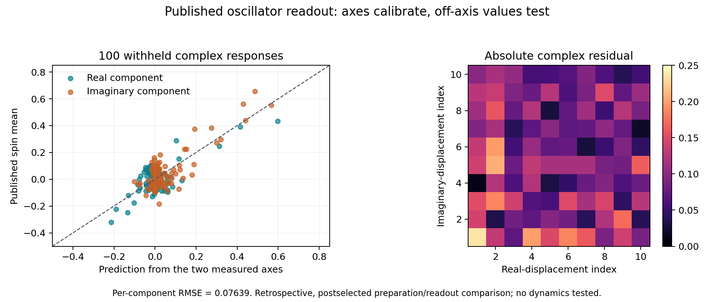

# Published oscillator observations: calibrate axes, predict off-axis responses

**Direct source execution:** the separate [executable readout comparison](EXECUTABLE_READOUT.md)
fits two preparation parameters on the axes and generates the off-axis
probabilities through native preparation and detector words, with an
occupation certificate. The original analysis below uses measured-axis
factorization; its predicted values were not emitted by that execution.
Its protocol, receipt and data remain unchanged.

This component compares the existing smooth detector's characteristic-function
description with **published experimental observations**. Twenty-one complex
axis responses calibrate an aligned Gaussian preparation/readout family;
one hundred other complex responses are withheld from calibration. The
prediction uses no fit to those withheld values.

The [data](https://zenodo.org/records/18752287) accompany
[McGarry et al., *Programmable quantum simulation of anharmonic dynamics*](https://arxiv.org/abs/2603.04744v1).
We use only their zero-simulated-duration oscillator readout, conditional on
the experiment's preparation selection. It is a preparation/detector test;
neither their later dynamics nor our seven-mode interacting action is tested.
It is not an OPH-specific prediction.

## Retained result

| Comparison on 100 withheld complex points | RMSE per real spin mean | Disjoint simultaneous boxes |
| --- | ---: | ---: |
| Prediction from the two measured axes | 0.07639048 | 0 |
| Zero-response diagnostic baseline | 0.12810121 | 8 |
| Best unfitted nominal coordinate convention (extent 4, reversed row direction) | 0.06440141 | 0 |

The receipt's four unfitted nominal coordinate conventions use no fitted
parameter. One of them scores 0.06440141 with no box violation, below the
fitted axis-factorization score; the other three violate 2, 9 and 11 boxes.

There are 200 separately reported real/imaginary means in the validation set.
For the corresponding binary probability `(1+mean)/2`, the first RMSE is
**0.03819524**. This is a descriptive average error, not an error guarantee
for each measurement or a probability that the model is correct.



The [receipt](results.json) retains every selected point, its prediction,
uncertainty box, residual, data provenance and all alternate nominal
coordinate conventions. `all_pass` checks the software and split contracts;
scientific comparison verdicts are reported separately. A failing physical
comparison would not be rewritten into a software success claim.

## What is predicted

For a Gaussian state with zero position-momentum covariance, arbitrary
displacement and diagonal variances,

```text
chi(u + i v) = chi(u) chi(i v).
```

The two measured axes therefore predict the interior without estimating a
temperature, displacement or visibility from the interior. A rotated Gaussian
with nonzero covariance need not obey this relation. At the model's basis
frequency two, `exp(i eta Q)=D(i eta/2)`; the two detector phases `0` and
`-pi/2` read the real and imaginary characteristic components. Other directions
require the specified quadrature rotation. The [derivation](DERIVATION.md)
makes this mapping and the hypothesis precise.

Independent tests compare both components against the actual source-compiled
finite detector on mixed states. They establish the finite interface identity;
they do not certify this laboratory preparation's occupation error. The
existing [complete-history certificates](../OCCUPATION_DERIVATION.md) retain
their original seven-mode scope.

The [analysis rule](protocol.json) was written after reading the paper and
dataset description, before inspecting numeric outcomes. This is a
**retrospective withheld-point comparison**, not a prospectively acquired or
preregistered experiment. All reported noisy axis values are used directly;
the measured origin `0.984 + 0.112 i` is preserved. There is no origin
normalization, background subtraction or fitted readout correction.

## Metadata and uncertainty limits

The deposited grids contain exact mirror copies. We score one representative
quadrant: 21 axis points and 100 interior points. Reconstructed copies provide
no extra trials. Reflection structure identifies the imaginary-coordinate
array axis, but not its physical direction.

The deposit description says the coordinate extent is five; the paper says
four. This discrepancy remains unresolved. The primary factorization test is
invariant under either scale and direction. The nominal displaced-thermal
formula is evaluated under **both extents and both directions**, with every
result retained. The convention giving the smallest residual is not selected
as a physical fact.

The uncertainty calculation assumes 250 accepted independent binary shots
per reported scalar mean and no additional apparatus bias. The archive
contains aggregate means, without accepted counts or rejected-shot records;
it cannot authenticate those assumptions. Conditional simultaneous Hoeffding
widths are approximately 0.25487 for calibration and 0.27829 for validation.
The exact rational concentration certificates allocate a total failure
allowance of 0.05. These deliberately broad boxes explain why failure to
reject is limited evidence. They are not a measured hardware-error budget.

This comparison calibrates response profiles, not an absolute field scale,
scalar coupling, physical mass or clock in seconds. Gaussian factorization
also has a classical phase-space description; agreement does not distinguish
OPH from established quantum mechanics or that classical relation. A stronger
dynamical comparison needs a justified action and clock mapping, corrected
coordinate metadata, and independently documented acquisition errors.

## Reproduce and attribution

From the repository root:

```sh
python3 -m model.scalar_observations.experimental_readout --check model/scalar_observations/experimental_readout/results.json
python3 -m pytest -q -W error model/scalar_observations/experimental_readout
python3 -m model.verify --hashes-only
```

Replay is offline. The figure can be regenerated with
`python3 -m model.scalar_observations.experimental_readout.plot` when the
optional Matplotlib dependency is installed.

The original two CSV files and [source description](data/SOURCE_README.md)
are retained without modification under **CC BY 4.0**, attributed to McGarry,
Chalermpusitarak, Schwennicke, Scuccimarra, Millican, Matsos, Valahu, Nagpal,
Chan, Nourse, Kassal and Tan. The [provenance record](provenance.json) contains
the DOI, source URLs, license link, published MD5 checksums and local SHA-256
bindings. New analysis, predictions and the figure are identified separately
from those source files.
